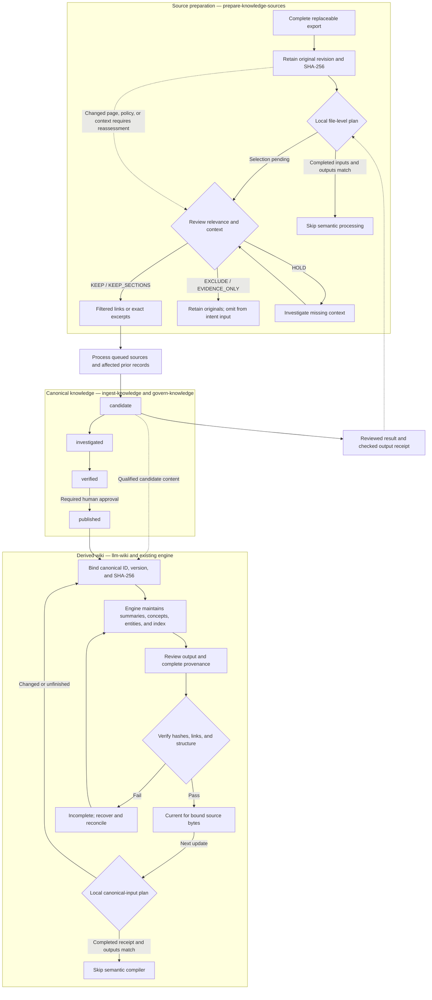

# Knowledge lifecycle and reusable skills

Use major-step skills to coordinate complete work. Invoke an operation skill directly when only that result is required.
Each operation declares its inputs, observable output, and conditions that prevent completion.
These skills guide agents. They do not add a workflow runner or an automatic approval mechanism.

## Three connected lifecycles

The diagram shows the main canonical path. [Governance](../knowledge/README.md#review-gates) also permits contested, stale, and superseded states.
Wiki stages describe operational outcomes. They are not new stored lifecycle fields.
Publication is not a prerequisite for qualified candidate summaries. Wiki freshness does not establish publication or passing business execution.
Querying reads these sources without promoting their states.
Release synchronization classifies changes and reuses only the affected operations.

## Storage and invalidation

| Stage | Storage | Reuse and invalidation |
| --- | --- | --- |
| Complete export | Ignored `evidence/knowledge/incoming/COLLECTION/` | Replace with the next complete export. |
| Retained originals | `evidence/knowledge/sources/` and `evidence/knowledge/manifest.yaml` | Preserve bytes and earlier revisions; append changed sources. |
| Source decisions | `evidence/knowledge/selections/` | Bind page hashes, ranges, policy, and governing context. Reassess changed bindings, including exclusions. |
| Canonical processing receipts | `evidence/knowledge/processing/` | Bind reviewed outcomes to source selections, recipe, prior outputs, and checked current hashes. |
| Incremental plans | Ignored `.workbench/ingestion/` | Keep full baselines on disk. Return compact review/process queues; reject stale plans. |
| Filtered view | Ignored `.workbench/` working storage | Generate exact excerpts or links with source/output hashes. Regenerate after selection changes. |
| Canonical knowledge | `knowledge/`, excluding the reserved derived subtree | Changes require source support, applicable review, and exact-byte governance evidence. |
| Wiki source aliases | `knowledge/llm-wiki/raw/` and `knowledge/llm-wiki/wiki/sources/` | Relative symlinks to canonical records. Never write through them. |
| Derived pages | `knowledge/llm-wiki/wiki/` | Maintain affected summaries, concepts, entities, contradictions, and index through the selected engine. |

Missing source pages preserve history. They do not authorize downstream deletion.
Filtered views support ingestion; canonical citations still identify original retained revisions and exact source sections.
No additional top-level raw archive or copied filtered source tree is required.

## Incremental execution

Run `sources refresh`, then `sources plan` before semantic reading.
Review queued selections and create a fresh plan after applying decisions.
Use `sources view --plan` for queued kept pages and retain complete original SHA-256 provenance.
Process the affected canonical closure, including previous outputs and former dependents of withdrawn claims.
Record reviewed results with `sources complete`; selection and observed hashes cannot prove canonical completion.
Updated outputs require the matching passed sealed ingestion checkpoint. No-change outcomes preserve their starting output bytes.
Partial completion remains retryable. A repeated refresh cannot clear unfinished work.

Run wiki `plan` with the exact canonical scope before semantic engine selection.
Current reviewed completion and output hashes permit unchanged inputs to skip compilation.
Legacy bindings without receipts require scoped review. Native compiler return alone leaves review pending.
Maintain summaries, prior and new concepts/entities, contradictions, backlinks, index entries, and affected saved explorations.
Global navigation edits do not independently invalidate every unrelated canonical input.

Deterministic planning follows declared relationships and retained output dependencies.
Broaden semantic discovery when source relationships are incomplete. No planner proves semantic completeness.
File-level processing is implemented. Section-level normalization and fingerprints remain deferred.
No token-saving percentage is established without measured provider usage.

## Major-step orchestrators

| Parent skill | Reusable operations and completion boundary |
| --- | --- |
| [prepare-knowledge-sources](../.agents/skills/prepare-knowledge-sources/SKILL.md) | [Capture](../.agents/skills/capture-knowledge-sources/SKILL.md) and [select](../.agents/skills/select-knowledge-sources/SKILL.md) sources. Return selection coverage, omissions, and verified view bindings. |
| [ingest-knowledge](../.agents/skills/ingest-knowledge/SKILL.md) | [Extract claims](../.agents/skills/extract-knowledge-claims/SKILL.md), [compose records](../.agents/skills/compose-knowledge-records/SKILL.md), and reuse evidence and integrity operations. Return cited candidates and actual checkpoint results. |
| [govern-knowledge](../.agents/skills/govern-knowledge/SKILL.md) | Retrieve evidence, assess applicability, review claims, resolve questions, prepare exact bytes, record audit, and check integrity. Publish only after applicable gates. |
| [query-knowledge](../.agents/skills/query-knowledge/SKILL.md) | Reuse evidence, applicability, claim review, and question investigation. [Evaluate retrieval](../.agents/skills/evaluate-knowledge-retrieval/SKILL.md) before returning a supported answer. |
| [llm-wiki](../.agents/skills/llm-wiki/SKILL.md) | [Bind sources](../.agents/skills/bind-wiki-sources/SKILL.md), [maintain content](../.agents/skills/maintain-wiki-content/SKILL.md), [finalize updates](../.agents/skills/finalize-wiki-update/SKILL.md), and [check health](../.agents/skills/check-wiki-health/SKILL.md). |
| [sync-release-knowledge](../.agents/skills/sync-release-knowledge/SKILL.md) | [Classify changes](../.agents/skills/classify-knowledge-change/SKILL.md), then reuse composition, governance, and wiki work. Reconcile declared rows and required report views. |

The shared canonical operations are:

| Operation | Checkable result |
| --- | --- |
| [retrieve-knowledge-evidence](../.agents/skills/retrieve-knowledge-evidence/SKILL.md) | Inspected sources with exact identities, locators, and retrieval limits. |
| [assess-knowledge-applicability](../.agents/skills/assess-knowledge-applicability/SKILL.md) | Intent-backed version and scope selection, separate from deployment evidence. |
| [review-knowledge-claims](../.agents/skills/review-knowledge-claims/SKILL.md) | Claim support, authority, confidence, conflicts, and unresolved limits. |
| [resolve-knowledge-questions](../.agents/skills/resolve-knowledge-questions/SKILL.md) | Investigated answers or material owner questions, with the applicable read-only or update route. |
| [prepare-knowledge-transition](../.agents/skills/prepare-knowledge-transition/SKILL.md) | Final-byte preparation, current hashes, and satisfied or pending gates. |
| [record-knowledge-audit](../.agents/skills/record-knowledge-audit/SKILL.md) | New immutable events bound to real actors, final hashes, and evidence. |
| [check-knowledge-integrity](../.agents/skills/check-knowledge-integrity/SKILL.md) | Actual validator and ingestion-check findings, with semantic limits kept separate. |

Seventeen operation skills serve six parent skills. Parents select the required route and aggregate results.
Hashing, schemas, prepared seals, JSON writes, and graph engines remain implementation tools beneath these procedures.

## Reuse wiki lifecycle controls

The [unchanged llm-wiki-agent](../.agents/skills/llm-wiki/upstream/AGENTS.md) already defines semantic ingestion, health, lint, and maintenance.
Its refresh helper tracks source changes. Its proposed `draft → stable` gate concerns automatic graph edges.
That open proposal does not establish a source approval lifecycle.

Native OpenKB owns document hashing, deduplication, conversion, compilation, removal, locks, and journaled ingestion recovery.
Its source-owning operations can copy or delete source files. They cannot own Workbench canonical aliases.
The [bridge](../.agents/skills/llm-wiki/references/workflows.md) selects an engine and preserves the shared linked layout.
It uses native semantic compilation directly, rather than the native source-owning transaction.
Therefore, native ingestion rollback does not make bridge compilation transactional.

Keep [finalization](../.agents/skills/finalize-wiki-update/SKILL.md) coordinated with verification and recovery.
ADE maintenance checks reviewed source/output hashes and retains paired provenance before-images.
The bridge stores completion receipts alongside existing source bindings, rather than creating a second approval lifecycle.
The two provenance writes are not crash-atomic. Failed semantic work can leave partial derived edits.
Never advance hashes to conceal incomplete maintenance. Report the affected scope and preserve edits for reconciliation.

Use OpenKB semantic operations only with both the configured URL and token.
Otherwise, use llm-wiki-agent in the current ADE session.
Both modes maintain one existing wiki. Neither supplies business approval or deployment evidence.
