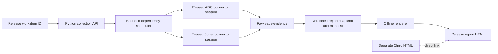

# Release report API and rendering design

Date: 2026-10-24 (Asia/Singapore).
Status: Historical design. See the [implementation record](RELEASE_REPORT_IMPLEMENTATION.md) and [current guide](RELEASE_REPORT.md).

**Reuse the connector foundation. Adapt the supplied query logic. Keep collection, report data, and rendering separate.**

The [design request](evidence/release-report-intake-20261024/api-render-performance-20261024/user-input.md#exact-input) defines this design.
The [scope plan](RELEASE_REPORT_REPRODUCTION.md#confirmed-scope) preserves one Release work item ID and separate Release Clinic content.
The [source review](evidence/release-report-intake-20261024/api-render-performance-20261024/source-review.json) records inspected code, consequences, owners, and actions.

## Implemented refinements

The implemented Python API takes a selected workspace path and uses the installed `release.report` provider.
Raw readers share existing connector configuration, authentication, proxy handling, grants, and the declared Axios dependency.
Each source session reuses its HTTP client and connection pools.
Raw REST transport permits limits on each HTTP attempt, including pagination and retries.
Existing SDK-based connector tools retain their response contracts.

Retained reports use the existing `.workbench/runs/ACTION_ID/release-report/` action directory.
`--output-dir` exports a portable bundle into a new workspace directory.
`--resume` revalidates a prior manifest, collects fresh source data, and records revision conflicts.
It does not reuse mutable response payloads between collections.
The sections below preserve the original design proposals.

## ADO integration decision

Use the existing Workbench connector for configuration, authentication, SDK access, exact grants, and transport.
Reuse the supplied `ado-api` as the source for release-specific queries and selection rules.
Adapt the missing reads into the connector layer rather than installing a second ADO client package.
Keep report orchestration in the Python runtime.

Both paths already use `azure-devops-node-api`.
See the [native factory](../core/connectors/workbench/server.js#L54-L61) and [supplied client](../core/release-report/ado-api/client.ts#L1-L18).
The supplied client embeds environment defaults and disables TLS verification.
See [its settings](../core/release-report/ado-api/client.ts#L95-L141).
The existing connector supplies the established workspace boundary.

| Capability | Existing connector use | Adaptation from supplied source |
| --- | --- | --- |
| Release details | Extend work item readers to preserve fields and expanded relations. | [Release field and relation mapping](../core/release-report/ado-api/release.ts#L11-L81). |
| Related records | Batch unique IDs and preserve complete records. | [Work item details](../core/release-report/ado-api/workitem.ts#L32-L104). |
| Builds | Use identified build IDs and structured build readers. | [Raw build result](../core/release-report/ado-api/build.ts#L11-L25). |
| Test attachments | Add timeline and attachment reads with retained raw JSON. | [Task and attachment selection](../core/release-report/ado-api/build.ts#L57-L110). |
| Production selection | Add focused pipeline deployment-history reads. | [Stage selection and ordering](../core/release-report/ado-api/pipeline.ts#L80-L174). |
| Commit comparisons | Add exact base/target comparison reads and complete change pages. | [Comparison direction](../core/release-report/ado-api/git.ts#L74-L146). |
| Coverage | Add missing ADO coverage summary reads. | [Expected coverage shape](../core/release-report/release-report.service.ts#L205-L253). |
| Test identities | Extend readers that currently discard result and test-case IDs. | [Attachment contract](../core/release-report/ado-api/interfaces.ts#L399-L479). |

Existing readers cannot supply every section unchanged.
The [work item reader](../core/connectors/packages/ado-workitems-read/src/tools/workitems-read.js#L21-L36) omits expanded relations.
The [batch reader](../core/connectors/packages/ado-workitems-read/src/tools/workitems-read.js#L69-L84) does not divide large ID sets.
The [build reader](../core/connectors/packages/ado-pipelines/src/tools/pipelines.js#L234-L292) accepts build IDs but drops continuation control.
The [test reader](../core/connectors/packages/ado-testplans/src/tools/testplans.js#L282-L298) omits test-case and result identities.

Extract shared structured readers where current tool callbacks combine requests with display formatting.
Keep existing tool responses compatible while exposing raw structured results for collection.
Add only the missing operations and grant their exact names.
Do not use SDK fallback calls to bypass denied connector tools.

## SonarQube integration decision

Use the existing native Sonar connector and its root `SONAR_BASE_URL` and `SONAR_TOKEN` settings.
The [native connection](../core/connectors/workbench/server.js#L91-L97) already supplies the selected endpoint and authentication.
Its [six registered reads](../registry/tools.yaml#L92-L100) cover projects, branches, measures, gates, issues, and hotspots.

Use the pasted `sonarqube-api` as a reference for useful metric names and response mapping.
Do not install its separate SDK or retain its embedded server URL.
See the [pasted connection](../core/release-report/sonarqube-api/client.ts#L14-L35) and [metric query](../core/release-report/sonarqube-api/client.ts#L50-L142).

| Area | Required connector work |
| --- | --- |
| Machine contract | Return raw structured results instead of requiring prose parsing. |
| Selection | Add branch or PR selectors where the target server supports them; reject conflicting selectors. |
| Pagination | Preserve page controls, totals, filters, and continuation metadata for complete issue and hotspot lists. |
| Metrics | Request the report's metric set together; preserve numeric, text, status, and missing values correctly. |
| Analysis identity | Resolve project key, branch/PR, analysis identity, revision, and collection time from available evidence. |
| Client lifetime | Reuse one configured HTTP client and connection pool for the collection. |

The current [measures tool](../core/connectors/packages/sonar/src/tools/sonar.js#L256-L288) accepts a branch but no PR selector.
The [gate tool](../core/connectors/packages/sonar/src/tools/sonar.js#L109-L149) supports both.
The [issues reader](../core/connectors/packages/sonar/src/tools/sonar.js#L160-L202) defaults to open issues and exposes no page number.
The [hotspot reader](../core/connectors/packages/sonar/src/tools/sonar.js#L212-L246) has the same paging limitation.
Do not describe those filtered first pages as complete data.
Use explicit filters for the report's full related-data scope instead of implicit open-only defaults.

Derive Sonar project and analysis references from build properties, published metadata, or repository configuration.
The source supplies a [build-properties reader](../core/release-report/ado-api/build.ts#L156-L163).
Do not assume a repository name always equals the Sonar project key.
If exact analysis association is unavailable, label available branch data as a current snapshot with an unverified build association.
Keep Sonar metrics separate from ADO coverage.
The [active supplied service](../core/release-report/release-report.service.ts#L205-L253) reads ADO coverage without invoking Sonar.

Sonar documents endpoint details within each server instance.
Validate supported parameters against the selected server during implementation.
See [SonarSource's Web API guide](https://docs.sonarsource.com/sonarqube-server/extension-guide/web-api).

## Collection API and renderer boundary

The collection API returns versioned machine data and evidence references.
The renderer reads that saved data and creates presentation artifacts.
Rendering must make zero ADO or Sonar requests.
Changing layout must not repeat collection.



Proposed Python modules are `core/release_report.py`, `core/release_report_contract.py`, and `core/release_report_render.py`.
These paths do not exist as implemented report modules.
Connector readers remain under the existing connector packages.

| Interface | Contract |
| --- | --- |
| `collect_release_report(release_id, context)` | Collect related data and return a small manifest with snapshot identity and section statuses. |
| `read_release_report(manifest_path)` | Read and validate retained report data without external calls. |
| `render_release_report(manifest_path, output_path)` | Render saved data without connector clients or credentials. |

Proposed CLI commands are separate:

```text
ai-sdlc --workspace PATH release-report collect RELEASE_ID
ai-sdlc --workspace PATH release-report render REPORT_MANIFEST --output REPORT_HTML
```

These commands are design proposals, not installed commands.
CLI and MCP collection use the same service contract.
Any later HTTP adapter must wrap that contract rather than own a second collector.
No hosted service is required for this design.

Save the normalized snapshot separately from the raw request evidence.
The manifest records schema version, source revisions, hashes, section statuses, timestamps, and evidence locations.
Use `.workbench/release-report/` for this feature's artifacts.
Keep Release Clinic files and output ownership separate.
Compliance remains a direct link; the renderer does not parse or regenerate Clinic content.

## Performance design

### Remove repeated startup and client creation

The [current provider](../core/providers/connectors.py#L65-L77) starts a process for each call.
The [bridge](../core/connectors/workbench/bridge.js#L50-L66) creates and closes an MCP client and server for each request.
The [ADO factory](../core/connectors/workbench/server.js#L57-L61) creates a new `WebApi` for each tool invocation.
The [Sonar reader](../core/connectors/packages/sonar/src/tools/sonar.js#L22-L26) creates a new HTTP client per call.

Add a transient session mode to the existing connector bridge.
Start at most one ADO process and one Sonar process per collection.
Reuse the bridge clients, SDK service clients, HTTP clients, and explicit connection pools within those sessions.
Bind each session to one workspace, endpoint, and credential context.
Close sessions on completion, cancellation, or deadline expiry.
This is new implementation work; it is not existing connector behavior.

The [runtime lock](../core/runtime.py#L68-L105) serializes outer calls through one Workbench instance.
Run the collection scheduler inside one retained collection action.
Do not call `Workbench.call` recursively from its worker threads.
Retain individual request evidence under the parent collection action.
This design does not promise concurrent report jobs through one existing Workbench instance.

Reuse exact operation and tool grant checks for every inner request, including cache reuse.
One aggregate grant must not authorize ungranted ADO or Sonar operations.
Keep request correlation IDs, tool identities, sanitized arguments, statuses, hashes, and timings in the collection evidence.

### Batch and schedule the dependency graph

1. Read the release once with fields and relations.
2. Derive and deduplicate build, repository, work item, test, and attachment identities.
3. Batch work item IDs and identified build IDs.
4. Fetch independent build evidence and related records concurrently.
5. Resolve production candidates once per repository and pipeline.
6. Schedule comparisons, test enrichment, and Sonar reads when their identities are available.
7. Retain each completed page and update progress before requesting later pages.
8. Finalize the snapshot after all requested sections complete or record explicit failures.

ADO work item batches accept at most 200 IDs.
Use smaller batches when response bytes require them.
See [Microsoft's batch API](https://learn.microsoft.com/en-us/rest/api/azure/devops/wit/work-items/get-work-items-batch?view=azure-devops-rest-7.1).

Avoid scanning every project or recent build when release fields already identify the target.
Pass the discovered project, repository, and pipeline explicitly.
Share one timeline read between attachment consumers for the same build.
Share one production search and branch-tip resolution between comparisons for the same repository.
Coalesce identical requests already in progress.

Initial tuning values are six concurrent ADO requests and two concurrent Sonar requests.
These values are proposals, not measured optimal limits or latency promises.
Apply limits to actual HTTP attempts, including retries and pagination.
Enforce those limits beneath SDK methods, including endpoint discovery and automatic retry attempts.
Reduce concurrency when throttling occurs.

### Control retries, caching, and payloads

Honor `Retry-After` before sending the next request.
ADO can return that header with HTTP 200; retain the successful response rather than replaying it.
See [Microsoft's rate-limit guidance](https://learn.microsoft.com/en-us/azure/devops/integrate/concepts/rate-limits?view=azure-devops).
Use bounded retries with exponential backoff and jitter for transient read failures.
Do not retry denied access, invalid inputs, or unavailable permissions as transient failures.

Distinguish an individual request timeout from the overall collection deadline.
The [current workspace timeout](../workspace.yaml#L4) is 30 seconds and is passed into the [provider context](../core/runtime.py#L86-L87).
Add a validated collection-specific budget before enabling long collection sessions.
Keep that budget explicit and preserve existing timeout behavior for other operations.
Per-request waits and retries must fit inside the effective collection deadline.
Use a monotonic clock and retain completed responses before waiting, retrying, or cancelling remaining work.

| Data | Reuse rule |
| --- | --- |
| Requests already running | Share identical requests within the collection. |
| Commits and file contents | Reuse by endpoint, repository, exact commit, and path. |
| Completed build and test evidence | Revalidate state and artifact identity; results and attachments can change after completion. |
| Work items, branch tips, production selection | Refresh for each collection; pin the values used in its snapshot. |
| Sonar data | Key by endpoint, project, branch/PR, analysis identity, and metric set; label mutable snapshots. |
| Authorization | Scope reuse to the workspace and credential context; recheck current grants before serving cached data. |

Cache service clients only within the collection session.
Cross-run response reuse requires an exact immutable identity or explicit revalidation evidence.
Do not store tokens or token hashes in cache keys or reports.

Follow pagination until completion and record all continuation metadata.
Timeouts, response limits, and failed pages must produce explicit partial states.
Never label a silently truncated page as complete.
Keep raw pages and large test attachments in hashed sidecar files.
Use bounded transfers; large raw downloads stream into confined evidence files rather than one JSON frame.
The Python parent assigns artifact destinations inside the action directory and verifies their byte counts and hashes.
The [current four MiB response limit](../core/providers/connectors.py#L96-L99) must not become a whole-report size limit.
Return a small manifest through CLI/MCP instead of embedding every raw response in one tool result.

Render all collected report data from the snapshot.
For large sections, page the local display or link retained detail artifacts without fetching remote data.
Expose log and binary artifact metadata with original links; avoid automatically downloading every log or binary artifact.

## Verification before performance claims

Measure request counts, phase durations, startup time, transferred bytes, cache hits, retries, throttling, and peak concurrency.
Compare a serial reference run with the scheduled run using the same fixture dataset and equivalent output coverage.
Use fixed synthetic network delays for reproducible scheduling checks.
Use authorized live releases to measure actual endpoint latency later.
No measured live latency or speedup is currently available.

The cases below define performance boundaries for implementation.
They are not executed tests or automation-ready cases.
The [scope cases](RELEASE_REPORT_REPRODUCTION.md#proposed-verification-cases) separately define report behavior and renderer isolation.

### RR-P1: Batch unique work item identities

```gherkin
Feature: Avoid duplicate work item reads

  @RR-P1
Scenario: Batch 401 unique work item IDs
  Given release references contain 401 unique work item IDs and 99 duplicate references
  And the response byte limit permits 200 IDs per batch
  When the collector schedules work item detail reads
  Then exactly 3 batch requests occur
  And each batch contains at most 200 IDs
  And each unique ID appears in exactly 1 batch
  And all 401 records remain represented in the report
```

### RR-P2: Bound actual requests and reuse sessions

```gherkin
Feature: Bound collection concurrency

  @RR-P2
Scenario: Collect independent ADO and Sonar data
  Given one collection has 20 independent ADO requests and 8 independent Sonar requests
  And the concurrency limits are 6 for ADO and 2 for Sonar
  When all fixture endpoints return successful responses
  Then peak ADO concurrency is at most 6
  And peak Sonar concurrency is at most 2
  And exactly 1 ADO bridge session and 1 Sonar bridge session are created
  And the ADO session reuses 1 WebApi connection
  And all 28 requested responses are retained
```

### RR-P3: Respect a delay on a successful response

```gherkin
Feature: Preserve successful responses during throttling

  @RR-P3
Scenario: Receive Retry-After with HTTP 200
  Given the test clock reads 10 seconds
  And an ADO read returns HTTP 200 with Retry-After value 3
  When the scheduler handles that response
  Then the successful response is retained
  And that completed read is not retried
  And no new request to that ADO host starts before test clock time 13 seconds
```

### RR-P4: Apply grants before cached data access

```gherkin
Feature: Keep collection authorization consistent

  @RR-P4
Scenario: Deny an ungranted inner operation
  Given the collection references an ADO tool absent from its exact allowed tool list
  And cached data exists for that tool request
  When the collection scheduler requests that data
  Then the operation returns TOOL_NOT_GRANTED
  And zero network requests occur for that operation
  And zero cached protected payloads are returned
```

### RR-P5: Retain evidence larger than one tool response

```gherkin
Feature: Separate evidence size from tool response size

  @RR-P5
Scenario: Retain a large test attachment
  Given a test attachment contains 5242880 bytes with a known SHA-256
  And connector JSON frames are limited to 4194304 bytes
  When the collector streams the attachment into its evidence directory
  Then the retained artifact contains exactly 5242880 bytes
  And its SHA-256 equals the known input SHA-256
  And each connector JSON frame contains at most 4194304 bytes
  And the returned manifest links the artifact and records its hash
```

### RR-P6: Resume without concealing changed sources

```gherkin
Feature: Keep resumed evidence identity explicit

  @RR-P6
Scenario: Resume after the release revision changes
  Given a retained collection checkpoint records Release work item 501 at revision 7
  And the current work item query returns revision 8
  When the collector resumes that checkpoint
  Then the revision mismatch is recorded
  And the old evidence remains retained
  And the collector does not mark the mixed revision snapshot complete
```

Detailed automation mappings and retained execution belong to implementation work.

## Implementation order and limits

First define the report contract and renderer isolation.
Then add structured connector readers, session reuse, and the bounded scheduler.
Add complete ADO traversal and Sonar enrichment through that shared foundation.
Validate performance and output completeness before calling the optimized collector ready.

Update connector guides, timeout contracts, catalogs, tests, and installed assets with their corresponding runtime changes.
Follow [dependency maintenance](../AGENTS.md#dependency-maintenance) if any dependency changes.
No dependency, source adapter, connector grant, or runtime module changes in this preparation stage.

The [validation record](evidence/release-report-intake-20261024/api-render-performance-20261024/validation.json) covers this document stage.

```yaml
standard: ASD-STE100
automated_check: PASSED
asd_review: PENDING
reviewer: null
reviewed_at: null
limitations:
  - Automated checks do not check the complete approved dictionary or grammar rules.
  - Static source inspection does not establish runtime behavior, endpoint compatibility, or measured performance.
```
