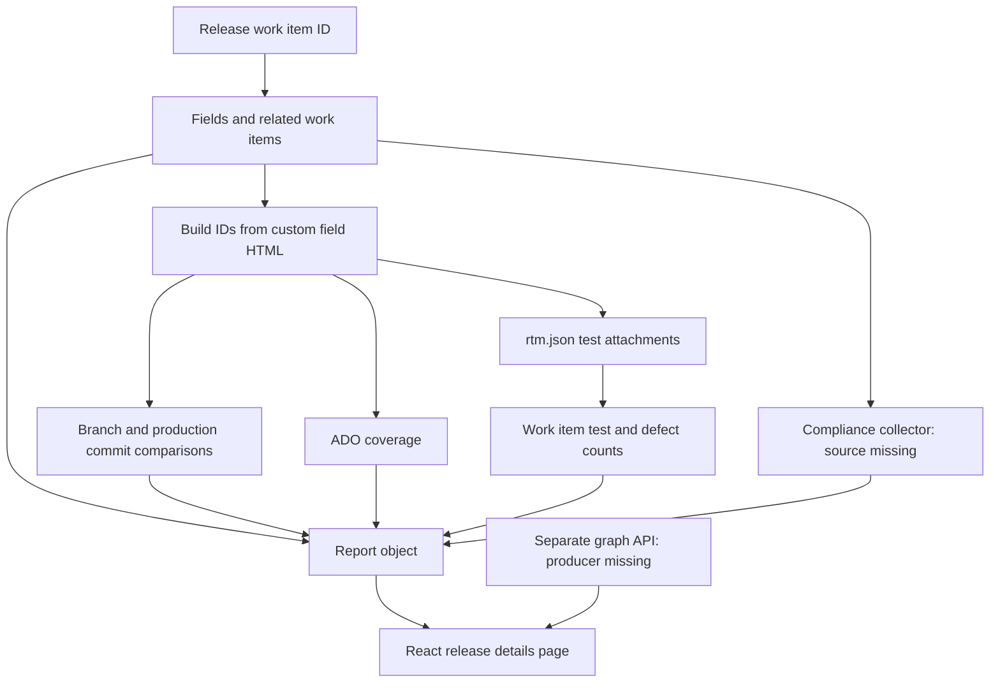

# Release report reproduction preparation

Date: 2026-10-24 (Asia/Singapore).
Status: Preparation complete. Implementation has not started.

**Build a Python report capability through existing Workbench interfaces. Missing rule sources prevent exact source parity.**

The [preserved user request](evidence/release-report-intake-20261024/user-input.md#exact-input) defines this preparation.
This work concerns Workbench tooling, so it requires no business task or domain knowledge record.
The [project principles](../PRINCIPLE.md#ownership-boundary) define that boundary.

## Evidence and scope

The supplied directory contains 44 files with 242,794 source bytes.
The [inventory](evidence/release-report-intake-20261024/source-inventory.json) records each path, size, and SHA-256.
The original repository, commit, package versions, and execution environment are unknown.
The Workbench baseline is `4797c7f8944251c5a0b2c1c8fdf20a7147a66db9`.

The [source archive](evidence/release-report-intake-20261024/supplied-source.tar.gz) preserves the supplied file bytes and relative paths.
The original directory remains unchanged and untracked.
Source links refer to that directory; the archive supports later inspection.
The archive is retained evidence, not installed runtime source.

To inspect the archive, run these commands from the source checkout.
They extract into a new temporary directory without replacing the supplied directory.

```sh
release_report_reference=$(mktemp -d)
python3 -m tarfile --extract docs/evidence/release-report-intake-20261024/supplied-source.tar.gz "$release_report_reference"
```

Each archived member retains its inventory path beneath that temporary directory.
Use the same path and line number when a copied-source link is unavailable.

| Evidence | Purpose |
| --- | --- |
| [Collector analysis](evidence/release-report-intake-20261024/collector-analysis.md) | Entry point, ADO reads, selection rules, errors, and missing dependencies. |
| [UI analysis](evidence/release-report-intake-20261024/report-ui-analysis.md) | Report views, graph contracts, compliance presentation, and inspected assertions. |
| [Integration analysis](evidence/release-report-intake-20261024/integration-analysis.md) | Existing consumers, connector gaps, packaging boundaries, and reuse options. |
| [Import scan](evidence/release-report-intake-20261024/import-check.json) | Seven unresolved relative import sites and external import names. |
| [ADO capability discovery](evidence/release-report-intake-20261024/ado-capability-summary.json) | Available operations and exact current grants. |
| [Release Clinic discovery](evidence/release-report-intake-20261024/release-clinic-discovery.json) | Installed paths and local setup limits. |
| [Living questions](RELEASE_REPORT_QUESTIONS.md) | Unanswered choices for implementation and live comparison. |

No ADO endpoint, source application, or supplied TypeScript test was executed.
Static source inspection does not establish deployed behavior or approved release policy.

## What the supplied code does

The input `releaseId` identifies an ADO Release work item.
It does not identify a classic Release Management release.
See [work item collection](../core/release-report/ado-api/release.ts#L11-L81).



| Component | Observed behavior | Source |
| --- | --- | --- |
| Report service | Returns `release` with requested `builds`, `workitems`, and `compliance` sections. | [Entry point](../core/release-report/release-report.service.ts#L38-L101). |
| Build references | Parses `Custom.LatestPipelineRuns` and `Custom.DeploymentComponents` from HTML. | [Field mapping](../core/release-report/ado-api/release.ts#L31-L58), [parser](../core/release-report/ado-api/utils.ts#L70-L126). |
| Build comparisons | Compares the candidate commit with branch tip, production, and `main`. | [Git checks](../core/release-report/ado-api/git.ts#L287-L429). |
| Production candidate | Selects runs by `prod` and `rollback_prod` numeric results and production finish time. | [Run selection](../core/release-report/ado-api/pipeline.ts#L80-L174). |
| Coverage | Reads ADO coverage when the branch name contains a digit. | [Collection](../core/release-report/release-report.service.ts#L205-L253), [condition](../core/release-report/release-report.service.ts#L376-L382). |
| Test counts | Reads `rtm.json` from a `generatetestreport` task and matches requirement IDs. | [Attachment](../core/release-report/ado-api/build.ts#L57-L110), [join](../core/release-report/release-report.service.ts#L357-L372). |
| Compliance | Collects backend checks; the UI presents fourteen named checks within five groups. | [Service](../core/release-report/release-report.service.ts#L140-L177), [mapping](../core/release-report/release/data/compliance-audit.ts#L118-L152). |
| Report page | Shows release fields, work items, build comparisons, coverage, and compliance. | [Page](../core/release-report/release/details.tsx#L95-L451). |
| Optional graph | Shows repositories, commits, files, stories, and test cases through a separate API. | [Contract](../core/release-report/release/data/release-graph.ts#L1-L70), [query](../core/release-report/release/api/queryReleaseGraph.ts#L6-L24). |

The active service uses Sonar-shaped field names for ADO coverage.
It does not call the supplied Sonar client.
The [older specification](../core/release-report/release/docs/RELEASE_REPORT_PAGE_SPEC.md#L37-L47) requests Sonar issues that the current page does not show.
These sources describe different scopes; neither establishes the intended replacement scope.

The inspected report path returns an object for display.
It has no report export or ADO upload operation.
Database persistence is commented out in the [service](../core/release-report/release-report.service.ts#L94-L101).

## Material reproduction findings

| Finding and evidence | Consequence | Owner | Next action |
| --- | --- | --- | --- |
| Missing coverage, compliance, service interfaces, Drizzle, and host files. See [imports](evidence/release-report-intake-20261024/import-check.json). | The copy cannot establish standalone execution or exact compliance rules. | Original source owner: unknown. | Obtain missing rules or define replacement contracts. |
| Failed builds and attachments are removed. See [handlers](../core/release-report/release-report.service.ts#L270-L324). | A partial report can appear complete. | Workbench maintainer; individual unknown. | Preserve attempted identities, statuses, and errors. |
| Production selection searches bounded keyword pages. See [search](../core/release-report/ado-api/pipeline.ts#L96-L138). | Missing history can omit the actual deployed baseline. | Release process owner: unknown. | Resolve [Q2](RELEASE_REPORT_QUESTIONS.md#q2-production-baseline) and retain deployment evidence. |
| Duplicate requirement statistics use the first match. See [join](../core/release-report/release-report.service.ts#L357-L372). | Build order can determine displayed test counts. | Test report owner: unknown. | Keep build-specific counts until reconciliation rules exist. |
| Embedded endpoints and disabled TLS verification appear in [client settings](../core/release-report/ado-api/client.ts#L95-L141). | Direct reuse carries environment assumptions and weak transport checks. | Workbench maintainer; individual unknown. | Reuse root variables and certificate validation. |
| Graph metadata is discarded by the [mapper](../core/release-report/release/components/release-graph-mapper.ts#L84-L110). | Warnings and unresolved relationships disappear. | Workbench maintainer; individual unknown. | Display warnings and unresolved identities. |
| Empty comparisons can receive successful classifications. See [UI analysis](evidence/release-report-intake-20261024/report-ui-analysis.md#ui-4-comparison-results-lack-a-consistent-unavailable-state). | Missing evidence can become misleading success. | Workbench maintainer; individual unknown. | Require an explicit unavailable state. |

The qualitative implementation risk is medium for collection and high for inferred compliance or production conclusions.
This rating concerns replacement design, not production readiness.
Preparation changes only documentation and retained evidence.

## Recommended Workbench design

Use one Python report capability under `core/`, exposed through existing CLI and MCP boundaries.
Keep the installed package name `ai_sdlc_workbench`.
Use connector tools for external reads and action records for evidence.
This follows the [architecture](../ARCHITECTURE.md#architectural-boundary) and [connector guide](CONNECTORS.md#discover-and-invoke-tools).

Start with retained JSON and a local HTML renderer.
The current consumer is an operator inspecting a release before further analysis.
The benefit is one report connecting release fields, build identities, comparisons, and evidence gaps.
A React application, NestJS server, Drizzle database, and GraphQL server are unnecessary for this initial consumer.

| Concern | Reuse | Required extension |
| --- | --- | --- |
| Configuration | Workspace selection, root credentials, and connector grants. | Explicit project, custom fields, repository IDs, and pipeline IDs. |
| Release reads | Existing ADO work item tools. | Normalize fields and relations with exact source revisions. |
| Build and test reads | Existing connector source where sufficient. | Grant exact required reads and add missing reads. |
| Git comparisons | ADO code reads and registered repositories. | Pin base and target commits; label comparison direction. |
| Coverage | ADO coverage evidence. | Define the missing summary contract and baseline-build association. |
| Test statistics | Supplied `TestReportSchema` as reference. | Validate attachment identity and preserve build-specific statistics. |
| TDA interpretation | Release Clinic and its report skill. | Link compatible evidence without changing established rules. |
| Presentation | Local artifact conventions. | Versioned JSON and escaped, self-contained HTML. |
| Optional graph | Supplied graph contract. | Build evidence-backed edges and display unresolved boundaries. |

Local discovery returned 87 ADO tool schemas.
Existing build, test, and commit reads are not currently granted.
Discovery found no direct coverage summary, production hierarchy, or arbitrary commit comparison-count operation.
The existing build test-result tool also drops test case IDs.
See [capability evidence](evidence/release-report-intake-20261024/ado-capability-summary.json) and the [integration analysis](evidence/release-report-intake-20261024/integration-analysis.md).

Release Clinic already collects TDA evidence and supports local reporting.
Its full collector also uses Confluence, Sonar, Genie, and optional ServiceNow.
Keep those systems optional for the initial ADO report.
Keep observed engineering data separate from interpreted TDA findings.
See [existing reporting modes](RELEASE_CLINIC.md#generate-an-html-release-report).

The local Release Clinic diagnostic returned `INCOMPLETE` with no missing dependencies.
It identified seven missing configuration names in the [retained result](evidence/release-report-intake-20261024/release-clinic-discovery.json).
Full collector readiness remains unestablished; offline development and this preparation can proceed.

### Proposed report contract

These fields are proposals, not installed contracts.

| Field | Required meaning |
| --- | --- |
| `schema_version`, `generated_at` | Version the saved report and record UTC collection time. |
| `collection_status` | Overall collection completeness derived from requested section states. |
| `source` | Organization or collection, project, work item ID, revision, and URL. |
| `release` | Selected fields, declared approvals, component references, and related IDs. |
| `builds` | Every requested build, repository ID, branch, commit, result, and collection status. |
| `comparisons` | Exact base and target commits, direction, baseline evidence, and completeness. |
| `coverage` | Build-specific line and branch values, units, collection method, and unavailable reasons. |
| `workitems` | Work item revisions with build-specific test and defect statistics. |
| `compliance` | Rule version, status, deciding field evidence, and interpretation limits. |
| `graph` | Optional nodes, edges, evidence locators, warnings, and unresolved identities. |
| `evidence`, `warnings`, `errors` | Retained action IDs, input hashes, source locators, and partial failures. |

Keep collection states distinct: `complete`, `partial`, `unavailable`, `failed`, and `excluded`.
Keep evaluation results separate from collection states.
Unknown data must not become zero coverage, zero defects, a passed check, or deployment approval.
Retain immutable inputs so offline rendering needs no credentials or network access.

### API constraints checked during preparation

ADO Work Items List accepts at most 200 IDs per request.
Batch larger sets. See [Microsoft's work item contract](https://learn.microsoft.com/en-us/rest/api/azure/devops/wit/work-items/list?view=azure-devops-rest-7.1).

ADO commit differences support version types, comparison direction, and change pagination.
The default page contains at most 100 changes.
See [Microsoft's diff contract](https://learn.microsoft.com/en-us/rest/api/azure/devops/git/diffs/get?view=azure-devops-rest-7.1).
Preserve `allChangesIncluded` and use commit identities for reproducible comparisons.

ADO exposes build coverage reads, but that endpoint does not define the snippet's summary object.
The missing parser and supported formats still need evidence.
See [Microsoft's coverage contract](https://learn.microsoft.com/en-us/rest/api/azure/devops/test/code-coverage/get-build-code-coverage?view=azure-devops-rest-7.1).
These documents do not confirm the target tenant, server version, custom fields, or tool grants.

## Small implementation stages

| Stage | Deliverable | Completion evidence |
| --- | --- | --- |
| 1. Offline report | Versioned normalization and JSON-to-HTML rendering. | Schema assertions, explicit missing states, escaped content, and repeatable rendering. |
| 2. ADO collection | Granted reads for one selected Release work item and its builds. | Retained actions, revisions, pagination, partial failures, and reference-release comparison. |
| 3. Comparisons and tests | Pinned baselines, validated attachments, and coverage evidence. | Direction assertions, missing-baseline cases, duplicate requirement cases, and retained observations. |
| 4. Compliance and graph | Selected compliance mappings and graph generation. | Rule versions, deciding evidence, unresolved edges, and inspected assertions. |
| 5. Distribution | Installed CLI/MCP access and generated-workspace instructions. | Runtime tests, wheel build, external workspace initialization, and installed-command checks. |

These stages describe proposed work; this preparation does not implement them.
Use [the living questions](RELEASE_REPORT_QUESTIONS.md) to resolve target identity, baseline authority, compliance scope, and delivery.
No unanswered choice prevents completion of this preparation.
Live parity needs a named reference release and retained expected output.
Exact compliance parity needs missing rule sources or reviewed replacement rules.

Dependency changes must update manifests, lockfiles, setup, offline preparation, diagnostics, and dependency analysis together.
See [dependency maintenance](../AGENTS.md#dependency-maintenance).
Generated workspaces receive guides and contracts; runtime source remains in the installed package.

### Proposed verification cases

These canonical cases describe replacement boundaries for later implementation.
They are not executed tests or approved business rules.

#### RR-1: Preserve a failed build

```gherkin
Feature: Preserve collection completeness

  @RR-1
Scenario: Preserve a failed build read
  Given a release references build IDs 101 and 102
  And build 101 is readable
  And the read for build 102 returns a forbidden response
  When the collector creates the report
  Then the report contains both requested build IDs
  And build 102 has collection status "failed"
  And the report links the retained error evidence
  And the overall collection status is "partial"
```

#### RR-2: Preserve an unknown production baseline

```gherkin
Feature: Preserve baseline uncertainty

  @RR-2
Scenario: Report an unavailable production comparison
  Given a candidate build has an exact source commit
  And no production baseline has supporting deployment evidence
  When the report evaluates the production comparison
  Then the comparison status is "unavailable"
  And the report contains the missing-baseline reason
  And the comparison has no passed verdict
```

#### RR-3: Keep duplicate requirement evidence

```gherkin
Feature: Preserve build-specific test evidence

  @RR-3
Scenario: Keep test counts from different builds
  Given builds 101 and 102 contain test statistics for requirement 501
  And build 101 records 3 passed tests and 1 failed test
  And build 102 records 2 passed tests and 2 failed tests
  And no aggregation rule is configured
  When the report joins requirement evidence
  Then requirement 501 contains build 101 with 3 passed tests and 1 failed test
  And requirement 501 contains build 102 with 2 passed tests and 2 failed tests
  And the report identifies the unresolved aggregation rule
  And no combined statistic is reported
```

#### RR-4: Replay retained evidence

```gherkin
Feature: Reproduce local rendering

  @RR-4
Scenario: Render a report without external access
  Given retained normalized JSON has a recorded SHA-256
  And no service credentials are available
  When the renderer creates HTML twice from the same JSON
  Then zero external requests occur
  And both HTML outputs have the same SHA-256
  And the HTML records the input SHA-256
```

#### RR-5: Preserve graph limits

```gherkin
Feature: Display relationship evidence limits

  @RR-5
Scenario: Display unresolved graph evidence
  Given graph metadata contains warning "Story links are incomplete"
  And graph metadata identifies unresolved story 501
  When the renderer displays the graph section
  Then warning "Story links are incomplete" is visible
  And unresolved story 501 is visible
  And the report does not label the graph complete
```

Test assertions must link each case to exact implementation and retained execution before behavior verification.
The supplied twelve UI tests establish inspected assertions only.
They do not establish passing execution or collector coverage.
See [the assertion review](evidence/release-report-intake-20261024/report-ui-analysis.md#inspected-assertion-coverage).

## Preparation validation

The [validation record](evidence/release-report-intake-20261024/validation.json) records checks for this documentation stage.
The [Gherkin draft check](evidence/release-report-intake-20261024/gherkin-draft-check.json) found no structural failures after correction.
Its status remains `UNVERIFIED`; implementation, evidence mappings, and automation review do not yet exist.
The [initial failure record](evidence/release-report-intake-20261024/gherkin-initial-check.json) preserves the corrected structure findings.
Runtime tests and wheel builds are outside this documentation-only change.
No deployment recommendation or human release approval is recorded.

```yaml
standard: ASD-STE100
automated_check: PASSED
asd_review: PENDING
reviewer: null
reviewed_at: null
limitations:
  - Automated checks do not check the complete approved dictionary or grammar rules.
  - Static source inspection does not establish runtime behavior or passing business execution.
  - Preparation links and archive integrity were checked; draft Gherkin remains UNVERIFIED.
```
