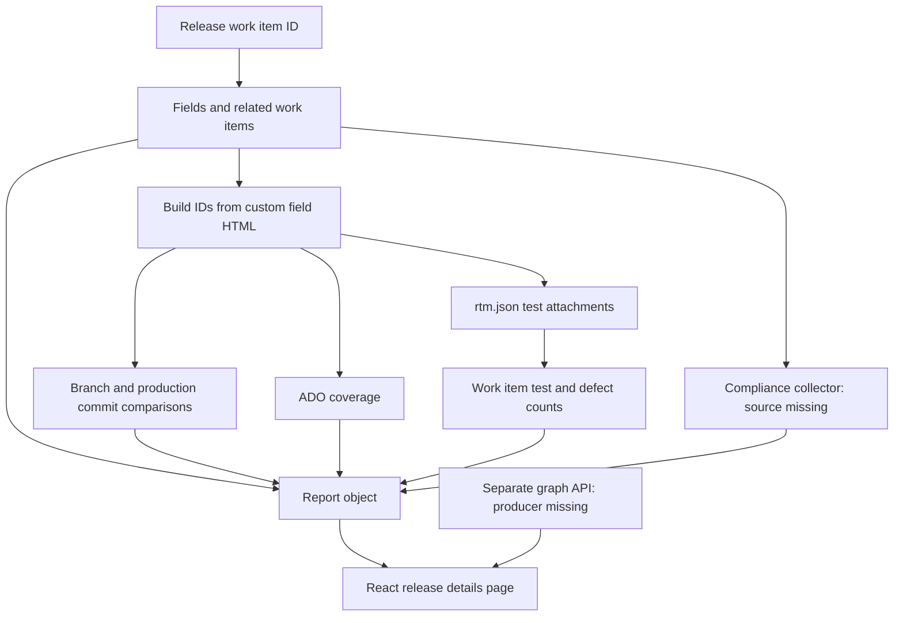

# Release report reproduction preparation

Date: 2026-10-24 (Asia/Singapore).
Status: Preparation complete. Scope questions are resolved. Implementation has not started.

**Use one Release work item ID to collect related information. Link compliance directly to separate Release Clinic HTML.**

The [latest user clarification](evidence/release-report-intake-20261024/clarification-20261024/user-input.md#exact-input) has first priority for scope.
The [original request](evidence/release-report-intake-20261024/user-input.md#exact-input) remains preserved.
This work concerns Workbench tooling, so it requires no business task or domain knowledge record.
The [project principles](../PRINCIPLE.md#ownership-boundary) define that boundary.

## Confirmed scope

The only per-report input is the Release work item ID.
Derive the project, build references, repositories, work items, and tests through the available query APIs.
Use existing workspace credentials and endpoint settings.
Collect all report information connected through the supplied source paths.
Retain complete queried records and render readable summaries with detail links.

Release Clinic keeps its existing repository, rules, generation procedure, and HTML output.
The report's compliance section links directly to the corresponding Release Clinic HTML.
It does not import Clinic logic, merge findings, or generate replacement compliance verdicts.
These boundaries follow the [latest explicit clarification](evidence/release-report-intake-20261024/clarification-20261024/user-input.md#exact-input).

The [recorded answers](RELEASE_REPORT_QUESTIONS.md) close the earlier questionnaire using user input and source-derived behavior.
No additional business clarification blocks implementation within this scope.

## Evidence and scope

The supplied directory contains 44 files with 242,794 source bytes.
The [inventory](evidence/release-report-intake-20261024/source-inventory.json) records each path, size, and SHA-256.
The original repository, commit, package versions, and execution environment are unknown.
The Workbench baseline is `4797c7f8944251c5a0b2c1c8fdf20a7147a66db9`.

The [source archive](evidence/release-report-intake-20261024/supplied-source.tar.gz) preserves the supplied file bytes and relative paths.
The original directory remains unchanged and untracked.
Source links refer to that directory; the archive supports later inspection.
The archive is retained evidence, not installed runtime source.

To inspect the archive, run these commands from the source checkout.
They extract into a new temporary directory without replacing the supplied directory.

```sh
release_report_reference=$(mktemp -d)
python3 -m tarfile --extract docs/evidence/release-report-intake-20261024/supplied-source.tar.gz "$release_report_reference"
```

Each archived member retains its inventory path beneath that temporary directory.
Use the same path and line number when a copied-source link is unavailable.

| Evidence | Purpose |
| --- | --- |
| [Collector analysis](evidence/release-report-intake-20261024/collector-analysis.md) | Entry point, ADO reads, selection rules, errors, and missing dependencies. |
| [UI analysis](evidence/release-report-intake-20261024/report-ui-analysis.md) | Report views, graph contracts, compliance presentation, and inspected assertions. |
| [Integration analysis](evidence/release-report-intake-20261024/integration-analysis.md) | Historical connector and packaging findings. Clinic reuse proposals are superseded by the latest clarification. |
| [Import scan](evidence/release-report-intake-20261024/import-check.json) | Seven unresolved relative import sites and external import names. |
| [ADO capability discovery](evidence/release-report-intake-20261024/ado-capability-summary.json) | Available operations and exact current grants. |
| [Release Clinic discovery](evidence/release-report-intake-20261024/release-clinic-discovery.json) | Installed paths and local setup limits. |
| [Recorded answers](RELEASE_REPORT_QUESTIONS.md) | Resolved input, source behavior, scope, and Clinic separation. |

No ADO endpoint, source application, or supplied TypeScript test was executed.
Static source inspection does not establish deployed behavior or approved release policy.

## What the supplied code does

The input `releaseId` identifies an ADO Release work item.
It does not identify a classic Release Management release.
See [work item collection](../core/release-report/ado-api/release.ts#L11-L81).



| Component | Observed behavior | Source |
| --- | --- | --- |
| Report service | Returns `release` with requested `builds`, `workitems`, and `compliance` sections. | [Entry point](../core/release-report/release-report.service.ts#L38-L101). |
| Build references | Parses `Custom.LatestPipelineRuns` and `Custom.DeploymentComponents` from HTML. | [Field mapping](../core/release-report/ado-api/release.ts#L31-L58), [parser](../core/release-report/ado-api/utils.ts#L70-L126). |
| Build comparisons | Compares the candidate commit with branch tip, production, and `main`. | [Git checks](../core/release-report/ado-api/git.ts#L287-L429). |
| Production candidate | Selects runs by `prod` and `rollback_prod` numeric results and production finish time. | [Run selection](../core/release-report/ado-api/pipeline.ts#L80-L174). |
| Coverage | Reads ADO coverage when the branch name contains a digit. | [Collection](../core/release-report/release-report.service.ts#L205-L253), [condition](../core/release-report/release-report.service.ts#L376-L382). |
| Test counts | Reads `rtm.json` from a `generatetestreport` task and matches requirement IDs. | [Attachment](../core/release-report/ado-api/build.ts#L57-L110), [join](../core/release-report/release-report.service.ts#L357-L372). |
| Compliance | Collects backend checks; the UI presents fourteen named checks within five groups. | [Service](../core/release-report/release-report.service.ts#L140-L177), [mapping](../core/release-report/release/data/compliance-audit.ts#L118-L152). |
| Report page | Shows release fields, work items, build comparisons, coverage, and compliance. | [Page](../core/release-report/release/details.tsx#L95-L451). |
| Optional graph | Shows repositories, commits, files, stories, and test cases through a separate API. | [Contract](../core/release-report/release/data/release-graph.ts#L1-L70), [query](../core/release-report/release/api/queryReleaseGraph.ts#L6-L24). |

The active service uses Sonar-shaped field names for ADO coverage.
It does not call the supplied Sonar client.
The [older specification](../core/release-report/release/docs/RELEASE_REPORT_PAGE_SPEC.md#L37-L47) requests Sonar issues that the current page does not show.
The active source paths and latest clarification define the replacement scope.

The inspected report path returns an object for display.
It has no report export or ADO upload operation.
Database persistence is commented out in the [service](../core/release-report/release-report.service.ts#L94-L101).

## Material reproduction findings

| Finding and evidence | Consequence | Owner | Next action |
| --- | --- | --- | --- |
| Missing coverage, compliance, service interfaces, Drizzle, and host files. See [imports](evidence/release-report-intake-20261024/import-check.json). | The original copy cannot run alone. | Workbench maintainer; individual unknown. | Implement required report reads independently; use direct Clinic links for compliance. |
| Failed builds and attachments are removed. See [handlers](../core/release-report/release-report.service.ts#L270-L324). | A partial report can appear complete. | Workbench maintainer; individual unknown. | Preserve attempted identities, statuses, and errors. |
| Production selection searches bounded keyword pages. See [search](../core/release-report/ado-api/pipeline.ts#L96-L138). | Missing history can omit the baseline. | Workbench maintainer; individual unknown. | Preserve the [source selection rule](RELEASE_REPORT_QUESTIONS.md#q2-production-baseline); paginate and show unavailable evidence. |
| Duplicate requirement statistics use the first match. See [join](../core/release-report/release-report.service.ts#L357-L372). | Build order can determine displayed test counts. | Test report owner: unknown. | Keep build-specific counts until reconciliation rules exist. |
| Embedded endpoints and disabled TLS verification appear in [client settings](../core/release-report/ado-api/client.ts#L95-L141). | Direct reuse carries environment assumptions and weak transport checks. | Workbench maintainer; individual unknown. | Reuse root variables and certificate validation. |
| Graph metadata is discarded by the [mapper](../core/release-report/release/components/release-graph-mapper.ts#L84-L110). | Warnings and unresolved relationships disappear. | Workbench maintainer; individual unknown. | Display warnings and unresolved identities. |
| Empty comparisons can receive successful classifications. See [UI analysis](evidence/release-report-intake-20261024/report-ui-analysis.md#ui-4-comparison-results-lack-a-consistent-unavailable-state). | Missing evidence can become misleading success. | Workbench maintainer; individual unknown. | Require an explicit unavailable state. |

The qualitative implementation risk is medium for collection and source-derived production comparisons.
Compliance evaluation remains owned by Release Clinic.
This rating concerns replacement design, not production readiness.
Preparation changes only documentation and retained evidence.

## Recommended Workbench design

Use one Python report capability under `core/`, exposed through existing CLI and MCP boundaries.
Keep the installed package name `ai_sdlc_workbench`.
Use connector tools for external reads and action records for evidence.
This follows the [architecture](../ARCHITECTURE.md#architectural-boundary) and [connector guide](CONNECTORS.md#discover-and-invoke-tools).

Generate a standalone release report with retained JSON and local HTML.
Only the Release work item ID is required for collection.
The current consumer is an operator inspecting a release before further analysis.
The benefit is one report connecting release fields, build identities, comparisons, and evidence gaps.
A React application, NestJS server, Drizzle database, and GraphQL server are unnecessary for this initial consumer.

| Concern | Reuse | Required extension |
| --- | --- | --- |
| Configuration | Workspace selection, root credentials, and connector grants. | Derive project, repository, pipeline, and custom field references from queried release data. |
| Release reads | Existing ADO work item tools. | Preserve complete fields, relations, attachments, and exact source revisions. |
| Build and test reads | Existing connector source where sufficient. | Grant exact required reads and add missing reads. |
| Git comparisons | ADO code reads and registered repositories. | Pin base and target commits; label comparison direction. |
| Coverage | ADO coverage evidence. | Define the missing summary contract and baseline-build association. |
| Tests and defects | Supplied `TestReportSchema` as reference. | Preserve attachment contents, test identities, evidence links, and build-specific statistics. |
| Compliance | Release Clinic's independently generated HTML. | Link matching report attachments directly; preserve their names and original URLs. |
| Presentation | Local artifact conventions. | Versioned JSON and escaped, self-contained HTML. |
| Relationships | Supplied graph contract. | Collect evidence-backed edges and display unresolved boundaries. |

### Complete release information

The replacement retains data that the original service projects out of its displayed report.
This extends collection completeness while following the same release relationships.

| Information | Source-derived collection path |
| --- | --- |
| Release details | All returned fields, approvals, dates, component references, revision, and relations from [release reads](../core/release-report/ado-api/release.ts#L11-L81). |
| Related work items | Resolve Related, Tested By, and Stories Linked IDs from [relations](../core/release-report/ado-api/release.ts#L59-L76). |
| Work item details | Preserve descriptions, acceptance criteria, assignees, priorities, severity, and revisions from [detail queries](../core/release-report/ado-api/workitem.ts#L32-L104). |
| Builds and repositories | Derive identities from release fields; retain full [build results](../core/release-report/ado-api/build.ts#L11-L25). |
| Branch and production comparisons | Use candidate, branch tip, `main`, and production commits from [Git checks](../core/release-report/ado-api/git.ts#L287-L429). |
| Build evidence | Retain test report contents; expose attachment, artifact, and log references from [build APIs](../core/release-report/ado-api/build.ts#L33-L185). |
| Tests and defects | Preserve requirements, cases, defects, plans, suites, runs, results, environments, and evidence from [attachment contracts](../core/release-report/ado-api/interfaces.ts#L399-L479). |
| Coverage | Read candidate and production build coverage through [coverage paths](../core/release-report/release-report.service.ts#L205-L253). |
| Relationships | Resolve repository, commit, file, story, and test-case edges using the [graph contract](../core/release-report/release/data/release-graph.ts#L1-L70). |
| Compliance document | Preserve matching Release Clinic HTML attachment links from the release work item. |

Follow this release's references and deduplicate identities during traversal.
Keep every failed read and unresolved reference visible beside the affected information.

### Separate Release Clinic link

The snippet already requests expanded work item relations but discards attachment relations during normalization.
See [expanded retrieval](../core/release-report/ado-api/release.ts#L11-L19) and [relation projection](../core/release-report/ado-api/release.ts#L59-L76).
Preserve those relations in our report.

Clinic's audit identifies HTML attachments through names such as `TDAReport_<STREAM>_<release_id>.html` and annotated variants.
See [existing attachment identification](../core/release-clinic/plugins/test/dtp-tda-report/skills/dtp-tda-report/scripts/tda_audit/run_tda_audit.py#L242-L302).
The release report displays matching attachment names, dates, and their original URLs.
Display all matching versions when several attachments exist.
The user opens the separate Clinic HTML to read compliance content.

Existing local Clinic output can also supply a direct link when its filename identifies the same release.
Use `TDA_OUTPUT_DIR` or `.workbench/release-clinic/reports`, as defined by [Clinic output naming](../core/release-clinic/plugins/test/dtp-tda-report/skills/dtp-tda-report/scripts/gen_tda_report.py#L1976-L1999).
Keep the existing file in place and record whether each link comes from an attachment or local output.

Do not import Clinic modules, parse its HTML, copy its rules, or merge its findings into this report.
Do not change its repository, templates, collectors, or output format for this feature.
If no matching document exists, display `Release Clinic report unavailable` and continue the release report.
No additional per-report stream, build ID, baseline, or Clinic path is required from the user.

Local discovery returned 87 ADO tool schemas.
Existing build, test, and commit reads are not currently granted.
Discovery found no direct coverage summary, production hierarchy, or arbitrary commit comparison-count operation.
The existing build test-result tool also drops test case IDs.
See [capability evidence](evidence/release-report-intake-20261024/ado-capability-summary.json) and the [integration analysis](evidence/release-report-intake-20261024/integration-analysis.md).

Release Clinic continues through its [existing reporting modes](RELEASE_CLINIC.md#generate-an-html-release-report).
Its earlier [setup diagnostic](evidence/release-report-intake-20261024/release-clinic-discovery.json) is historical evidence for that separate tool.
Clinic setup does not gate release report collection or attachment linking.

### Proposed report contract

These fields are proposals, not installed contracts.

| Field | Required meaning |
| --- | --- |
| `schema_version`, `generated_at` | Version the saved report and record UTC collection time. |
| `collection_status` | Overall collection completeness derived from requested section states. |
| `source` | Organization or collection, project, work item ID, revision, and URL. |
| `release` | Complete returned fields and relations, declared approvals, component references, and related IDs. |
| `builds` | Every requested build, repository ID, branch, commit, result, and collection status. |
| `comparisons` | Exact base and target commits, direction, baseline evidence, and completeness. |
| `coverage` | Build-specific line and branch values, units, collection method, and unavailable reasons. |
| `workitems` | Complete returned work item records with build-specific test and defect evidence. |
| `tests`, `defects` | Full test attachment data, result identities, evidence links, and related records. |
| `compliance` | Clinic HTML names, original URLs or local paths, source kind, dates, and availability; no recalculated verdict. |
| `graph` | Nodes, edges, evidence locators, warnings, and unresolved identities. |
| `evidence`, `warnings`, `errors` | Retained action IDs, input hashes, source locators, and partial failures. |

Keep collection states distinct: `complete`, `partial`, `unavailable`, `failed`, and `excluded`.
Keep evaluation results separate from collection states.
Unknown data must not become zero coverage, zero defects, a passed check, or deployment approval.
Retain immutable inputs so offline rendering needs no credentials or network access.

### API constraints checked during preparation

ADO Work Items List accepts at most 200 IDs per request.
Batch larger sets. See [Microsoft's work item contract](https://learn.microsoft.com/en-us/rest/api/azure/devops/wit/work-items/list?view=azure-devops-rest-7.1).

ADO commit differences support version types, comparison direction, and change pagination.
The default page contains at most 100 changes.
See [Microsoft's diff contract](https://learn.microsoft.com/en-us/rest/api/azure/devops/git/diffs/get?view=azure-devops-rest-7.1).
Preserve `allChangesIncluded` and use commit identities for reproducible comparisons.

ADO exposes build coverage reads, but that endpoint does not define the snippet's summary object.
The missing parser and supported formats still need evidence.
See [Microsoft's coverage contract](https://learn.microsoft.com/en-us/rest/api/azure/devops/test/code-coverage/get-build-code-coverage?view=azure-devops-rest-7.1).
These documents do not confirm the target tenant, server version, custom fields, or tool grants.

## Small implementation stages

| Stage | Deliverable | Completion evidence |
| --- | --- | --- |
| 1. Release report | Complete report contract and JSON-to-HTML rendering. | Complete records, explicit missing states, escaped content, and repeatable rendering. |
| 2. ADO collection | One Release work item ID derives all related report reads. | Automatic reference discovery, retained actions, revisions, pagination, and partial failures. |
| 3. Comparisons and tests | Pinned baselines, validated attachments, and coverage evidence. | Direction assertions, missing-baseline cases, duplicate requirement cases, and retained observations. |
| 4. Links and relationships | Direct Clinic HTML links and release relationship graph. | Original attachment URLs, unchanged Clinic source, and visible unresolved graph edges. |
| 5. Distribution | Installed CLI/MCP access and generated-workspace instructions. | Runtime tests, wheel build, external workspace initialization, and installed-command checks. |

These stages describe proposed work; this preparation does not implement them.
The [recorded answers](RELEASE_REPORT_QUESTIONS.md) establish sufficient scope for implementation.
Use the supplied baseline-selection behavior without requesting a new business policy.
Missing source modules are technical work items, not clarification gates.
Live verification requires an actual Release work item ID and granted endpoint access during execution.
Missing Clinic rule modules do not block direct report links.

Dependency changes must update manifests, lockfiles, setup, offline preparation, diagnostics, and dependency analysis together.
See [dependency maintenance](../AGENTS.md#dependency-maintenance).
Generated workspaces receive guides and contracts; runtime source remains in the installed package.

### Proposed verification cases

These canonical cases describe replacement boundaries for later implementation.
They are not executed tests or approved business rules.

#### RR-1: Preserve a failed build

```gherkin
Feature: Preserve collection completeness

  @RR-1
Scenario: Preserve a failed build read
  Given a release references build IDs 101 and 102
  And build 101 is readable
  And the read for build 102 returns a forbidden response
  When the collector creates the report
  Then the report contains both requested build IDs
  And build 102 has collection status "failed"
  And the report links the retained error evidence
  And the overall collection status is "partial"
```

#### RR-2: Preserve an unknown production baseline

```gherkin
Feature: Preserve baseline uncertainty

  @RR-2
Scenario: Report an unavailable production comparison
  Given a candidate build has an exact source commit
  And no production baseline has supporting deployment evidence
  When the report evaluates the production comparison
  Then the comparison status is "unavailable"
  And the report contains the missing-baseline reason
  And the comparison has no passed verdict
```

#### RR-3: Keep duplicate requirement evidence

```gherkin
Feature: Preserve build-specific test evidence

  @RR-3
Scenario: Keep test counts from different builds
  Given builds 101 and 102 contain test statistics for requirement 501
  And build 101 records 3 passed tests and 1 failed test
  And build 102 records 2 passed tests and 2 failed tests
  And no aggregation rule is configured
  When the report joins requirement evidence
  Then requirement 501 contains build 101 with 3 passed tests and 1 failed test
  And requirement 501 contains build 102 with 2 passed tests and 2 failed tests
  And the report identifies the unresolved aggregation rule
  And no combined statistic is reported
```

#### RR-4: Replay retained evidence

```gherkin
Feature: Reproduce local rendering

  @RR-4
Scenario: Render a report without external access
  Given retained normalized JSON has a recorded SHA-256
  And no service credentials are available
  When the renderer creates HTML twice from the same JSON
  Then zero external requests occur
  And both HTML outputs have the same SHA-256
  And the HTML records the input SHA-256
```

#### RR-5: Preserve graph limits

```gherkin
Feature: Display relationship evidence limits

  @RR-5
Scenario: Display unresolved graph evidence
  Given graph metadata contains warning "Story links are incomplete"
  And graph metadata identifies unresolved story 501
  When the renderer displays the graph section
  Then warning "Story links are incomplete" is visible
  And unresolved story 501 is visible
  And the report does not label the graph complete
```

Test assertions must link each case to exact implementation and retained execution before behavior verification.
The supplied twelve UI tests establish inspected assertions only.
They do not establish passing execution or collector coverage.
See [the assertion review](evidence/release-report-intake-20261024/report-ui-analysis.md#inspected-assertion-coverage).

#### RR-6: Derive report identities

```gherkin
Feature: Collect related information from one release identity

  @RR-6
Scenario: Derive builds and work items from a Release work item
  Given Release work item 501 references builds 101 and 102
  And its Related relation identifies story 201
  And its Tested By relation identifies test case 301
  When the collector receives only Release work item ID 501
  Then the report identifies release 501
  And the report contains builds 101 and 102
  And the report contains story 201 and test case 301
  And no additional per-report identity input is requested
```

#### RR-7: Link separate compliance content

```gherkin
Feature: Preserve Release Clinic separation

  @RR-7
Scenario: Link a Release Clinic HTML attachment
  Given release 501 has attachment named "TDAReport_STREAM_501.html"
  And its attachment URL is "https://ado.example/attachments/clinic-501"
  When the renderer creates the release report
  Then its compliance section links to "https://ado.example/attachments/clinic-501"
  And its link label is "TDAReport_STREAM_501.html"
  And zero Release Clinic generation operations occur
  And zero Release Clinic files are modified
  And zero compliance verdicts are recalculated
```

#### RR-8: Continue without a compliance document

```gherkin
Feature: Keep unavailable compliance content explicit

  @RR-8
Scenario: Keep release information when no Clinic report is linked
  Given release 501 has no matching Release Clinic HTML attachment or local output
  And its build and work item reads succeed
  When the renderer creates the release report
  Then its compliance section displays "Release Clinic report unavailable"
  And its build and work item information remains present
  And zero Release Clinic generation operations occur
  And no additional per-report input is requested
```

## Preparation validation

The [clarification validation](evidence/release-report-intake-20261024/clarification-20261024/validation.json) covers the current scope revision.
The [initial validation](evidence/release-report-intake-20261024/validation.json) records the earlier preparation at Git revision `d0bc47ef`.
The [initial Gherkin check](evidence/release-report-intake-20261024/gherkin-draft-check.json) belongs to that earlier revision.
Draft cases remain `UNVERIFIED`; implementation, evidence mappings, and automation review do not yet exist.
The [initial failure record](evidence/release-report-intake-20261024/gherkin-initial-check.json) preserves the corrected structure findings.
Runtime tests and wheel builds are outside this documentation-only change.
No deployment recommendation or human release approval is recorded.

```yaml
standard: ASD-STE100
automated_check: PASSED
asd_review: PENDING
reviewer: null
reviewed_at: null
limitations:
  - Automated checks do not check the complete approved dictionary or grammar rules.
  - Static source inspection does not establish runtime behavior or passing business execution.
  - Preparation links and archive integrity were checked; draft Gherkin remains UNVERIFIED.
```
