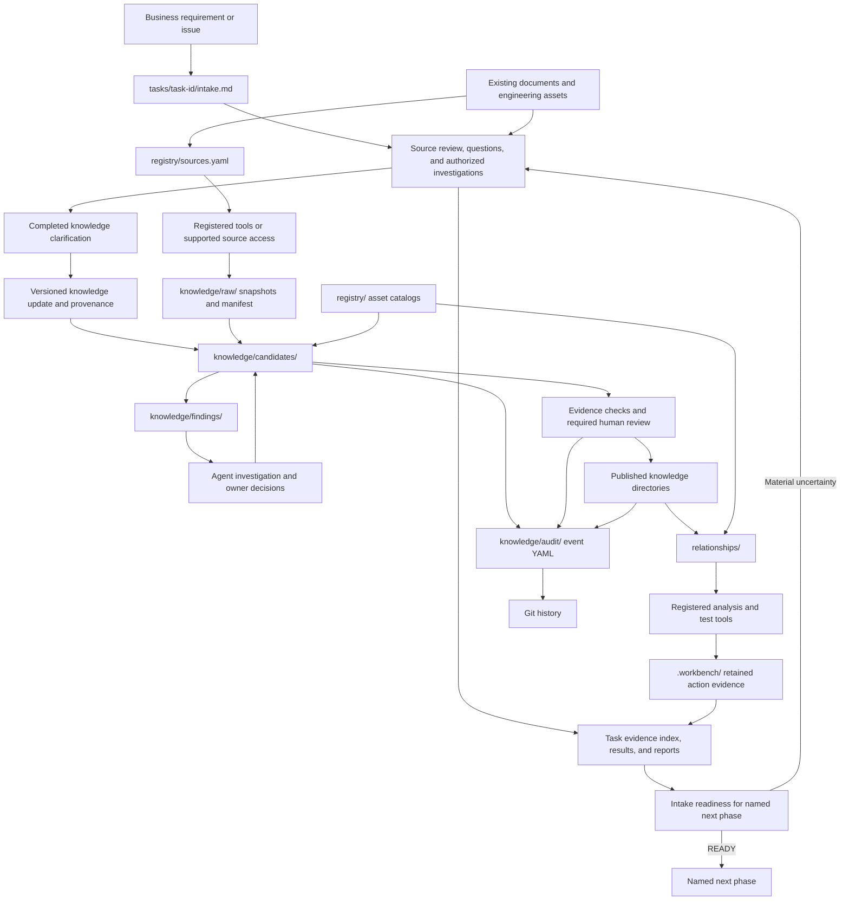
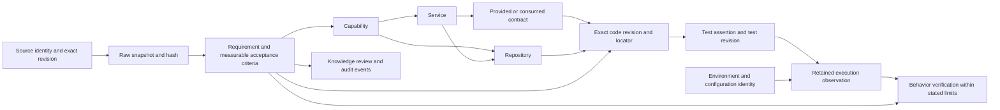

# Workspace design v2

Decision date: 14 October 2026.
Authority: The project owner's [approved plan](https://chatgpt.com/c/6acda433-95e4-83e9-933d-4f7b458ff7bf).
Scope: Standalone workspace construction, portable knowledge contracts, and deterministic validation.
External source adapters and automatic AI governance remain future capabilities.

## Asset identities and local locations

Repositories, services, capabilities, contracts, sources, and tools answer different questions.
Keep their identities separate and connect them with explicit references.
Do not force one repository to represent one service.

| Catalog | Question | Important fields |
| --- | --- | --- |
| `repositories.yaml` | Where does implementation live? | `primary_type`, `responsibilities`, `ownership`, contract IDs, optional `location`. |
| `services.yaml` | Which runtime or application service is described? | `repository_ids`, `deployment_repository_ids`. |
| `capabilities.yaml` | Which business responsibility does the system support? | `service_ids`, `repository_ids`. |
| `contracts.yaml` | Which interface or boundary joins components? | `type`, `status`, exact repository source locator. |
| `sources.yaml` | Where does engineering knowledge originate? | `type`, `purpose`, `read_only`, source locator and ownership. |
| `tools.yaml` | Which configured operations can execute? | Provider, configuration, environment, and operation grants. |

Repository types include frontend, backend, library, integration, data, deployment, and testing.
Services can use several implementation and deployment repositories.
Capabilities can reference several services and repositories.
Provider and consumer contract IDs describe declared relationships.
They do not prove deployed connectivity or execution.

Contracts use `http`, `graphql`, `messaging`, `ui`, `data`, or `deployment` types.
Each contract retains a repository ID, source path, and revision.
Contract source revisions require a full 40-character or 64-character hexadecimal Git commit ID.
Moving refs and abbreviated commit IDs do not identify an exact contract version.

A documented contract has source evidence.
A candidate contract records `documentation_gap` and cannot invent verified claims.
Keep uncertain interfaces as candidates until investigation supplies evidence.

Source types include Git, filesystem, XWiki, Confluence, Azure DevOps, email, and Teams.
Use `purpose: technical` for implementation or technical design evidence.
Use `purpose: context` for business rules, requirements, or decision context.
Confluence source records require `read_only: true`.
Other sources default to read-only when `read_only` is absent.
These declarations do not install adapters or grant source access.

Keep portable identities in tracked catalogs.
Track portable relative checkout locations in `registry/repositories.yaml`.
Keep machine paths in ignored `workspace.local.yaml` when possible.
Copy [the example](../workspace.local.example.yaml), which starts with an empty mapping.
Add paths only for IDs present in the repository catalog.

```yaml
schema_version: 1
repository_paths:
  payments-api: repos/payments-api
  settlement-worker: /absolute/path/to/settlement-worker
```

Relative paths resolve against the workspace directory.
Absolute paths can select existing external checkouts.
An override replaces the repository metadata location in memory.
It does not rewrite an executable provider's configured path or operation grants.
Configure executable resources separately in `registry/tools.yaml`.
Initialization does not clone repositories.

Use the visible `repos/` directory for independent Azure DevOps (ADO) Git checkouts.
Each checkout owns its `.git`, remotes, branches, and commits.
Read [the repository guide](../repos/README.md) for placement and registration.
Stage harness files explicitly. Do not use `git add repos/`.

## Folder construction

```text
workbench/
├── AGENTS.md
├── PRINCIPLE.md
├── ARCHITECTURE.md
├── README.md
├── workspace.yaml
├── workspace.local.example.yaml
├── workspace.local.yaml              # Ignored machine paths; optional.
├── repos/                            # Visible independent ADO checkouts.
│   └── README.md                    # Placement and registration guide.
├── tasks/
│   ├── README.md                    # Portable intake procedure.
│   └── <task-id>/                   # Intake and task evidence.
├── registry/
│   ├── repositories.yaml
│   ├── services.yaml
│   ├── capabilities.yaml
│   ├── contracts.yaml
│   ├── sources.yaml
│   ├── tools.yaml
│   └── examples/                    # Catalog examples checked against registry contracts.
├── knowledge/
│   ├── raw/                          # Unchanged source snapshots and manifest.
│   ├── candidates/                   # Draft knowledge awaiting investigation or review.
│   ├── findings/                     # Gaps, conflicts, ambiguity, and stale evidence.
│   ├── requirements/                 # Published requirement knowledge.
│   ├── architecture/                 # Published architecture knowledge.
│   ├── decisions/                    # Published decision knowledge.
│   ├── repository-profiles/           # Repository context derived from source evidence.
│   ├── audit/                        # One immutable YAML file per governance event.
│   ├── schemas/                      # Workbench contracts for structured records.
│   └── templates/                    # Starting records; no implied business approval.
├── relationships/
│   ├── requirement-code/
│   ├── code-test/
│   └── service-dependencies/
├── .agents/
│   └── skills/                         # Canonical shared skills.
│       ├── ingest-knowledge/
│       ├── govern-knowledge/
│       ├── query-knowledge/
│       ├── analyze-requirement/
│       ├── impact-analysis/
│       ├── verify-implementation/
│       ├── detect-gaps/
│       ├── service-dependencies-graph/
│       ├── repository-onboarding/
│       └── validate-sdlc-documents/
├── .claude/
│   └── skills/                         # Links to canonical skills for Claude Code.
├── core/                           # Single Python runtime and responsibility guides.
│   ├── __init__.py
│   ├── cli.py
│   ├── runtime.py
│   ├── workspace.py
│   ├── providers/
│   ├── context/
│   ├── ingestion/
│   ├── understanding/
│   ├── governance/
│   ├── relationships/
│   ├── evidence/
│   └── execution/
├── adapters/
│   ├── sources/
│   ├── claude-code/
│   ├── copilot/
│   └── mcp/
├── docs/
├── tests/
└── pyproject.toml
```

The six responsibility roots remain `registry/`, `knowledge/`, `relationships/`, `.agents/skills/`, `core/`, and `adapters/`.
`tasks/` connects their evidence for business behavior requirements and defects in existing repositories.

`core/` contains the single runtime and its responsibility guides.
Packaging installs this directory as `ai_sdlc_workbench`.
Generated workspaces contain core guides without core runtime source.
They receive `tasks/README.md` without project task contents.

Initialization copies all canonical skills with their executable helpers and supporting resources.
Initialization creates Claude skill links, empty catalogs, empty raw provenance, and fresh workspace configuration.
It ships `repos/README.md` for checkout placement and registration.
Packages exclude live project catalogs, snapshots, candidate knowledge, findings, and audit events.

`registry/examples/` contains catalog examples checked against the supported registry contracts.
Tests check supported behavior, consequential boundaries, and confirmed defects.
Later-phase descriptions do not justify unused implementation or demonstration assets.

`registry/` declares assets and explicit references.
`knowledge/raw/` preserves domain source snapshots before interpretation.
Task-owned investigation captures and source excerpts stay in `tasks/<task-id>/evidence/`.
Its `manifest.yaml` records source IDs, locators, revisions, hashes, retrieval times, classifications, and optional snapshot paths.
`knowledge/candidates/` and `knowledge/findings/` preserve uncertainty.
Published concept directories supply reviewed context for engineering tasks.
Repository profiles describe responsibility, components, contracts, and dependencies with exact evidence.

`KnowledgeTopic` adds connected background, terms, workflows, and historical explanations to the supported knowledge contracts.
Its classification organizes retrieval without changing source authority or lifecycle state.
Classified drafts use `knowledge/candidates/<classification>/` and a project-specific `knowledge/candidates/index.md`.
The reusable knowledge guide remains separate from live project indexes.

The ingestion skill handles review and ingestion through agent reasoning.
Its review mode leaves original materials and provenance records unchanged.
Its ingestion mode preserves originals and produces cited candidates before any publication.
The installed ingestion harness checks retained bytes, locators, execution hashes, and prepared content.
It keeps semantic review, business execution, and human approval separate.

`knowledge/audit/` and Git history retain the decisions behind changes.

`relationships/` owns implementation, test, and service dependency mappings.
Behavior-review baselines retain source, assertion, execution, and finding references without publishing knowledge.
The [behavior review guide](BEHAVIOR_REVIEW.md) defines contract, freshness, immutable save, and comparison checks.
These checks keep business verification at `NOT_VERIFIED`.
`.agents/skills/` supplies canonical procedures that external agents can execute.
`.claude/skills/` links Claude Code discovery to those canonical procedures.

`.agents/skills/service-dependencies-graph/` owns graph extraction, resolution, validation, queries, and visualization.
Keep graph enhancements within that canonical skill.
Workbench CLI and MCP integrations invoke its helpers through thin adapters.

The [repository onboarding skill](../.agents/skills/repository-onboarding/SKILL.md) supplies static repository assessment and registry proposals.
It preserves existing source locations, separate identities, evidence limits, and review boundaries.
Stage assessments in ignored `.workbench/onboarding/` when that location is outside the target checkout.
Use an external staging directory when assessing the Workbench itself.
Preserve separate runs and unresolved findings until investigation resolves them.

When requested, generate linked topic documents inside the target repository through the skill's `documentation_dir` option.
Default to stable `docs/onboarding/` without timestamp child directories.
Upsert topic and evidence links by stable document IDs within a managed block in the repository's root `AGENTS.md`.
Preserve instructions outside that block and keep detailed evidence in the topic index and portable register.
Keep original assessment staging external and preserve the assessed source revision in portable documentation provenance.
The navigation mapping does not change Workbench catalogs or runtime contracts.

The skill-local report is not a governed knowledge record.
Use shipped knowledge templates and ingestion procedures for authorized candidate creation.

Discovery links under `.claude/skills/` point to every canonical skill.
Initialization creates forwarding `SKILL.md` files when the platform denies directory links.

`adapters/` supplies integration boundaries for clients and sources.
These folders do not establish complete ingestion, governance, or behavior verification engines.

## Task intake and evidence ownership

Task intake applies to business behavior requirements and defects in existing repositories.
Harness configuration, upgrades, tooling, and Workbench maintenance require no task or business knowledge record.
Maintain their code, documentation, applicable checks, and Git commits directly.
For mixed requests, track the business scope in its task. Follow [the scope rules](../tasks/README.md#scope).

Create `tasks/<task-id>/intake.md` before progressing a business requirement or issue.
Use the applicable existing requirement or defect template.
Follow [the task guide](../tasks/README.md) for question logs, evidence indexing, and readiness decisions.
Keep new investigation results, reports, and evidence under the same task.
Reference existing evidence through exact locators, revisions, and hashes.
Keep authoritative domain source snapshots and audit event files in their established locations.
An explicitly authorized relocation can move task-generated materials while preserving their exact bytes and source identities.
Archive the old manifest and record old-to-new locators and hashes.
Update active snapshot references and append a new relocation audit event.
Historical locators resolve through the relocation map and retained Git revision.

Use three primary inputs: `knowledge/`, registered repository code and tests, and investigation results.
Read existing reports as additional evidence.
Inspect test assertions and retained executions before inferring behavior.
Use authorized browser, Playwright, service, and live data-flow investigations when they resolve material intake questions.
Record evidence limits beside the claims they limit.
Keep business code and tests in their independent repositories.
Reports hold derived evidence; they do not replace repository source.

Clarify missing, ambiguous, or stale knowledge before changing its meaning.
When clarification changes business understanding, update domain knowledge, source evidence, version, and the task knowledge-update log before handoff.
Keep unresolved questions open and retain publication review gates.
Continue intake until evidence resolves material uncertainties for a named next phase.
Record `READY` only with a clear scope and supporting evidence rationale.
`READY_WITH_LIMITS` permits more intake evidence collection only.
`NEEDS_CLARIFICATION` blocks the next phase.
Keep readiness separate from business approval and knowledge publication.
This procedure does not introduce an executable core gate or workflow runner.

## Folder data flow



The diagram describes the intended operating procedure.
Agents perform source interpretation, investigation, and review coordination in this stage.
The deterministic validator checks saved records and provenance.
It does not perform the whole diagram automatically.

## Knowledge format and governance

Use Markdown with YAML frontmatter for portable concept documents.
The format follows [Open Knowledge Format v0.2](https://github.com/GoogleCloudPlatform/open-knowledge-format/blob/main/SPEC.md).
OKF requires `type` and permits provenance, generation, review, and lifecycle metadata.
Workbench adds SDLC schemas, templates, acceptance criteria, and audit requirements.
These stricter rules define the Workbench profile.
They do not define general OKF validity.

Read [the knowledge guide](../knowledge/README.md) for exact record fields and validation rules.

Keep OKF `status` values `draft`, `stable`, and `deprecated` separate from Workbench `governance_state`.
OKF `verified` records knowledge confirmation and uses explicit actor identities.
Neither field establishes actual business execution.

The normal Workbench path is:

```text
candidate → investigated → verified → published
```

| State | Meaning |
| --- | --- |
| `candidate` | Extracted or drafted knowledge still needs investigation. |
| `investigated` | Evidence and open findings have been examined. |
| `verified` | Recorded review supports the stated knowledge claims. |
| `published` | Required review and publication evidence support engineering use. |
| `contested` | Conflicting evidence prevents a settled claim. |
| `stale` | Source changes or freshness limits require another review. |
| `superseded` | A retained successor replaces this version. |

Record actual source locators, revisions, hashes, authorship, and review events.
Important requirements and decisions require recorded human review before publication.
Keep missing approval unresolved.
Do not copy an old approval onto changed content.
Knowledge verification remains separate from implementation and execution verification.

Preserve each governance event in its own YAML file under `knowledge/audit/`.
Add a new event for each state change, review, correction, or replacement.
Never edit an existing event to conceal or replace a previous decision.
Retain events and the related content in Git.
An event binds its item version and content hash to its evidence and actual actor.

Promoted states require matching audit evidence for the current content hash.
Published requirements and decisions require a human approval event and matching verifier.
Git history and hashes support inspection; they do not authenticate a human or guarantee truthful claims.

## Actionable acceptance criteria

Requirement acceptance criteria must describe observable behavior.
Use structured `given`, `when`, and `then` fields with a measurable result.
Record the metric, comparison operator, and target value.
Numeric measures require a unit, such as count, seconds, or status code.
Write the readable scenario in Gherkin form.

```gherkin
Scenario: Reject a request without its required identifier
  Given the request has no account identifier
  When the client submits the request
  Then the response status is 400
  And no settlement record is created
```

This scenario is illustrative and defines no actual business requirement.
Bind real criteria to approved source intent and exact implementation evidence.
Do not replace an unresolved business rule with an invented threshold.

## Traceability



Each link requires its own evidence and scope.
A catalog reference establishes a declaration.
Runtime calls require separate evidence.
A contract can remain a candidate when documentation is missing.
A test name alone does not establish assertion coverage.
A successful action alone does not establish verified behavior.

The [canonical graph skill](../.agents/skills/service-dependencies-graph/SKILL.md) produces validated static dependency snapshots.
The installed `graph build` command delegates to that skill.
The `graph.snapshot` provider delegates queries through CLI and MCP resource operations.
Complete automatic traceability and behavior verification remain future work.

## Deterministic validation and implementation limits

```sh
ai-sdlc --workspace PATH validate
```

The command loads configuration and catalogs, then checks saved knowledge contracts and provenance.
Its JSON result includes `schema_version`, `status`, catalog counts, document count, and findings.
Status is `VALID` or `INVALID`.
Validation errors must identify the affected record and required correction.
An empty valid workspace contains no approved business knowledge by implication.

The current runtime still supports configured resource operations and retained action history.
Deterministic dependency extraction supports the source layouts listed in each graph snapshot.
Remote synchronization, AI governance, durable approval workflows, and complete assertion mapping remain future capabilities.
The standalone package must ship its configuration, schemas, templates, skills, and guides.
It must run without imports or command paths from a parent project.

## Output review

```yaml
standard: ASD-STE100
automated_check: PASSED
asd_review: PENDING
reviewer: null
reviewed_at: null
limitations:
  - Automated checks do not check the complete approved dictionary or grammar rules.
```
