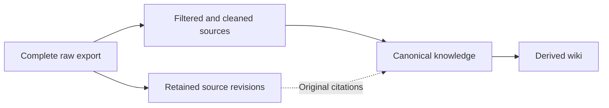

# Source selection before first knowledge ingestion

Date: 11 November 2026, Asia/Singapore.
Scope: source selection for intended business-system behavior.
Reference: [exact user input](user-input.md#exact-user-input).
Pipeline reference: [full-export pipeline clarification](user-pipeline-followup.md#exact-user-input).
Latest reference: [implementation request](user-implementation.md#exact-user-input).
Layout correction: [cleanup authorization](user-layout-cleanup.md#exact-user-input) and [current checks](layout-cleanup.md).

**Select source sections that explain intended behavior, its meaning, or necessary system responsibilities.**
Keep exceptions, conditions, and conflicting intent with each selected rule.
Use a generated filtered source layer between complete exports and canonical knowledge.
The selection review is complete. The local pipeline is implemented through the installed `sources` commands.
See [implementation and validation](implementation.md) for execution results and remaining limits.

## Full-export pipeline

The user can replace a complete export without manually removing excluded documents or editing mixed documents.
The Workbench derives its filtered source view from that export.

| Layer | Responsibility | Update rule |
| --- | --- | --- |
| Raw import | Accept the complete exported collection, including irrelevant documents. | The user can replace this input collection. |
| Filtered and cleaned sources | Select exact passages or link complete pages. Preserve original meaning and source mappings. | Generate this view. Do not maintain it manually. |
| Canonical knowledge | Connect intended rules, definitions, responsibilities, and decisions across sources. Retain lifecycle and authority limits. | Reconcile affected records through ingestion and review. |
| Wiki | Explain and connect canonical knowledge for retrieval. | Refresh affected pages from canonical records. |

### Replaceable input and retained evidence

Use `evidence/knowledge/incoming/COLLECTION/` for the user's replaceable complete exports.
The [knowledge evidence guide](../../../evidence/knowledge/README.md) describes this ignored input location.

Retain changed source bytes before deriving knowledge. Reuse unchanged retained payloads.
Keep registered snapshots under the existing `evidence/knowledge/sources/` structure and retain previous manifest entries.
Existing registered originals remain at their current locations. They do not become the replaceable import folder.

Generate the filtered view outside `knowledge/`, in a new directory under ignored `.workbench/` storage.
Rebuild it from the current import, retained snapshots, and recorded selection decisions.
Knowledge citations must still reach the original retained source revision and exact source ranges.
Keep selection decisions when needed for reproduction. Retain cleaned bytes only when required to interpret a result.

### Storage and duplication

Treat the pipeline as logical stages. It does not require four complete copies of every source document.
Keep each retained source revision once. Reuse equal payloads while preserving their separate provenance identities.

Make the filtered layer primarily a selection index.
It records source references, hashes, selected ranges, decisions, reasons, intent status, and governing policy and context bindings.
Generate cleaned excerpts when ingestion or inspection requires them. Keep rebuildable excerpts in disposable working storage.
Avoid copying complete raw documents into the filtered layer when source references already provide the required content.

The current wiki has the following source and derived entries.
These measurements concern the local files inspected on 11 November 2026.

| Location | Observed entries | Content storage |
| --- | ---: | --- |
| `knowledge/llm-wiki/raw/` | 12 symbolic links | Links to 12 canonical knowledge records. No regular source files. |
| `knowledge/llm-wiki/wiki/sources/` | 12 symbolic links | Links to the same 12 canonical records. No regular source files. |
| Wiki summaries, concepts, entities, and explorations | 91 regular Markdown files | 618,534 bytes of generated content. |

All 24 source aliases resolve to existing canonical records. Corresponding aliases resolve to the same target.
The [bridge implementation](../../../.agents/skills/llm-wiki/scripts/wiki.py#L148-L158) creates relative symbolic links.
Its [compilation path](../../../.agents/skills/llm-wiki/scripts/wiki.py#L213-L224) binds both source folders to canonical records.
Keep those aliases for the existing wiki integration. They add directory entries and link metadata without copying document content.

The exact-hash scan covered 85 original documents, 12 canonical records, and 91 generated wiki pages.
It found no identical regular-file pairs within those 188 Markdown files.
This scan does not measure repeated paragraphs or semantic overlap.
Generated summaries and concepts can repeat facts while serving different retrieval purposes.

The replaceable import export can overlap with retained snapshots while both remain stored.
Archive deduplication prevents repeated retained payloads. It does not remove the separately stored incoming export.
Never make writable incoming files links to protected snapshots. Overwriting those links could modify retained evidence.

The selection index stores reviewed decisions. The view generator emits exact excerpts and complete pages only when requested.
Complete pages use symbolic links when supported. Otherwise, the generator writes byte-identical copies.
Every view entry retains the source-page SHA-256 and an emitted output SHA-256.

### Refresh behavior

1. Inventory the new export and compare source identities and content hashes.
2. Retain new source revisions without replacing previously registered bytes.
3. Reassess new and changed documents, including documents excluded in the previous review.
4. Reuse decisions only when source bytes, filter rules, and governing context remain unchanged.
5. Regenerate the filtered view and report new exclusions, selected sections, held content, and unresolved conflicts.
6. Identify affected knowledge records. Reconcile their meaning through the existing candidate and review procedures.
7. Refresh affected wiki pages from the resulting canonical records.

Each selection binds the source ID, revision/hash, selected ranges, policy hash, and governing context hashes.
Changed source bytes invalidate old line selections. Locate the intended passages again before reusing a decision.
Changed filter rules or relevant clarifications can require reassessment even when source bytes remain unchanged.

An absent document means missing input for this export. It does not automatically revoke a rule or delete knowledge.
An incomplete export must not trigger automatic removal of prior evidence, knowledge, or wiki pages.
A source update can mark affected content for review. It cannot silently approve new intent or replace reviewed meaning.

### Cleaning boundary

Select exact source lines to omit navigation, empty layout blocks, and unrelated sections when meaning remains intact.
The current runtime preserves selected text. It does not normalize formatting.
Preserve conditions, exceptions, units, defaults, field types, proposal status, and conflicting rules.
Keep missing diagrams and attachments explicit when they limit understanding.

Do not turn cleaning into unsupported correction or synthesis.
Record original-to-output range mappings for every excerpt.
Semantic reconciliation belongs in canonical knowledge ingestion.

### Fit with the current Workbench

The [existing-file review](filter-review.md#current-conclusion) supplies the first selection baseline for 85 documents.
Its exclusions concern the intent input. Original files remain unchanged.
The review supplies semantic decisions. The local `sources` commands apply those decisions and detect stale bindings.

The [source retention contract](../../../knowledge/README.md#source-provenance-outside-knowledge) already requires retained revisions and exact source bindings.
The [ingestion procedure](../../../.agents/skills/ingest-knowledge/references/workflow.md#2-protect-the-originals) preserves source bytes before interpretation.
The [wiki bridge](../../../.agents/skills/llm-wiki/SKILL.md#maintain-the-shared-documents) already uses canonical records as its source.
Its existing `knowledge/llm-wiki/raw/` links remain canonical-record aliases.

Confidence is high that these boundaries fit the current architecture.
The [source preparation procedure](../../../.agents/skills/ingest-knowledge/references/source-preparation.md) documents supported commands and hash bindings.
Knowledge reconciliation and wiki synthesis remain separate agent procedures. Local source commands do not perform those stages.

## Topics to keep

These topic groups are recommendations within the existing knowledge boundary.
Use only groups that answer the project's actual questions.

| Topic | Content to select |
| --- | --- |
| Purpose and scope | Users, supported capabilities, business outcomes, and explicit exclusions. |
| Domain concepts and data | Terms, entities, identity meanings, relationships, states, and data lifecycle rules. |
| User and system workflows | Actors, triggers, preconditions, steps, outputs, alternative paths, and state transitions. |
| Business rules | Eligibility, validation, calculations, precedence, limits, and decision rules. |
| Security behavior | Authentication, permissions, sessions, tenant isolation, and denial behavior. |
| Contracts and integration | Requests, responses, events, defaults, errors, compatibility, and external system obligations. |
| Target architecture | Intended component responsibilities, trust boundaries, dependencies, and ownership of rules. |
| Failure and recovery | Retry, timeout, rollback, duplicate handling, recovery, and continuity requirements. |
| Quality constraints and decisions | Measurable performance, availability, audit, retention, accessibility, and behavior-relevant design rationale. |

Target architecture qualifies when it explains intended responsibilities and has a current consumer.
Generic framework descriptions do not qualify merely because the system uses that framework.
Historical proposals can support candidate intent. Their age or presence does not establish current applicability.

## Selection method

1. Define the system boundary and the questions the first ingestion must answer.
2. Inventory source paths, titles, dates, owners, revisions, and hashes. Identify duplicates and missing attachments.
3. Read each document's sections. Use filenames and keywords only to locate possible material.
4. Ask whether each section defines intended behavior, necessary domain meaning, or intended responsibilities.
5. Read the surrounding conditions, exceptions, tables, diagrams, and linked definitions before selecting a claim.
6. Record relevance separately from authority, intent status, and applicability. Investigate material conflicts before treating a rule as settled.
7. Derive connected candidate records from selected evidence. Keep the original sources and exact locators available.

For behavior claims, capture the actor, trigger, conditions, required result, and exceptions when the source supplies them.
Do not invent missing values to complete that description.
For definitions and architecture, capture the meaning or responsibility and the behavior it supports.
Keep system rules found inside operational procedures. Defer unrelated staffing, scheduling, and tool instructions.

## Selection decisions

These review labels now have corresponding runtime decisions. They remain separate from knowledge publication states.
Runtime names use `KEEP_SECTIONS`, `EVIDENCE_ONLY`, and `EXCLUDE` for their corresponding table labels.

| Decision | Use |
| --- | --- |
| KEEP | The complete page describes intended behavior or necessary context. Preserve its actual intent status. |
| KEEP SECTIONS | The document mixes qualifying content with unrelated material. Select exact sections with necessary context. |
| EVIDENCE ONLY | The content describes implementation, deployment, incidents, measurements, or execution outcomes. |
| HOLD | Missing context, conflicting rules, or unclear applicability prevents a reliable interpretation. Record the reason and next evidence. |
| EXCLUDE FROM BATCH | The content is unrelated, duplicated, empty, or general tool instruction without relevant system semantics. |

Exclusion from this batch does not authorize deleting original documents or protected evidence.
Unknown authority does not erase relevant content. Preserve it as uncertain candidate material when its meaning remains clear.
Source selection does not approve the rule or publish knowledge.

Keep one durable selection index per source collection.
Each source row records these fields:

`path | source identity and snapshot | present | decision | reason | ranges | topic | intent_status | policy_sha256 | context`

Record applicability, authority, and unresolved context in the review rationale and resulting knowledge.

Reference each retained payload once. Reuse its identity across all supported topics.

## Boundary examples

These examples illustrate selection. They are not claims about the project's actual policy.

| Source content | Decision and reason |
| --- | --- |
| A requirement defines when users lose access. | KEEP: it defines intended security behavior. |
| A release guide mixes configuration validation with staffing schedules. | KEEP SECTIONS: retain validation rules and their conditions. |
| A test report records observed latency. | EVIDENCE ONLY: a measurement cannot define the performance requirement. |
| A draft design proposes a recovery timeout. | KEEP as proposed intent, or HOLD if missing context prevents interpretation. |
| A tutorial lists framework installation commands. | EXCLUDE FROM BATCH unless a section supplies a relevant system contract. |

## Evidence and confidence

| Claim | Evidence | Class and confidence | Limit |
| --- | --- | --- | --- |
| Knowledge retains intent, workflows, contracts, and intended architecture. | [Knowledge standards](../../../knowledge/README.md#knowledge-standards) | Documented rule; high. The source states the permitted content. | This does not classify each raw document. |
| Actual implementation and observations remain separate from intent. | [Intent boundary](../../../knowledge/README.md#intended-behavior-and-independent-gaps) | Documented rule; high. The source states the separation. | Actual behavior needs its own evidence. |
| Selection must answer project questions and preserve source context. | [Scope](../../../.agents/skills/ingest-knowledge/references/workflow.md#1-define-the-scope) and [evidence reading](../../../.agents/skills/ingest-knowledge/references/workflow.md#3-read-and-trace-the-evidence) | Documented procedure; high. The workflow requires both checks. | Topic groups and decision labels above are recommendations. |

Initial proposal inspected workspace HEAD: `86f686b9d01f8faedf805ee67df28dfb631ddbea`.
The following hashes identify historical guide bytes inspected for that proposal.
The implementation updates those guides. Current validation appears in [the implementation report](implementation.md).

| Source | SHA-256 |
| --- | --- |
| `knowledge/README.md` | `abf81e780245f54d6e026c0e96e2b47a83004d3039539af05dd5d093ae423329` |
| `.agents/skills/ingest-knowledge/references/workflow.md` | `0340e6d98af51e6b486eedf9567256d9d97336e5f4db53e96074ac5c0916629f` |

The [follow-up review](filter-review.md#current-conclusion) classifies the existing 85-document export.
No knowledge publication or semantic ingestion ran during this source preparation implementation.
Authority and applicability remain source-specific review questions.

## Validation

Initial proposal checks: PASSED for 14 local links, anchors, source ranges, and the then-current guide hashes.
Diff checks found no whitespace errors. The prose sentence-length check found no sentences over 20 words.
ASD-STE100 review: PENDING. No complete dictionary or grammar certification was performed.
Runtime and installed-workspace checks are recorded in [the implementation report](implementation.md).
