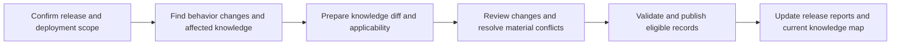

# Post-release knowledge synchronization design

Status: PROPOSED. This document defines an agent workflow, not an implemented runtime feature.
Primary source: [latest user clarification](user-followup.md#exact-user-input), 1 November 2026.
Earlier source: [initial question](user-input.md#exact-user-input).
The earlier proposal is preserved by Git revision `1d581f66f` at this same path.

**Recommendation: make knowledge synchronization a standard operation after each release, scoped by deployment and environment.**
The result should explain current system behavior and preserve its previous meaning, applicability, evidence, and review history.
Owner: proposed release knowledge owner; actual owner remains unknown.
Confidence: HIGH for compatibility with inspected Workbench contracts; operational effectiveness remains untested.

## User outcome

A user should be able to request: “Synchronize knowledge for this release in this environment.”
Workbench should collect available release evidence, identify affected knowledge, and prepare a reviewable update.
It should identify supported current behavior, unresolved differences, and knowledge that no longer describes the selected deployment.
The final result should list updated knowledge versions, unchanged records, gaps, review decisions, and remaining actions.
Existing Markdown and HTML release reports should show the same synchronization outcome.

## Scope and evidence contract

Select the release, owning task, target environment, deployment or rollout identity, and available evidence.
Discover existing evidence before requesting missing inputs. Use registered tools only within their grants and task authorization.
A release spanning tasks uses one synchronization owner and links each contributing task.
No deployment evidence limits the operation to a candidate update. It cannot establish current deployed behavior.

| Input | Purpose and limit |
| --- | --- |
| Release change set and baseline | Identify included commits, repositories, services, settings, requirements, and exclusions. |
| Deployment receipt and artifact/configuration identities | Establish which components and settings reached the selected scope, and when. A release name alone is insufficient. |
| Existing knowledge versions and hashes | Identify the meaning being replaced and detect concurrent knowledge edits. |
| Reviewed requirements and decisions | Establish intended behavior and business authority. Implementation cannot supply missing policy approval. |
| Exact source, contracts, tests, and retained results | Explain implemented and observed behavior, with separate claim classes. |
| UAT remote logs and applicable target observations | Corroborate behavior within their environment and observation window. UAT evidence cannot prove PROD execution. |

Deployment evidence can establish artifact applicability while execution remains unverified.
Do not require a production probe for every documentation claim. Match evidence strength to the actual claim.
Keep raw evidence outside `knowledge/`, under its current task or registered provenance location.

## Repeatable flow



1. Capture the exact baseline, deployed artifacts, effective settings, environment, rollout cohort, and observation window.
2. Inspect behavior changes and affected consumers. Map them to existing knowledge IDs and identify missing topics.
3. Compare old knowledge with new implementation, approved intent, deployment evidence, and observed execution separately.
4. Prepare a candidate diff for changed reusable meaning. Include affected rules, workflows, contracts, responsibilities, and consequential boundaries.
5. Review the batch and resolve material ambiguity. Apply the existing human review gates to important requirements and decisions.
6. Validate final bytes and provenance. Publish eligible records with their required immutable audit events.
7. Update navigation, related references, the task knowledge-update log, and maintained release-report views.
8. Retain a completion summary with updated versions, unresolved items, owners, and exact evidence identities.

The agent prepares mapping, drafting, evidence links, validation, and the review summary.
The reviewer receives grouped changes by topic, with old meaning, proposed meaning, evidence, and material questions together.
Do not request confirmation per file. Review scope and actual authority must remain explicit.
Release approval can support knowledge publication only when it explicitly covers the final knowledge content and required authority.

## What changes in knowledge

Knowledge includes reusable descriptions of actual behavior, alongside requirements and design decisions.
A release can change actual behavior without changing the requirement. Update the applicable system topic or contract explanation in that case.

| Disposition | Knowledge action |
| --- | --- |
| Released behavior implements a reviewed new rule | Update the requirement's delivery context and applicable workflow or system topic. Preserve the rule's authority. |
| Released behavior restores an existing rule | Preserve requirement meaning. Correct outdated actual-behavior descriptions and link the released correction. |
| Public contract, responsibility, or relevant configuration semantics change | Update the affected domain architecture or topic and linked consumers. |
| Implementation or runtime differs from approved intent | Record the actual behavior with scope and evidence. Open a conflict finding; preserve intended behavior separately. |
| Only evidence changes; reusable meaning and applicability stay the same | Retain the new task evidence. Avoid unnecessary knowledge version changes. |
| No knowledge record describes the changed behavior | Propose a new domain topic with its owner, sources, and review state. |

A known defect may be documented as actual behavior. It must remain a defect where the approved rule differs.
Observed implementation does not silently redefine required behavior.

## Version and applicability

Keep the stable knowledge ID when a concept remains the same. Create a successor version when its content changes.
Record predecessor version and content hash. Preserve prior bytes through Git and required retained snapshots.
Use each ID/version pair once, as the [validator requires](../../../core/governance/validation.py#L305-L308).
A published predecessor and candidate successor can coexist at different versions.
Do not label the predecessor globally superseded while it still applies to another supported environment or cohort.

Each changed claim needs applicability visible in the document:

- Release and deployment identity; relevant artifact and configuration fingerprints.
- Environment, tenant or cohort when relevant; use configured project identities.
- Effective start and end, or explicit unknowns. Distinguish rollout time from observation and documentation times.
- Evidence class: intended, inspected implementation, deployment, observed execution, or inference.
- Review state, owner, predecessor, and evidence limits.

These values are proposed authoring fields. Existing schemas permit extensions; the runtime does not interpret their applicability automatically.
Initial adoption can use a concise applicability table in existing knowledge records.
Do not invent a backdated effective time when the evidence cannot establish it.

For partial rollout, retain the old and new behavior with their separate scopes.
For rollback, record a new rollout outcome and applicability interval. Preserve the withdrawn behavior and original release evidence.
Recheck effective configuration, persisted data, and migrations. Restoring old code does not prove restoration of earlier behavior.
Do not rewrite publication history to make the rollback look like an unreleased change.
For overlapping releases, derive behavior from actual component and configuration combinations. Do not use release-name ordering alone.

## Safe retries and completion

Identify the operation by workspace, release, deployment or rollout identity, and target scope.
Record the input evidence fingerprint and the starting knowledge hashes.
The same inputs should resume pending work or return the existing result. They should not create duplicate versions or audit events.
Changed deployment evidence creates a new scoped attempt. Keep the earlier attempt and its conclusions inspectable.
Before applying a prepared update, recheck knowledge hashes. Reconcile concurrent edits and re-review affected final bytes.

Suggested synchronization statuses are PENDING, DRAFTED, IN_REVIEW, COMPLETE, PARTIAL, and BLOCKED.
These proposed task statuses are separate from knowledge governance states and release status.
Track each required row as updated, unchanged with rationale, or unresolved with an owner and next action.
Do not count an unresolved row as synchronized merely because it has a disposition.

COMPLETE means all declared required rows have matching published knowledge or a supported no-change rationale.
It does not mean every runtime predicate passed or that deployment was approved by this workflow.
Unknown affected scope prevents a complete-coverage claim. Report the denominator as unknown.
PARTIAL allows resolved topics to finish while independent unresolved topics remain visible.
Apply related records as a consistent group when their claims depend on each other.

The release report should show synchronized required rows over the declared total, unknown scope, open conflicts, and changed knowledge versions.
Keep process counts separate from runtime evidence, behavior outcomes, and release confidence.
Knowledge publication cannot remove a failed release condition or convert an observed failure into a pass.

## Implementation approach

Start with one reusable `sync-release-knowledge` skill that coordinates existing release and governance procedures.
Add a post-release handoff to the release-confidence skill. Use the same workflow for manual requests and future deployment events.
Keep the first implementation local and file based. Reuse existing Markdown records, source manifests, audit events, validation, and Git.
Use one living `10-knowledge-sync.md` under the owning task, with supporting evidence under that task.
Use a lifecycle-compatible current-stage record. Preserve the frozen intake and existing task evidence.

The first implementation should prepare updates, track review, and validate the final handoff.
It should not require a new database, full workflow engine, or broad schema migration.
Add deterministic helpers later for repeated identity checks, evidence reconciliation, and retry handling when actual runs justify them.
A deployment hook can later invoke the same declared operation. Do not create a background automation from this design discussion.
Knowledge retrieval should use environment and as-of scope when selecting current behavior.
Initially, the query skill must inspect applicability. Automatic environment filtering requires a separately implemented and tested capability.
Current [knowledge retrieval](../../../core/providers/knowledge.py#L110-L120) does not automatically select the applicable published version.

These are proposed implementation steps. No new skill, trigger, applicability resolver, or synchronization runner exists from this document.

## Session-renewal example

Assume a future release deploys the manual-renewal correction to PROD with inspectable artifact and configuration identities.
This is a hypothetical deployment. The [retained local pilot](../../../tasks/portal-background-session-20261019/10-runtime-log-pilot.md) does not establish it.

The agent would inspect the [session topic](../../../knowledge/candidates/security/KT-authentication-and-sessions.md) and [renewal requirement](../../../knowledge/candidates/requirements/REQ-active-session-renewal.md#delivery-status).
It would update an outdated actual-behavior description with the applicable deployed renewal behavior and its evidence limits.
It would retain the existing pending, success, and retry criteria unless a reviewed business decision changed them.
It would update delivery context only for the verified deployed scope. Activity-renewal backlog items would retain their separate status.
The unexercised stale-response diagnostic would remain unresolved. It would not become an approved business rule or a passing observation.
Required knowledge publication review would still apply to the changed final content.

## Compatibility and limits

The [knowledge contract](../../../knowledge/README.md) defines domain boundaries, provenance, lifecycle fields, and publication gates.
The [governance procedure](../../../.agents/skills/govern-knowledge/SKILL.md) defines candidate preparation, review, and immutable events.
The [deployment comparison](../../../.agents/skills/verify-implementation/references/deployment-comparison.md) distinguishes artifact, configuration, and observed target behavior.
The [architecture](../../../ARCHITECTURE.md) keeps automatic governance and a durable workflow runner as future capabilities.
Resolved business clarification still updates knowledge before the next SDLC handoff. The post-release operation completes deployed applicability.

The actual owner, selected release, target deployment evidence, and rollout scopes are unknown for an execution of this design.
Those inputs are unnecessary for proposing this workflow. They remain necessary before applying a specific post-release update.
No domain record, publication state, release decision, or external system changed during this design discussion.
The [design checks](design-validation.json) retain source identities, link checks, writing-check limits, and independent agent review.

## Writing review

```yaml
standard: ASD-STE100
automated_check: PASSED
asd_review: PENDING
reviewer: null
reviewed_at: null
limitations:
  - Automated checks do not check the complete approved dictionary or grammar rules.
```
