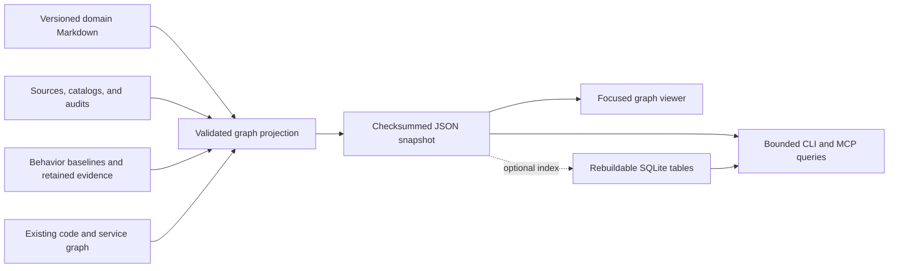

# Workbench knowledge graph solution

**Recommendation: Extend the existing graph with governed knowledge and traceability. Keep it derived from authoritative records.**

No critical conclusions require user attention or action.

## Scope and decision

The [exact knowledge graph input](../evidence/knowledge-mechanism-review-20261103/user-input.md#exact-knowledge-graph-input) controls this recommendation.
This review follows the [knowledge mechanism assessment](KNOWLEDGE_MECHANISM_AND_LLM_WIKI_20261103.md).
The scope is a graph for Workbench knowledge, relationships, and engineering evidence.
This stage changes documentation only. It does not select or install a database.

The best fit is a **local, evidence-backed graph projected from existing records**.
Reuse the current graph engine, validation, snapshot format, viewer, and CLI/MCP integration.
Extend their schema through the owning graph skill.
Keep canonical Markdown, manifests, catalogs, baselines, and retained evidence in their existing locations.
A generated graph provides connected queries and navigation over those sources.

Start with generated JSON snapshots and bounded traversal queries.
Use a rebuildable SQLite index when query measurements justify indexed local access.
SQLite would store graph tables. It would not become a second authored knowledge store.
Choose Neo4j when demonstrated shared-service or graph-query needs exceed this local design.

Confidence is **HIGH** for the reuse opportunity and current capability gaps.
Confidence is **MEDIUM** for the proposed storage choice because workload and concurrency requirements remain unspecified.
No comparative performance benchmark was run.

## Existing foundations and missing links

| Evidence | Current fact | Consequence |
| --- | --- | --- |
| [Saved graph inventory](../evidence/knowledge-mechanism-review-20261103/graph/local/existing-graph-and-identities.json) | The saved graph has 6,517 nodes, 17,836 edges, and 17,998 evidence records across nine repositories. | A substantial code and architecture foundation already exists. Counts do not establish completeness. |
| [Coverage action](../evidence/knowledge-mechanism-review-20261103/graph/local/coverage-query.json) | The snapshot dates from 28 October 2026. Current freshness is `STALE`, with 11 changed paths. | Treat the current graph as historical. Refresh and validate affected sources before current impact claims. |
| [Knowledge identity inventory](../evidence/knowledge-mechanism-review-20261103/graph/local/existing-graph-and-identities.json) | No exact governed knowledge record ID appears among existing node IDs. | The missing layer connects domain intent and its provenance to engineering evidence. |
| [Graph ownership contract](../../.agents/skills/service-dependencies-graph/references/architecture/graph-contract.md#envelope-and-schema) | One skill owns graph schema, validation, queries, and projections. | Extend this path. Keep CLI/MCP adapters thin. |
| [Current neighborhood query](../../.agents/skills/service-dependencies-graph/tools/snapshot.py#L195) | Neighborhood retrieval returns direct incident edges. | Add bounded recursive paths and reverse references for knowledge questions. |
| [Behavior relationship schema](../../core/schemas/behavior-review.schema.json#L287) | Baselines retain implementation/assertion links, endpoint hashes, source ranges, and evidence grades. | Reuse these contracts for traceability. Do not infer semantic coverage from shared IDs. |

The [graph inventory](../evidence/knowledge-mechanism-review-20261103/graph/local/existing-graph-and-identities.json) records inspected source hashes and baseline identities.
The successful coverage action is `5e34a0a4b72a4e608cb90146cc92bf25`.
Its scoped capture preserves freshness, snapshot hashes, repository limits, and the action ID.
No graph bundle was rebuilt.

## Recommended design



The graph should answer a question through typed, inspectable paths.
Its viewer should start with topics, rules, capabilities, and services.
Expand code and test detail when the reader needs it.
A single diagram containing every code symbol would make business navigation harder.
Reuse the current viewer path, subject to changes required by the extended schema.

The [relationship responsibility guide](../../core/relationships/README.md) defines existing ownership.
Graph work belongs inside the canonical skill under current project rules.
A broader domain graph requires explicit schema, validation, query, and viewer extensions there.
It must preserve current dependency meanings and consumer compatibility.

### Initial model

| Node | Identity and role |
| --- | --- |
| Knowledge record version | Existing record ID, version, content hash, type, owner, lifecycle, and locator. |
| Source revision | Manifest source ID, resource, revision, byte hash, and snapshot locator. |
| Catalog entity | Distinct repository, service, capability, contract, and source IDs. |
| Acceptance criterion | Criterion ID within its exact requirement version. |
| Code, assertion, and execution artifact | Existing evidence identities, source revisions, hashes, ranges, configuration, and outcome limits. |
| Finding or audit event | Existing ID, affected version, assessment, actor metadata, and supporting evidence. |

Start with deterministic edges that the current records explicitly declare.
Use `CITES_SOURCE`, `RELATED_TO`, `HAS_CRITERION`, and catalog relationships with their original meanings.
Import `IMPLEMENTED_BY` and `ASSERTED_BY` links with their recorded grades and limits.
Expose review, predecessor, conflict, and supersession edges only where exact evidence supports them.
LLMs can propose additional semantic relationships for investigation.
Unreviewed proposals must remain distinguishable from reviewed claims.

Each consequential relationship needs source locators, revisions, hashes, evidence class, assessment, and material limits.
Preserve intended applicability where a source supplies it.
Keep knowledge lifecycle, source freshness, relationship confidence, and execution outcome as separate fields.
Record source observation and graph-generation times separately from intended effective dates.
A temporal database cannot determine those dates when the sources omit them.

### Consequential boundaries

The [citation rule](../../.agents/skills/ingest-knowledge/references/evidence.md#L40) distinguishes a working reference from semantic support.
A citation creates `CITES_SOURCE`. It does not automatically create a proven rule.
An untyped related ID creates `RELATED_TO`. It does not establish a dependency.
Current [code-derived capability links](../../.agents/skills/service-dependencies-graph/tools/build_graph.py#L612) include inferred `IMPLEMENTS` edges.
They do not establish verified requirement conformance.

Join identities explicitly.
For example, registry repository `single-ui-auth-sdk` corresponds to graph repository `repo:single-ui-sdk-starter` through its registered location.
Constructing graph IDs from registry names would miss that mapping.
Keep repository, service, and knowledge identities distinct after joining them.

All 12 current domain records remain candidate drafts.
An approved-only query must return no domain records until actual publication evidence exists.
A graph must not turn connected candidates into approved business intent.

## Technology options

The [primary-source excerpts](../evidence/knowledge-mechanism-review-20261103/graph/external/primary-source-excerpts.md) support this comparison.
They are normalized excerpts, rather than complete byte-identical snapshots.
The [retrieval metadata](../evidence/knowledge-mechanism-review-20261103/graph/external/retrieval.json) records source URLs, revisions where available, and capture limits.

| Option | Fit for Workbench | Select when |
| --- | --- | --- |
| Existing graph engine, JSON, optional SQLite index | Best current fit. Reuses the runtime and keeps sources reviewable. SQLite supports recursive graph queries through SQL. | Local workspaces need connected navigation, impact paths, and review queues. |
| Neo4j | Strong dedicated graph database with Cypher and local or hosted deployment options. Adds a separate database prerequisite and operations. | Shared access, concurrent workloads, complex Cypher queries, or measured local-query limits justify a graph service. |
| Graphiti | Temporal context framework with episode provenance, typed extraction, LLMs, embeddings, and a graph backend. | Continuously arriving episodes and temporal agent memory are the primary workload. Evaluate it as an optional extraction layer. |
| Microsoft GraphRAG | LLM extraction, graph communities, summaries, and graph-assisted retrieval over unstructured text. | Corpus-wide thematic questions require this retrieval pipeline and comparative evaluation demonstrates value. |

SQLite is already used through Python in [the action store](../../core/store.py#L9).
The official [SQLite guidance](https://www.sqlite.org/whentouse.html) describes local application storage and one concurrent writer.
Its [recursive query documentation](https://www.sqlite.org/lang_with.html#queries_against_a_graph) demonstrates graph traversal.
Do not share a SQLite file directly between many computers.
A future shared service needs its own concurrency, access, and operational design.

[Neo4j documentation](https://neo4j.com/docs/getting-started/whats-neo4j/) describes graph-native storage, Cypher, and deployment options.
Edition features and licensing need a separate assessment before selection.
No Neo4j platform installation or workload was tested here.

[Graphiti's pinned README](https://github.com/getzep/graphiti/blob/7e0342a49ce5a04f6415ac2f64ce150bb81b0689/README.md) requires a graph backend, LLM, and embedder.
It provides temporal fact management and episode provenance.
These features cannot establish business authority, publication approval, or intended-policy supersession.
Workbench would still need its own governance integration and operational boundaries.

[GraphRAG's pinned README](https://github.com/microsoft/graphrag/blob/34b2b67ae4601ad0b47bcd179fbe3f2a23aa0857/README.md) describes a research demonstration and potentially expensive indexing.
It states that the project is largely in maintenance mode.
That status further limits its fit as a new core dependency.
GraphRAG is a retrieval pipeline, rather than a substitute for Workbench's relationship and approval contracts.

## First useful delivery

The Workbench maintainer owns the proposed harness work.
Business owners retain authority for meaning, unresolved policy, and publication review.
Unknown owners must remain explicit.

1. Extend the existing graph contract for knowledge versions, source revisions, and explicit catalog joins.
2. Project citations, related IDs, criteria, lifecycle, findings, and audit references deterministically.
3. Connect existing behavior baselines and code graph identities with their original grades and freshness limits.
4. Add reverse-reference and bounded-path queries, then expose a focused viewer.
5. Evaluate actual project questions before adding indexed storage, an external database, or LLM extraction dependencies.

Use these questions as initial evaluation cases:

- Which topics cite a source revision that has changed?
- Which requirements lack a review owner or publication evidence?
- Show a session rule, its criteria, implementation mappings, assertions, and retained outcomes.
- Which criteria lack code or assertion mappings, and which mappings have stale evidence?
- Which conflicting claims concern this rule, and what decision could resolve them?
- Which intended rules connect to this service through explicit, inferred, or unresolved relationships?

Passing evaluation needs correct paths, exact citations, visible uncertainty, and bounded results.
Node counts and visually attractive diagrams do not establish useful retrieval or verified coverage.
Any new prerequisite must follow the [dependency maintenance rule](../../AGENTS.md#dependency-maintenance).

## Checks and limits

Source inspection and a read-only coverage query support the current-state findings.
No implementation, graph rebuild, database installation, or external product benchmark occurred.
No runtime behavior changed. Runtime tests and wheel builds were unnecessary for these documentation changes.
Documentation checks cover local links, locators, JSON, whitespace, and prose sentence length.
See the [check result](../evidence/knowledge-mechanism-review-20261103/graph/document-checks.json).
The proposed design still needs implementation-specific validation and meaningful query tests.

```yaml
standard: ASD-STE100
automated_check: PASSED
asd_review: PENDING
reviewer: null
reviewed_at: null
limitations:
  - Automated checks do not check the complete approved dictionary or grammar rules.
```
