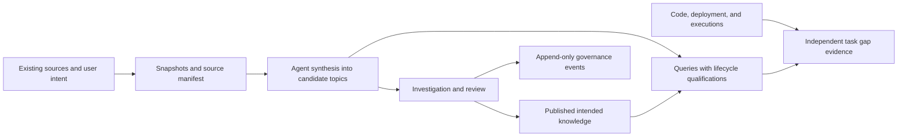

# Workbench knowledge mechanism and llm-wiki

**Recommendation: Enhance the existing knowledge mechanism. A separate wiki system has no demonstrated need in this review.**

No critical conclusions require user attention or action.

## Scope and answer

The [exact user input](../evidence/knowledge-mechanism-review-20261103/user-input.md#exact-user-input) controls this review.
This is a Workbench harness review, dated 3 November 2026.
The review covers knowledge storage, synthesis, retrieval, governance, and maintenance.
Implementation risk is low because this stage changes review documents and evidence only.

The comparison assumes [Karpathy's LLM Wiki pattern](https://gist.github.com/karpathy/442a6bf555914893e9891c11519de94f).
The user supplied no project URL.
The inspected reference describes an idea, rather than a specific software implementation.
A recommendation about another product would require its exact source and capabilities.

**You do not need another knowledge store to gain the main llm-wiki benefits.**
Workbench already uses retained sources, connected Markdown topics, agent procedures, and recorded governance.
Its deterministic checks provide additional provenance and publication controls.
The useful next improvements concern access, retrieval quality, and consistent maintenance.

Confidence is **HIGH** for the inspected mechanism and overlap.
Confidence is **MEDIUM** for the improvement order because retrieval quality and maintenance effort lack comparative measurements.

## How the mechanism works



| Layer | Current responsibility | Main boundary |
| --- | --- | --- |
| Sources and provenance | Preserve source identities, revisions, retrieval times, and byte hashes. | A snapshot preserves evidence. It does not establish authority or current applicability. |
| Connected domain records | Explain terms, intended rules, requirements, contracts, and target architecture. | Candidate content must retain its review limits. |
| Agent procedures | Read sources, synthesize topics, investigate contradictions, answer questions, and prepare updates. | The Python runtime does not perform semantic synthesis automatically. |
| Runtime checks | Check schemas, source bindings, snapshot hashes, lifecycle evidence, and prepared content. | Passing validation does not establish truth or business approval. |
| Queries | Find records, read exact content, and trace claims to evidence. | Agents must select applicable versions and distinguish candidates from published intent. |
| Task evidence | Compare intended, old, new, and observed behavior. | Actual behavior cannot silently redefine intended rules. |

The [knowledge contract](../../knowledge/README.md#intended-behavior-and-independent-gaps) defines the content boundary.
The [ingestion workflow](../../.agents/skills/ingest-knowledge/references/workflow.md#4-draft-the-connected-knowledge) already requires connected synthesis.
It supports several sources per topic and several topics per source.
The [publication gates](../../knowledge/README.md#review-gates) bind recorded reviews and transitions to final file hashes.
Important requirements and decisions need recorded human review before publication.

## Current evidence-backed claims

Local hashes identify the inspected working files in the [source register](../evidence/knowledge-mechanism-review-20261103/local/source-identities.json).
The initial HEAD was `d1c099ffc5705e3475effebb26d6d9d9135dd628`.
Concurrent unrelated work advanced HEAD during this review.
The [test record](../evidence/knowledge-mechanism-review-20261103/local/knowledge-tests.json) records its own revision and source hashes.

| ID | Claim and class | Confidence and support | Material limit |
| --- | --- | --- | --- |
| C1 | The current domain corpus contains 12 records, all candidate drafts. Inspected local records. | HIGH: [inventory](../evidence/knowledge-mechanism-review-20261103/local/inventory.json) and [candidate map](../../knowledge/candidates/index.md#portal-knowledge-map). All have unknown topic owners and no verifier entries. | Counts do not establish completeness. Candidate status does not invalidate every supported claim. |
| C2 | Workbench already has connected topic synthesis and navigation. Documented procedure and inspected content. | HIGH: [synthesis procedure](../../.agents/skills/ingest-knowledge/references/workflow.md#4-draft-the-connected-knowledge) and [classified topics](../../knowledge/candidates/index.md#classified-topics). | Semantic consistency still depends on source review and agent work. |
| C3 | Validation checks source integrity and recorded gates. Inspected implementation and controlled execution. | HIGH: [source checks](../../core/governance/validation.py#L187), [gate checks](../../core/governance/validation.py#L313), and [52 passing tests](../evidence/knowledge-mechanism-review-20261103/local/knowledge-tests.json). | It cannot authenticate reviewers, establish truth, or prove historical audit immutability. |
| C4 | The built-in knowledge provider has no configured resource here. Inspected configuration and runtime discovery. | HIGH: [retained status](../evidence/knowledge-mechanism-review-20261103/local/status.json), [workspace configuration](../../workspace.yaml#L6), and [resource loading](../../core/workspace.py#L29). | Direct file access and validation work. Provider availability alone does not create a callable resource. |
| C5 | Provider search uses literal, case-insensitive line matching. Inspected implementation and controlled execution. | HIGH: [operation schemas](../../core/providers/knowledge.py#L53), [search loop](../../core/providers/knowledge.py#L113), and [assertions](../../tests/test_providers.py#L38). | No ranking, aliases, lifecycle filter, environment filter, or as-of resolver appears in this provider. |
| C6 | Semantic maintenance remains agent work. Documented boundary and inspected implementation. | HIGH: [ingestion responsibility](../../core/ingestion/README.md) and [understanding responsibility](../../core/understanding/README.md). | Existing [harness checks](../../core/ingestion/harness.py#L299) already cover retention, references, and selected freshness evidence. |
| C7 | llm-wiki's core pattern substantially overlaps Workbench. Comparison inference. | HIGH: [pinned primary-source excerpts](../evidence/knowledge-mechanism-review-20261103/external/karpathy-llm-wiki-excerpts.md#architecture), C2, C3, and C6. | No third-party implementation was installed or benchmarked. |

The manifest contains 495 source records and 456 declared snapshot paths.
The inventory also contains 61 audit YAML files and two governance findings.
These numbers describe retained material, rather than reviewed knowledge coverage.

## What llm-wiki adds

The inspected gist revision is `ac46de1ad27f92b28ac95459c782c07f6b8c964a`.
The [retrieval record](../evidence/knowledge-mechanism-review-20261103/external/retrieval.json) identifies the capture and its limits.
The retained excerpts are transcriptions, rather than a complete byte-identical source snapshot.

| llm-wiki idea | Workbench equivalent | Useful addition |
| --- | --- | --- |
| Immutable raw sources | Snapshots and source manifest. | Reuse the existing provenance contract. |
| Agent-maintained Markdown wiki | Domain records, candidates, and classified topic map. | Maintain affected topics together when an authorized source changes. |
| Agent schema and operating rules | AGENTS.md, shared skills, schemas, and templates. | Add only demonstrated missing procedures. |
| Ingest, query, and lint | Ingest, query, govern, gap detection, and release synchronization skills. | Produce a concise health and review queue from these procedures. |
| Index and chronological log | Topic indexes, governance events, Git history, and action records. | Add navigation summaries only where users need them. These records serve different purposes. |
| Save valuable answers | Authorized ingestion into source-backed candidates. | Preserve reusable intent answers after review. Keep query operations read-only by default. |
| Optional search tooling | Literal provider search and normal source tools. | Measure retrieval failures before selecting a ranked or semantic search dependency. |

The pattern lets an LLM own generated wiki content.
Workbench needs a narrower adaptation because intent, observed behavior, and publication approval have separate owners and evidence requirements.
Copying implementation explanations into canonical intent would violate that boundary.
A second store would also require synchronization of versions, citations, and review states.
That additional maintenance has no demonstrated benefit here.

## Recommended improvement order

These are proposals. This review does not implement them.
The Workbench maintainer owns harness improvements; named business review owners remain unknown where the records state this.

| Order | Improvement | Evidence, consequence, and next action |
| --- | --- | --- |
| 1 | Make knowledge access explicit. | C4 prevents CLI/MCP knowledge calls here. Configure a resource with `list`, `search`, and `read` grants when required. Keep write grants separate. |
| 2 | Make retrieval show lifecycle and evidence context. | C1 and C5 expose candidate material without structured state summaries. Return IDs, versions, state, source links, and section context. Support explicit scope filters. |
| 3 | Maintain a source-to-topic review queue. | C6 leaves semantic reconciliation to agents. Use manifest changes and existing source references to identify affected topics and propose updates. |
| 4 | Check backlinks, orphan topics, and contradictions. | Existing synthesis already links topics. Add missing navigation checks and agent health review without duplicating retained-byte checks. |
| 5 | Make the existing retrieval exercise repeatable. | The [current workflow](../../.agents/skills/ingest-knowledge/references/workflow.md#7-check-usefulness-and-hand-off) already requires representative questions. Retain citation support, correct uncertainty, applicability, and retrieval effort for comparison. |

Before search infrastructure changes, evaluate a small fixed set of real project questions.
Include cross-topic questions, conflicting rules, unknown policy, and applicable-version questions.
Compare supported answers, citation accuracy, retrieval effort, and correct refusal to invent missing rules.
If literal search and indexes fail these cases, assess a small local ranked index first.
Choose semantic search only when it provides measured additional value.

Publication readiness also needs actual review ownership.
A wiki tool cannot supply source authority, resolve business policy, or authenticate human approval.
This remains separate from retrieval improvements.

Any future dependency must follow [principle 7](../../PRINCIPLE.md#7-local-first-minimal-dependencies) and the [dependency maintenance rule](../../AGENTS.md#dependency-maintenance).
A procedural enhancement can reuse the existing agent and Python runtime without adding infrastructure.

## Validation and limits

- Workspace validation: **VALID**, 14 documents, zero findings. This count includes 12 domain records and two governance findings.
- Focused existing tests: **52 passed**, zero failures, errors, skips, or expected failures.
- Test scope: Four knowledge-provider cases, 24 governance cases, and 24 ingestion-harness cases.
- Documentation checks: See the [retained check result](../evidence/knowledge-mechanism-review-20261103/local/document-checks.json).
- Writing review: ASD review remains pending.

The shell did not expose `ai-sdlc` directly.
The existing `.venv/bin/ai-sdlc` worked and loaded this checkout's runtime source.
No installation was required.
The registered external-web connector listed its tools, but its source fetch failed.
Browser retrieval supplied the pinned public text.
The [retrieval record](../evidence/knowledge-mechanism-review-20261103/external/retrieval.json) retains both outcomes and action IDs.

This review did not test live domain-source access, full semantic coverage, or comparative retrieval quality.
It did not run the complete runtime suite or build a wheel for these documentation changes.
The tests support only their controlled local assertions.
No knowledge records, publication states, runtime behavior, or dependencies changed in this stage.

## Checks and writing review

```yaml
standard: ASD-STE100
automated_check: PASSED
asd_review: PENDING
reviewer: null
reviewed_at: null
limitations:
  - Automated checks do not check the complete approved dictionary or grammar rules.
```
