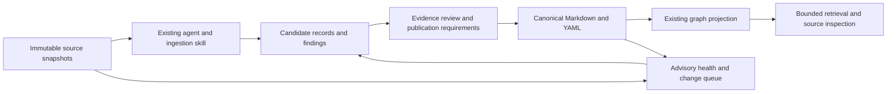

# llm-wiki-agent integration assessment

**Recommendation: adapt selected authoring and health workflows into existing Workbench skills. Retain the current knowledge graph and governed records.**

Direct adoption would introduce competing records, incompatible graph semantics, and additional model dependencies.
Owner: Workbench maintainer.
Next action: evaluate a bounded pilot before implementing an adapter.
The [compatibility checks](../evidence/knowledge-mechanism-review-20261103/llm-wiki-agent/compatibility-checks.json) confirm that direct record and graph imports need transformation.

## Scope and source priority

The [exact user input](../evidence/knowledge-mechanism-review-20261103/user-input.md#exact-llm-wiki-agent-integration-input) controls this assessment.
Date: 5 November 2026, Asia/Singapore.
Owner: Workbench maintainer.
This review concerns Workbench harness integration.

The inspected upstream revision is [`37145b8ba04d0acc6f3b6b0c02606768d1862c9a`](https://github.com/SamurAIGPT/llm-wiki-agent/tree/37145b8ba04d0acc6f3b6b0c02606768d1862c9a).
The Workbench baseline is `a75360bb826f4996e7099a1b39b94decac7416a2`.
The [retrieval manifest](../evidence/knowledge-mechanism-review-20261103/llm-wiki-agent/retrieval.json) binds source bytes, local hashes, grants, and access limits.

The [earlier assessment](KNOWLEDGE_MECHANISM_AND_LLM_WIKI_20261103.md) reviewed the llm-wiki pattern.
This assessment reviews the supplied implementation.
Public source was inspected without installing or executing upstream code.
No domain intent, publication state, dependency, or resource grant changed.

## Decision and expected value

| Option | Assessment | Reason |
| --- | --- | --- |
| Adapt selected workflows | Recommended first step. | Reuses existing provenance, candidate records, graph queries, agents, and publication controls. |
| Build a proposal adapter | Conditional later step. | Useful only if a measured pilot reduces source-review effort or improves supported answers. |
| Install the complete project | Poor fit for this workspace. | Adds a second wiki, incompatible graph, direct writers, and separate provider setup. |
| Replace the Workbench graph | Not recommended. | Loses evidence identities, directed relationship types, lifecycle handling, and engineering traceability. |

Confidence is high for the inspected compatibility boundaries.
Incremental answer quality, cost, and maintenance savings remain unmeasured.
This recommendation applies to the pinned revision.

## What the project actually provides

The [manual route](https://github.com/SamurAIGPT/llm-wiki-agent/blob/37145b8ba04d0acc6f3b6b0c02606768d1862c9a/README.md#L36-L50) uses an existing coding agent to maintain Markdown.
Root instruction files support several agent clients.
The archive contains four Claude command files, but no `.agents/skills` package.
It contains no agent CLI wrapper or permission-management runtime.

Optional [Python tools](https://github.com/SamurAIGPT/llm-wiki-agent/blob/37145b8ba04d0acc6f3b6b0c02606768d1862c9a/tools/_utils.py#L47-L77) call LiteLLM directly.
They provide ingestion, queries, semantic lint, refresh, healing, and graph inference.
These calls use separate provider configuration from the existing coding agent.

| Capability | Existing Workbench mechanism | Incremental value |
| --- | --- | --- |
| Source-to-topic synthesis | [Connected candidate authoring](../../.agents/skills/ingest-knowledge/references/workflow.md#L66-L108). | More consistent topic maps and cross-source overviews. Upstream [ingest instructions](https://github.com/SamurAIGPT/llm-wiki-agent/blob/37145b8ba04d0acc6f3b6b0c02606768d1862c9a/AGENTS.md#L61-L77) provide useful prompts. |
| Contradiction and gap review | Existing governance findings and evidence review. | Better review ordering. Upstream [lint topics](https://github.com/SamurAIGPT/llm-wiki-agent/blob/37145b8ba04d0acc6f3b6b0c02606768d1862c9a/AGENTS.md#L164-L211) separate cheap checks from semantic review. |
| Source-change handling | Immutable snapshots, source hashes, record versions, and graph freshness. | A source-to-affected-topic review queue. Refresh should propose successors rather than rewrite approved intent. |
| Graph-assisted queries | Existing [knowledge, references, and bounded paths](../../.agents/skills/service-dependencies-graph/references/architecture/knowledge-graph.md#build-and-query). | Keyword expansion may help discovery. It does not replace applicability review or evidence inspection. |
| Graph communities | Existing evidence graph and Knowledge viewer. | Optional navigation aid. Upstream [Louvain communities](https://github.com/SamurAIGPT/llm-wiki-agent/blob/37145b8ba04d0acc6f3b6b0c02606768d1862c9a/tools/build_graph.py#L349-L371) do not establish domain boundaries. |

Workbench already supports most of the underlying workflow.
Its [ingestion procedure](../../.agents/skills/ingest-knowledge/references/workflow.md#L110-L163) also includes validation, audit preparation, and a retrieval exercise.
The opportunity concerns automation and review quality rather than another canonical store.

## Recommended integration boundary



This diagram describes the recommended integration.
The current graph already exists; the advisory improvements remain proposals.
No second canonical `wiki/` or `graph.json` is required.

| Upstream artifact or action | Workbench destination or behavior |
| --- | --- |
| Original `raw/` file | Preserve original bytes through source snapshots and the existing manifest. Store converted text as a separate derivative. |
| Source, entity, or concept page | Map reusable intended behavior to the appropriate candidate template. Bind stable IDs, source revisions, hashes, and locators. |
| Implementation description | Retain engineering evidence or an independent task gap. It must not redefine intended behavior. |
| Cross-source overview | Produce candidate navigation and supported topic synthesis through `ingest-knowledge`. |
| Saved query answer | Keep ordinary answers ephemeral. Save reusable intent only through authorized candidate creation. |
| Wikilink or inferred relation | Resolve stable identities explicitly. Use navigation relationships only when their meaning fits. Keep semantic suggestions separate from canonical edges. |
| Broken link or changed source | Produce a review finding or affected-topic queue. Preserve unresolved and ambiguous references. |
| Automatic healing | Replace direct writes with reviewable proposals. Preserve publication requirements and immutable audit history. |
| Community or hub analysis | Apply advisory checks to the knowledge navigation subgraph. Do not score source and audit hubs as defects. |

Unicode titles and paths can remain readable.
Use explicit mappings to Workbench's stable ASCII record IDs.
Filename changes must not silently redefine record identity.

## Material compatibility findings

These findings come from source inspection unless a check is explicitly identified.
No upstream failure, exploit, or production impact was reproduced.
They constrain adoption; they do not establish failures in current Workbench behavior.
The Workbench maintainer owns integration actions below.
Upstream defect ownership is unknown.

| Finding and evidence | Consequence | Required integration action |
| --- | --- | --- |
| **Record and publication contracts differ.** Upstream [frontmatter](https://github.com/SamurAIGPT/llm-wiki-agent/blob/37145b8ba04d0acc6f3b6b0c02606768d1862c9a/AGENTS.md#L25-L54) lacks Workbench identity, lifecycle, version, owner, and exact provenance fields. | Direct copying fails the retained format checks. Agent ownership of the wiki does not supply publication approval. | Generate compliant candidates through current templates, validation, review, and audit procedures. |
| **Ingest writes before validation.** Model-provided slugs and paths reach [filesystem writes](https://github.com/SamurAIGPT/llm-wiki-agent/blob/37145b8ba04d0acc6f3b6b0c02606768d1862c9a/tools/ingest.py#L250-L289). The [writer](https://github.com/SamurAIGPT/llm-wiki-agent/blob/37145b8ba04d0acc6f3b6b0c02606768d1862c9a/tools/_utils.py#L38-L42) checks no root confinement before writing. | Invalid output can persist. Generated paths could escape the intended wiki, within process permissions. | Use constrained proposal output, path validation, staging, and validation before any canonical write. |
| **Refresh compares unequal hash lengths.** It [compares 16 characters](https://github.com/SamurAIGPT/llm-wiki-agent/blob/37145b8ba04d0acc6f3b6b0c02606768d1862c9a/tools/refresh.py#L71-L75) but [stores full hashes](https://github.com/SamurAIGPT/llm-wiki-agent/blob/37145b8ba04d0acc6f3b6b0c02606768d1862c9a/tools/refresh.py#L144-L147). | Unchanged successfully refreshed sources remain selected. Repeated calls can add cost and rewrite churn. | Reuse Workbench full hashes and propose updates only for changed source bindings. |
| **Graph semantics lose information.** [Deduplication](https://github.com/SamurAIGPT/llm-wiki-agent/blob/37145b8ba04d0acc6f3b6b0c02606768d1862c9a/tools/build_graph.py#L328-L346) uses unordered endpoints. [Checkpoint resume](https://github.com/SamurAIGPT/llm-wiki-agent/blob/37145b8ba04d0acc6f3b6b0c02606768d1862c9a/tools/build_graph.py#L180-L215) skips completed IDs before hash comparison. | Relationship direction and distinct types can collapse. Changed-page inference can remain stale during resumed builds. | Keep Workbench's typed directed graph and exact input bindings. Treat model relations as review proposals. |
| **Retrieval does not select applicable authority.** Initial [selection](https://github.com/SamurAIGPT/llm-wiki-agent/blob/37145b8ba04d0acc6f3b6b0c02606768d1862c9a/tools/query.py#L30-L108) caps discovery at 15 pages. Fallback selection relies on a prompted limit. Saved synthesis declares [empty sources](https://github.com/SamurAIGPT/llm-wiki-agent/blob/37145b8ba04d0acc6f3b6b0c02606768d1862c9a/tools/query.py#L140-L160). | Useful pages may be missed. Saved answers lack exact structured provenance and lifecycle selection. | Use current retrieval, inspect citations, and record applicability limits. Benchmark semantic ranking separately. |
| **Healing bypasses review.** [Entity generation](https://github.com/SamurAIGPT/llm-wiki-agent/blob/37145b8ba04d0acc6f3b6b0c02606768d1862c9a/tools/heal.py#L51-L96) creates pages automatically. This conflicts with the [report-only rule](https://github.com/SamurAIGPT/llm-wiki-agent/blob/37145b8ba04d0acc6f3b6b0c02606768d1862c9a/AGENTS.md#L280-L294). | Repeated broken references can become unsupported knowledge. | Emit findings and proposed candidates. Do not connect the healer to canonical knowledge. |

Upstream graph identities derive from page paths, and nodes embed [complete Markdown bodies](https://github.com/SamurAIGPT/llm-wiki-agent/blob/37145b8ba04d0acc6f3b6b0c02606768d1862c9a/tools/build_graph.py#L67-L112).
Wikilinks receive [confidence `1.0`](https://github.com/SamurAIGPT/llm-wiki-agent/blob/37145b8ba04d0acc6f3b6b0c02606768d1862c9a/tools/build_graph.py#L116-L138) because a textual link exists.
That score cannot become evidence confidence, approval, implementation conformance, or test coverage.
Workbench preserves these meanings through [separate evidence relationships](../../.agents/skills/service-dependencies-graph/references/architecture/knowledge-graph.md#evidence-boundaries).

Its lowercase-stem resolver also needs adaptation for duplicate filenames, aliases, fragments, and folder-qualified links.
The [resolver](https://github.com/SamurAIGPT/llm-wiki-agent/blob/37145b8ba04d0acc6f3b6b0c02606768d1862c9a/tools/build_graph.py#L118-L127) selects one matching stem.
The [wikilink parser](https://github.com/SamurAIGPT/llm-wiki-agent/blob/37145b8ba04d0acc6f3b6b0c02606768d1862c9a/tools/_utils.py#L94-L101) retains raw targets.
An adapter must preserve ambiguity rather than guess identities.

Workbench itself still requires manual [environment and as-of applicability review](../../.agents/skills/query-knowledge/SKILL.md#select-applicable-knowledge-versions).
Graph lifecycle filters do not implement a complete policy resolver.
Neither system establishes semantic completeness from graph connectivity.

## Dependencies, access, and maintenance

| Selected component | Additional requirement | Assessment |
| --- | --- | --- |
| Instruction-only workflow | Existing coding agent. | Best initial route. Adapt prompts within existing skills. |
| Structural health | Python standard library. | Small advisory checks could be adapted without another service. |
| Scripted ingest, query, lint, heal, and refresh | LiteLLM and configured provider access. | Adds a separate model route, data transfer, and cost controls. |
| Semantic graph inference | LiteLLM; optional NetworkX for communities. | Duplicates current graph ownership. Evaluate only isolated navigation proposals. |
| Explicit-link graph | Python; `--no-infer` bypasses model inference. | Still requires schema and relationship adaptation. |
| Non-Markdown ingestion | MarkItDown. | Reuse existing project tools where sufficient. Preserve original bytes. |
| Separate batch converter | MarkItDown and tqdm. | Select only if batch conversion adds measured value. |
| Advanced PDF conversion | One selected optional PDF backend. | Validate its platform and installation requirements independently. |
| Graph HTML | Unpinned [vis-network CDN script](https://github.com/SamurAIGPT/llm-wiki-agent/blob/37145b8ba04d0acc6f3b6b0c02606768d1862c9a/tools/build_graph.py#L600-L605). | Unlike the existing viewer, opening this graph requires an external asset request. |

The [project metadata](https://github.com/SamurAIGPT/llm-wiki-agent/blob/37145b8ba04d0acc6f3b6b0c02606768d1862c9a/pyproject.toml#L9-L20) declares Python `>=3.10,<3.14`, MarkItDown, and tqdm.
Its separate [requirements file](https://github.com/SamurAIGPT/llm-wiki-agent/blob/37145b8ba04d0acc6f3b6b0c02606768d1862c9a/requirements.txt#L1-L4) declares LiteLLM and NetworkX.
The installation declarations are disjoint.
Workbench [declares Python `>=3.10`](../../pyproject.toml#L9), without that upper bound.
The complete upstream inventory contains no lockfile, automated tests, or application validation CI.
Its only workflow updates star-history artwork.

Scripted ingestion sends source text, instructions, index, overview, and recent pages to the [configured model](https://github.com/SamurAIGPT/llm-wiki-agent/blob/37145b8ba04d0acc6f3b6b0c02606768d1862c9a/tools/ingest.py#L198-L241).
The shared [model wrapper](https://github.com/SamurAIGPT/llm-wiki-agent/blob/37145b8ba04d0acc6f3b6b0c02606768d1862c9a/tools/_utils.py#L47-L77) supplies no explicit timeout, retry bound, spending limit, or input-token bound.
Library and provider defaults were not verified.
Local Markdown storage therefore does not establish local inference or offline operation.

The [sync guide](https://github.com/SamurAIGPT/llm-wiki-agent/blob/37145b8ba04d0acc6f3b6b0c02606768d1862c9a/docs/automated-sync.md#L15-L98) provides a manual automation recipe, including macOS launchd configuration.
It is not an installed scheduler.
It calls ingestion and healing without Workbench publication checks.
Windows operation, offline installation, converter internals, and provider behavior remain untested.

The [MIT license](https://github.com/SamurAIGPT/llm-wiki-agent/blob/37145b8ba04d0acc6f3b6b0c02606768d1862c9a/LICENSE#L1-L21) permits adaptation.
Copied code or substantial text must retain its copyright and permission notice.
Third-party package licenses and provider terms require separate assessment if those components are selected.

Any future dependency addition must update [dependency analysis](../DEPENDENCIES.md), [setup](../SETUP.md), offline preparation, and applicable diagnostics together.
The recommended initial approach adds no package or service dependency.

## Proposed bounded pilot

The pilot remains unapplied.
Use five representative approved-for-processing source documents and ten fixed project questions.
Include cross-source synthesis, conflicting sources, a missing answer, changed source content, and candidate-versus-published applicability.
Keep the same source bytes, questions, agent model, and access limits for both approaches.

Compare the current workflow with adapted topic synthesis and advisory health prompts.
Use candidate output only, with no automated publication or canonical replacement.
Measure the following outcomes:

| Measure | Decision evidence |
| --- | --- |
| Supported answers | Count answers with inspected claim-level source support, exact locators, and correct state qualifiers. |
| Unsupported assertions | Count unsupported claims and incorrect authority or applicability selections separately. |
| Retrieval gaps | Record missed relevant sources, false absence claims, and unresolved conflicts. |
| Source-change precision | Distinguish affected topics from unchanged topics. Preserve predecessors and unchanged source hashes. |
| Review effort | Record elapsed review time, corrections, token usage where available, and attributable provider cost. |
| Governance preservation | Confirm unchanged approved records, source snapshots, audit history, grants, and runtime dependencies. |

Proceed to implementation only if supported answers or review effort improve without losing provenance or governance boundaries.
Choose numerical improvement targets before running the pilot.
Add a proposal adapter only when repeated manual steps justify its maintenance cost.
Graph databases, a second wiki, and scheduled auto-healing provide no demonstrated benefit from this inspection.

## Validation and evidence limits

The [canonical archive](../evidence/knowledge-mechanism-review-20261103/llm-wiki-agent/source-37145b8.tar.gz) retains 33 upstream files in 68,004 bytes.
The retrieval manifest records its SHA-256 and each contained file's hash.
Extracted source stayed in temporary storage.
The original license remains within the archive.

| Executed check | Result and limit |
| --- | --- |
| Upstream source template against Workbench domain validation | Rejected as expected. No schema transformation was supplied. |
| Same template against the graph frontmatter parser | Rejected as expected. Required identity and governance fields are absent. |
| Upstream graph envelope against Workbench graph schema | Rejected as expected. The fixture uses empty arrays and the inspected `{nodes, edges, built}` envelope. |
| Documentation and evidence integrity | See [document checks](../evidence/knowledge-mechanism-review-20261103/llm-wiki-agent/document-checks.json) for exact scope and results. |

All three compatibility assertions passed using existing Workbench validators.
The upstream graph was not generated.
No upstream module, converter, model call, dependency installation, scheduler, or healing operation ran.
Runtime tests and wheel builds were unnecessary for this documentation-only assessment.
No graph or source index was rebuilt.

Static findings have high source-based confidence within the inspected control flow.
Generated content quality, retrieval improvement, cost, platform compatibility, and end-to-end integration remain unknown.
This assessment does not claim a complete security or dependency audit.
The next decision can use the proposed pilot without assuming missing business approval.

## Checks and writing review

```yaml
standard: ASD-STE100
automated_check: PASSED
asd_review: PENDING
reviewer: null
reviewed_at: null
limitations:
  - Automated checks do not check the complete approved dictionary or grammar rules.
```
