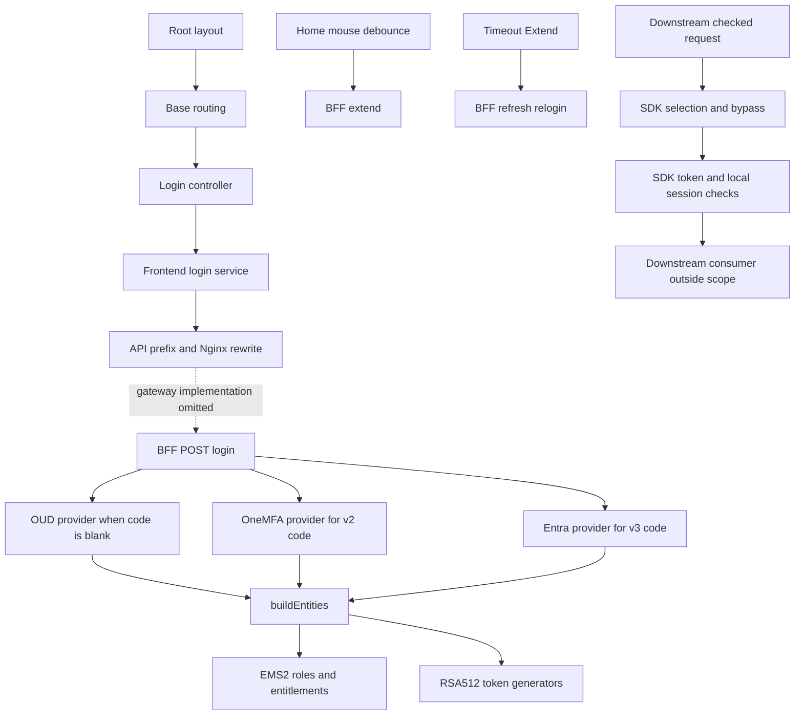

# Authentication runtime baseline

## Scope

This record describes inspected implementation at five initial repository revisions.
It separates implemented behavior, conditional effects, and unresolved policy.
Static source does not establish deployment or passing business execution.
The record has no human verification or publication approval.

| Repository identity | Exact revision |
| --- | --- |
| `mfe-root-config` | `83091d85beff5306ca0cd643955d8ea6ed0a2d93` |
| `mfe-base` | `99b4eda666bedf06574bc48766e4efdb339f4cc7` |
| `single-ui-bff` | `091c9d16c13f285a78463ff0235c21b152844b61` |
| `single-ui-auth-sdk` | `b0aa82005e7f14202f85f5ef583f25e42da9eeb3` |
| `ratan-test-engine` | `432f898f59fb06414bc14152d6e463a6a1f4eac2` |

Source links open retained snapshots.
For excerpts, link line numbers refer to snapshot lines.
Manifest records preserve original file ranges and hashes.
Later repository commits and the isolated frontend pilot are outside this baseline.

## Components

### Browser entry and application routing

Root configuration constructs applications from the single-spa layout and loads them through `System.import`.
The default layout selects `@fm/base`.
Its routing component renders Home when token and entities are truthy.
An empty entities array is truthy, so this condition does not establish permission.
See [root registration](../../raw/code/mfe-root-config/83091d85beff5306ca0cd643955d8ea6ed0a2d93/src/root.ts.snapshot#L10), [default application](../../raw/code/mfe-root-config/83091d85beff5306ca0cd643955d8ea6ed0a2d93/src/microfrontend-layout.html.snapshot#L1), and [Home selection](../../raw/code/mfe-base/99b4eda666bedf06574bc48766e4efdb339f4cc7/src/routing/index.tsx.snapshot#L11).

The routing controller validates a restored token before readiness.
A false validation result clears authentication storage.
LOCAL and DEV OpenFin mode accepts a bounded query token, stores it, and reloads after one second.
The next page load follows backend validation.
Input validation checks syntax, not token authenticity.
See [startup and OpenFin branches](../../raw/code/mfe-base/99b4eda666bedf06574bc48766e4efdb339f4cc7/src/routing/common/useController.ts.snapshot#L40) and [input bounds](../../raw/code/mfe-base/99b4eda666bedf06574bc48766e4efdb339f4cc7/src/auth/validation.ts.snapshot#L3).

### Provider selection and login

`getSSOLink` selects Entra or OneMFA through `ENABLE_ENTRA_SSO`.
The query key is case-sensitive.
Declared query values `true`, `1`, `yes`, and `y` enable the feature after lowercasing.
Other supplied values disable it.
The query override precedes environment defaults.
See [SSO selector](../../raw/code/mfe-base/99b4eda666bedf06574bc48766e4efdb339f4cc7/src/utils/common.ts.L117-L144.snapshot#L20) and [flag parser](../../raw/code/mfe-base/99b4eda666bedf06574bc48766e4efdb339f4cc7/src/utils/featureFlagController.ts.snapshot#L22).

The declared LOCAL, DEV, UAT, PRE-PROD, and PROD defaults enable Entra.
Unknown hosts map to PROD.
Mapped SIT and EKS environments are absent from the feature controller environment list.
Without query overrides, those two environments disable Entra.
See [declared defaults](../../raw/code/mfe-base/99b4eda666bedf06574bc48766e4efdb339f4cc7/src/utils/feature-flags.json.snapshot#L1), [host mapping](../../raw/code/mfe-base/99b4eda666bedf06574bc48766e4efdb339f4cc7/src/utils/common.ts.L117-L144.snapshot#L1), and [supported environments](../../raw/code/mfe-base/99b4eda666bedf06574bc48766e4efdb339f4cc7/src/utils/featureFlagController.ts.snapshot#L4).

Entra navigation requests an authorization code with callback `location.origin + /mfa/callback`.
The URL builder does not add state, nonce, or PKCE parameters.
It does not preserve the query feature override in the callback URL.
The callback controller reads `code`, `iss`, and `client_id`.
Code without `iss` or `client_id` selects the v3 API; other valid requests select v2.
See [Entra URL builder](../../raw/code/mfe-base/99b4eda666bedf06574bc48766e4efdb339f4cc7/src/utils/common.ts.L172-L177.snapshot#L1), [callback selection](../../raw/code/mfe-base/99b4eda666bedf06574bc48766e4efdb339f4cc7/src/pages/Login/common/useController.ts.snapshot#L21), and [login API methods](../../raw/code/mfe-base/99b4eda666bedf06574bc48766e4efdb339f4cc7/src/services/index.ts.L1-L44.snapshot#L15).

Credential validation trims username and preserves password whitespace.
Username accepts 1–256 characters; password accepts 1–4096 characters.
Code accepts 1–4096 characters, with optional URL issuer and bounded client ID.
These checks validate input shape.
PROD form hiding is a presentation condition, not a BFF restriction.
See [credential and code schemas](../../raw/code/mfe-base/99b4eda666bedf06574bc48766e4efdb339f4cc7/src/auth/validation.ts.snapshot#L10) and [credential form condition](../../raw/code/mfe-base/99b4eda666bedf06574bc48766e4efdb339f4cc7/src/pages/Login/common/useController.ts.snapshot#L78).

Both BFF login routes use OUD when code is blank.
The controller replaces the request hostname with servlet `serverName`.
OUD normally binds the supplied user DN and password, then reads configured directory attributes.
Matching configured hostname and username instead select service-credential attribute retrieval.
This branch bypasses the supplied-password bind.
See [v2 controller](../../raw/code/single-ui-bff/091c9d16c13f285a78463ff0235c21b152844b61/src/main/java/com/scb/sso/singleuibff/controller/v2/JwtAuthenticationController.java.snapshot#L154), [v3 controller](../../raw/code/single-ui-bff/091c9d16c13f285a78463ff0235c21b152844b61/src/main/java/com/scb/sso/singleuibff/controller/v2/JwtAuthenticationController.java.snapshot#L195), and [OUD provider](../../raw/code/single-ui-bff/091c9d16c13f285a78463ff0235c21b152844b61/src/main/java/com/scb/sso/singleuibff/service/v1/implementation/OUDAuthenticationService.java.snapshot#L31).

Effective allowlist membership is not retained or established.
`getUserInfo` catches directory errors and returns its accumulated map.
The controller can continue with that map and its username fallback.
Required directory attributes and environment restrictions need owner review.
See [service-credential retrieval](../../raw/code/single-ui-bff/091c9d16c13f285a78463ff0235c21b152844b61/src/main/java/com/scb/sso/singleuibff/service/v1/implementation/OUDAuthenticationService.java.snapshot#L73) and [attribute mapping](../../raw/code/single-ui-bff/091c9d16c13f285a78463ff0235c21b152844b61/src/main/java/com/scb/sso/singleuibff/util/OudUtil.java.snapshot#L27).

A v2 code login calls the deprecated `MFAAuthenticationService`.
It posts client ID, grant type, code, and configured redirect URI.
Its endpoint combines the request issuer with the configured access-token path.
It decodes the response identity token and uses its `name` claim as username.
See [OneMFA exchange](../../raw/code/single-ui-bff/091c9d16c13f285a78463ff0235c21b152844b61/src/main/java/com/scb/sso/singleuibff/service/v1/implementation/MFAAuthenticationService.java.snapshot#L39).

A v3 code login calls `EntraAuthenticationServiceImpl`.
It posts configured client ID, grant type, scope, redirect URI, assertion type, signed assertion, and received code.
It decodes the response identity token and uses `userId` as username.
Its profile contains user ID, names, email ID, locale, and country.

Neither provider implements local identity-token signature, issuer, audience, or nonce checks in these retained methods.
Upstream guarantees remain unknown.
See [Entra exchange](../../raw/code/single-ui-bff/091c9d16c13f285a78463ff0235c21b152844b61/src/main/java/com/scb/sso/singleuibff/service/v1/implementation/EntraAuthenticationServiceImpl.java.snapshot#L41) and [OneMFA decoding](../../raw/code/single-ui-bff/091c9d16c13f285a78463ff0235c21b152844b61/src/main/java/com/scb/sso/singleuibff/service/v1/implementation/MFAAuthenticationService.java.snapshot#L55).

The outgoing Entra assertion uses RSA256, a random JWT ID, and a certificate thumbprint.
Its issuer and subject are the client ID; its audience is the token endpoint.
Its lifetime is 300 seconds.
This authenticates the client request; it does not validate the returned identity token.
Proxy selection requires a nonblank configured host and positive port.
See [client assertion](../../raw/code/single-ui-bff/091c9d16c13f285a78463ff0235c21b152844b61/src/main/java/com/scb/sso/singleuibff/util/ClientAssertionGenUtil.java.snapshot#L31) and [Entra HTTP provider](../../raw/code/single-ui-bff/091c9d16c13f285a78463ff0235c21b152844b61/src/main/java/com/scb/sso/singleuibff/config/AuthConfig.java.snapshot#L102).

### Entitlements and issued tokens

`buildEntities` reads drawer rows through the category service and repository.
The query requires active categories, tiles, and import maps, ordered by category and tile sequence.
It derives requested EMS2 entities from those rows.
The EMS2 provider fetches roles, optionally filters entity names, and retrieves entitlements.
It groups subjects and actions by role before returning entities.
See [issuance orchestration](../../raw/code/single-ui-bff/091c9d16c13f285a78463ff0235c21b152844b61/src/main/java/com/scb/sso/singleuibff/controller/v2/JwtAuthenticationController.java.snapshot#L94), [active drawer query](../../raw/code/single-ui-bff/091c9d16c13f285a78463ff0235c21b152844b61/src/main/java/com/scb/sso/singleuibff/repository/ApplicationCategoryRepo.java.snapshot#L24), and [EMS2 provider](../../raw/code/single-ui-bff/091c9d16c13f285a78463ff0235c21b152844b61/src/main/java/com/scb/sso/singleuibff/service/v2/implementation/EMS2AuthorizationImplementation.java.snapshot#L34).

Drawer filtering permits template tiles without an entity match.
Other tiles require an entity match.
A blank tile subject skips subject checks; otherwise its name or long name must match.
The client renders returned drawers and restricts programmatic tile opening to those drawers.
These visibility checks do not prove downstream API permission enforcement.
See [drawer filtering](../../raw/code/single-ui-bff/091c9d16c13f285a78463ff0235c21b152844b61/src/main/java/com/scb/sso/singleuibff/util/AdminModuleUtil.java.snapshot#L97) and [programmatic tile selection](../../raw/code/mfe-base/99b4eda666bedf06574bc48766e4efdb339f4cc7/src/hooks/dispathcer/index.ts.L168-L213.snapshot#L1).

| Token | Issuer | Claims and lifetime from retained source |
| --- | --- | --- |
| Access | `single-ui-bff` | RSA512; subject, `oud`, session `id`, `iat`, `exp`, constant `jti`, initial `auth_time` and `max_age`. |
| Refresh | `single-ui-bff-refresh` | RSA512; subject, `oud`, `id`, `iat`, `exp`, constant `jti`; no `auth_time` or `max_age`. |
| Entitlement | `single-ui-bff-entitlement` | RSA512; subject and serialized `entity:role` → subject/actions; fixed 12-hour lifetime. |

All four retained configuration ranges specify access 15 minutes, refresh 225 minutes, and absolute 60 minutes.
Refresh generation adds another 24,000 milliseconds.
These settings describe repository files; runtime overrides remain unknown.
See [token generators](../../raw/code/single-ui-bff/091c9d16c13f285a78463ff0235c21b152844b61/src/main/java/com/scb/sso/singleuibff/util/JwtTokenUtil.java.snapshot#L48), [default lifetimes](../../raw/code/single-ui-bff/091c9d16c13f285a78463ff0235c21b152844b61/src/main/resources/application.yml.L73-L76.snapshot#L1), [DEV lifetimes](../../raw/code/single-ui-bff/091c9d16c13f285a78463ff0235c21b152844b61/src/main/resources/application-dev.yml.L79-L82.snapshot#L1), [PROD lifetimes](../../raw/code/single-ui-bff/091c9d16c13f285a78463ff0235c21b152844b61/src/main/resources/application-prod.yml.L420-L423.snapshot#L1), and [FMRP2 lifetimes](../../raw/code/single-ui-bff/091c9d16c13f285a78463ff0235c21b152844b61/src/main/resources/application-fmrp2.yml.L436-L439.snapshot#L1).

### Renewal and timeout behavior

BFF validation invokes the RSA512 verifier, then checks `max_age` when present.
An absent `max_age` skips that additional check.
Endpoint issuer checks are separate calls.
Session validation rejects blacklist membership.
No last-activity timestamp is stored by this session provider.
See [token validation](../../raw/code/single-ui-bff/091c9d16c13f285a78463ff0235c21b152844b61/src/main/java/com/scb/sso/singleuibff/util/JwtTokenUtil.java.snapshot#L87) and [blacklist validation](../../raw/code/single-ui-bff/091c9d16c13f285a78463ff0235c21b152844b61/src/main/java/com/scb/sso/singleuibff/service/v1/implementation/SessionServiceImplementation.java.snapshot#L27).

| Operation | Required input and checks | Resulting behavior |
| --- | --- | --- |
| `validate` | Access token in JSON; signature, access issuer, blacklist. | Calls `buildEntities`, resetting `auth_time` and `max_age`. Body retains old user information and expiration. |
| `extend` | Access token in JSON; signature, access issuer, blacklist. | Removes `exp` and `iat`, issues a new token, and normally preserves other claims. |
| Near-boundary `extend` | New expiration exceeds retained `max_age`. | Calls the initial-time generator and resets `auth_time` and `max_age`. |
| `refreshtoken` | Valid access token in JSON; access issuer and blacklist. | Issues a refresh token with `oud` and `id`. |
| `relogin` | Refresh header; signature, refresh issuer, blacklist. | Refreshes entitlements and issues access credentials with new `auth_time` and `max_age`. |

Relogin performs no OUD or external SSO challenge.
Its request body does not control requested entities.
The retained paths do not consume or rotate the submitted refresh token.
Repeated renewal therefore does not establish a fixed initial-login absolute deadline.
See [validate](../../raw/code/single-ui-bff/091c9d16c13f285a78463ff0235c21b152844b61/src/main/java/com/scb/sso/singleuibff/controller/v2/JwtAuthenticationController.java.snapshot#L245), [extend](../../raw/code/single-ui-bff/091c9d16c13f285a78463ff0235c21b152844b61/src/main/java/com/scb/sso/singleuibff/controller/v2/JwtAuthenticationController.java.snapshot#L275), [refresh issuance](../../raw/code/single-ui-bff/091c9d16c13f285a78463ff0235c21b152844b61/src/main/java/com/scb/sso/singleuibff/controller/v2/JwtAuthenticationController.java.snapshot#L303), and [refresh relogin](../../raw/code/single-ui-bff/091c9d16c13f285a78463ff0235c21b152844b61/src/main/java/com/scb/sso/singleuibff/controller/v2/JwtAuthenticationController.java.snapshot#L328).

Home schedules the prompt at access-token `exp`.
It requests a refresh token 25 seconds earlier.
Mouse movement debounces extension for five seconds.
Continuous movement postpones the debounce until movement stops.
Extension skips requests during logout or with fewer than 25 seconds remaining.
See [activity and expiry timers](../../raw/code/mfe-base/99b4eda666bedf06574bc48766e4efdb339f4cc7/src/pages/Home/common/useController.ts.L56-L102.snapshot#L1), [mouse handler](../../raw/code/mfe-base/99b4eda666bedf06574bc48766e4efdb339f4cc7/src/pages/Home/index.tsx.L87-L92.snapshot#L1), and [extension guard](../../raw/code/mfe-base/99b4eda666bedf06574bc48766e4efdb339f4cc7/src/hooks/service/util/extend.ts.snapshot#L8).

The timeout dialog waits for a refresh token before arming automatic logout.
When available, it schedules logout two seconds before refresh expiration.
Without a refresh token, this hook has no fallback logout timer.
Manual Extend calls relogin and then closes the prompt.
The relogin helper does not return its request promise, so that await does not wait for the response.
See [timeout hook](../../raw/code/mfe-base/99b4eda666bedf06574bc48766e4efdb339f4cc7/src/components/Timeout/common/useController.ts.snapshot#L29) and [relogin helper](../../raw/code/mfe-base/99b4eda666bedf06574bc48766e4efdb339f4cc7/src/hooks/service/index.ts.snapshot#L35).

The refresh helper also omits its request promise.
Relogin failures are logged.
The shared error handler clears authentication only when its message contains `TOKEN_INVALID_EXPIRED`.
A generic HTTP 401 or network error does not independently trigger that cleanup.
This baseline records the original asynchronous behavior, before the isolated pilot.
See [refresh helper](../../raw/code/mfe-base/99b4eda666bedf06574bc48766e4efdb339f4cc7/src/hooks/service/index.ts.snapshot#L16) and [error handling](../../raw/code/mfe-base/99b4eda666bedf06574bc48766e4efdb339f4cc7/src/hooks/service/util/error.response.handler.ts.snapshot#L6).

### Storage and logout boundaries

Login response handlers accept capitalized or lowercase authorization headers.
They store the access token and user profile in localStorage and sessionStorage.
Initial state restores access token and user profile from localStorage.
Refresh and entitlement tokens remain in memory in these handlers.
`SET_TOKEN` clears the current refresh token.
See [token storage](../../raw/code/mfe-base/99b4eda666bedf06574bc48766e4efdb339f4cc7/src/utils/login.ts.L15-L50.snapshot#L1), [response handling](../../raw/code/mfe-base/99b4eda666bedf06574bc48766e4efdb339f4cc7/src/utils/login.ts.L53-L109.snapshot#L1), [refresh handling](../../raw/code/mfe-base/99b4eda666bedf06574bc48766e4efdb339f4cc7/src/utils/login.ts.L111-L141.snapshot#L1), [dual storage](../../raw/code/mfe-base/99b4eda666bedf06574bc48766e4efdb339f4cc7/src/utils/common.ts.L18-L80.snapshot#L31), and [initial restoration](../../raw/code/mfe-base/99b4eda666bedf06574bc48766e4efdb339f4cc7/src/hooks/model/root.ts.L125-L158.snapshot#L9).

The browser decodes JWT payloads to derive expiration and issue-time timers.
This parser does not verify signatures.
The profile displays `auth_time` and expiration.
Frontend timing does not enforce an absolute deadline through `auth_time`.
Browser restart survival remains unexecuted.
See [payload decoder](../../raw/code/mfe-base/99b4eda666bedf06574bc48766e4efdb339f4cc7/src/utils/common.ts.L18-L80.snapshot#L22), [timer dispatch](../../raw/code/mfe-base/99b4eda666bedf06574bc48766e4efdb339f4cc7/src/utils/login.ts.L15-L50.snapshot#L14), and [profile timing derivation](../../raw/code/mfe-base/99b4eda666bedf06574bc48766e4efdb339f4cc7/src/components/Profile/index.tsx.L146-L182.snapshot#L1), and [profile timing display](../../raw/code/mfe-base/99b4eda666bedf06574bc48766e4efdb339f4cc7/src/components/Profile/index.tsx.L247-L288.snapshot#L1).

Browser logout starts portal and SSI logout requests, then clears local authentication immediately.
It does not return their promises.
`CLEAR` resets token, refresh token, user, and timing fields.
It leaves entities, drawers, entitlement token, and workspaces unchanged in these reducers.
The storage listener synchronizes theme only, so logout does not clear another tab's in-memory token through this listener.
See [logout requests](../../raw/code/mfe-base/99b4eda666bedf06574bc48766e4efdb339f4cc7/src/services/index.ts.L1-L44.snapshot#L19), [storage cleanup](../../raw/code/mfe-base/99b4eda666bedf06574bc48766e4efdb339f4cc7/src/utils/common.ts.L18-L80.snapshot#L56), [state cleanup](../../raw/code/mfe-base/99b4eda666bedf06574bc48766e4efdb339f4cc7/src/hooks/reducer/root0.reducers.ts.snapshot#L36), and [storage listener](../../raw/code/mfe-base/99b4eda666bedf06574bc48766e4efdb339f4cc7/src/routing/common/useController.ts.snapshot#L29).

BFF logout decodes a valid submitted JWT and inserts its session ID into the database blacklist.
It catches token extraction or persistence errors.
It then invalidates the servlet session, deletes `JSESSIONID`, clears the authorization response header, and returns success.
Its cookie deletion specifies `/`, HttpOnly, Secure, and SameSite Strict.
Response success does not prove blacklist persistence or identity-provider logout.
See [cookie deletion](../../raw/code/single-ui-bff/091c9d16c13f285a78463ff0235c21b152844b61/src/main/java/com/scb/sso/singleuibff/controller/v2/JwtAuthenticationController.java.snapshot#L144) and [BFF logout](../../raw/code/single-ui-bff/091c9d16c13f285a78463ff0235c21b152844b61/src/main/java/com/scb/sso/singleuibff/controller/v2/JwtAuthenticationController.java.snapshot#L358).

The session table stores a row ID, session ID, and creation time.
Login does not insert an active-session row or revoke an earlier user session.
The migration deletes blacklist rows older than 15 minutes after an insertion.
A retained refresh token could pass later checks after its blacklist row disappears.
That consequence requires this migration and the expected database search path.
See [session fields](../../raw/code/single-ui-bff/091c9d16c13f285a78463ff0235c21b152844b61/src/main/java/com/scb/sso/singleuibff/entity/ApplicationSession.java.snapshot#L16), [blacklist lookup](../../raw/code/single-ui-bff/091c9d16c13f285a78463ff0235c21b152844b61/src/main/java/com/scb/sso/singleuibff/repository/ApplicationSessionRepo.java.snapshot#L13), and [cleanup trigger](../../raw/code/single-ui-bff/091c9d16c13f285a78463ff0235c21b152844b61/src/main/resources/db/migration/V1_0_2__fmo_schema_config.sql.snapshot#L25).

### Downstream SDK boundary

Spring registration resources declare JWT and authentication configuration.
Authentication configuration creates the filter when `fmoportal.auth.enabled` is true or absent.
It gives each filter a new `CopyOnWriteArrayList` for session revocations.
Actual downstream registration and filter order remain unknown.
See [Spring registration](../../raw/code/single-ui-auth-sdk/b0aa82005e7f14202f85f5ef583f25e42da9eeb3/single-ui-sdk-starter/src/main/resources/META-INF/spring/org.springframework.boot.autoconfigure.AutoConfiguration.imports.snapshot#L1) and [filter construction](../../raw/code/single-ui-auth-sdk/b0aa82005e7f14202f85f5ef583f25e42da9eeb3/single-ui-sdk-starter/src/main/java/com/scb/fmoportal/auth/config/AuthConfiguration.java.snapshot#L19).

`doFilterInternal` checks configured bypass headers before URL selection.
Any nonempty configured header value bypasses JWT checks, without value comparison.
Exclude patterns take precedence over include patterns.
Empty includes check every remaining URI; unmatched includes pass through.
Ingress removal and trusted header sources remain unknown.
See [selection and bypass](../../raw/code/single-ui-auth-sdk/b0aa82005e7f14202f85f5ef583f25e42da9eeb3/single-ui-sdk-starter/src/main/java/com/scb/fmoportal/auth/filter/AuthTokenFilter.java.snapshot#L35).

Selected requests read `Single-UI-Authorization` and split on the case-sensitive literal `Bearer `.
The utility invokes the RSA512 verifier and requires issuer `single-ui-bff`, ignoring issuer case.
It rejects an expired `max_age` only when that claim exists.
It declares no audience or `auth_time` assertion.
Standard JWT temporal behavior is delegated to the unexecuted library.
See [checked request](../../raw/code/single-ui-auth-sdk/b0aa82005e7f14202f85f5ef583f25e42da9eeb3/single-ui-sdk-starter/src/main/java/com/scb/fmoportal/auth/filter/AuthTokenFilter.java.snapshot#L83) and [SDK verifier](../../raw/code/single-ui-auth-sdk/b0aa82005e7f14202f85f5ef583f25e42da9eeb3/single-ui-sdk-starter/src/main/java/com/scb/fmoportal/auth/util/JwtTokenUtil.java.snapshot#L27).

The filter checks local blacklist membership only when payload `id` exists.
A checked URI ending in `logout` adds that ID and access-token expiration to the local list.
Matching IDs are rejected on later requests to that filter instance.
No retained SDK path propagates BFF revocations or shares storage across instances.
This does not establish whole-system logout revocation.
See [session branch](../../raw/code/single-ui-auth-sdk/b0aa82005e7f14202f85f5ef583f25e42da9eeb3/single-ui-sdk-starter/src/main/java/com/scb/fmoportal/auth/filter/AuthTokenFilter.java.snapshot#L88) and [local revocation](../../raw/code/single-ui-auth-sdk/b0aa82005e7f14202f85f5ef583f25e42da9eeb3/single-ui-sdk-starter/src/main/java/com/scb/fmoportal/auth/util/JwtTokenUtil.java.snapshot#L82).

Successful checks set a JSON servlet request attribute named `userInfo`.
It contains available session ID, entitlements, OUD, user ID, and version `3`.
Caught filter errors return HTTP 401 and stop the chain.
The filter exposes identity claims; it does not enforce entity, subject, or action permissions.
See [claims and error branches](../../raw/code/single-ui-auth-sdk/b0aa82005e7f14202f85f5ef583f25e42da9eeb3/single-ui-sdk-starter/src/main/java/com/scb/fmoportal/auth/filter/AuthTokenFilter.java.snapshot#L88).

The SDK entitlement service fetches EMS2 roles and entitlements, then builds entity-role maps of subjects and actions.
Its configured entity list filters exact names.
Exceptions return an empty map.

Its entitlement-token utility checks signature and entitlement issuer, then returns the entitlement claim or null.
The retained filter does not call that utility.
Downstream permission consumers remain outside this baseline.
See [entitlement provider](../../raw/code/single-ui-auth-sdk/b0aa82005e7f14202f85f5ef583f25e42da9eeb3/single-ui-sdk-starter/src/main/java/com/scb/fmoportal/auth/services/implementation/AuthorizationImpl.java.snapshot#L29), [service interface](../../raw/code/single-ui-auth-sdk/b0aa82005e7f14202f85f5ef583f25e42da9eeb3/single-ui-sdk-starter/src/main/java/com/scb/fmoportal/auth/services/AuthorizationService.java.snapshot#L5), and [entitlement-token utility](../../raw/code/single-ui-auth-sdk/b0aa82005e7f14202f85f5ef583f25e42da9eeb3/single-ui-sdk-starter/src/main/java/com/scb/fmoportal/auth/util/JwtTokenUtil.java.snapshot#L63).

## Interfaces

Frontend login methods use `/api/auth/v2/sso/login` and `/api/auth/v3/sso/login` through the shared endpoint helper.
Retained Nginx configuration removes `/api/auth` and forwards to a gateway.
BFF POST mappings match the resulting v2 and v3 paths.
The gateway implementation and deployed routing are outside the retained evidence.
See [API prefix](../../raw/code/mfe-base/99b4eda666bedf06574bc48766e4efdb339f4cc7/src/hooks/service/util/getEndpoint.ts.snapshot#L1), [Nginx forwarding](../../raw/code/mfe-root-config/83091d85beff5306ca0cd643955d8ea6ed0a2d93/nginx/mfe.conf.L784-L795.snapshot#L1), and [BFF mappings](../../raw/code/single-ui-bff/091c9d16c13f285a78463ff0235c21b152844b61/src/main/java/com/scb/sso/singleuibff/controller/v2/JwtAuthenticationController.java.snapshot#L154).

The browser callback is navigation to `/mfa/callback`, followed by an API POST.
The retained static server falls back to `index.html` and preserves query arguments.
This is separate from the BFF POST code exchange.
Frontend origin-derived redirect and BFF configured redirect equality remain unconfirmed.
See [static fallback](../../raw/code/mfe-root-config/83091d85beff5306ca0cd643955d8ea6ed0a2d93/nginx/mfe.conf.L1054-L1073.snapshot#L12), [callback consumption](../../raw/code/mfe-base/99b4eda666bedf06574bc48766e4efdb339f4cc7/src/pages/Login/common/useController.ts.snapshot#L21), and [configured redirect exchange](../../raw/code/single-ui-bff/091c9d16c13f285a78463ff0235c21b152844b61/src/main/java/com/scb/sso/singleuibff/service/v1/implementation/EntraAuthenticationServiceImpl.java.snapshot#L45).

| Interface | Carrier | Consumer and condition |
| --- | --- | --- |
| Access token | `Single-UI-Authorization: Bearer ...` | Ordinary business requests and auth-admin requests receive the stored token. |
| Access token for auth operations | JSON `singleUIAuthorization` | Validate, extend, refresh issuance, and portal logout explicitly pass it. |
| Refresh token | `Single-UI-Refresh: Bearer ...` | Relogin receives the in-memory refresh token. |
| Entitlement token | Response body `entitlementsToken` | Frontend stores and decodes it for profile data. Specific API enforcement requires consumer evidence. |
| User ID | Request `userId` header | Shared request interceptor copies the stored user ID. This declaration does not prove authentication. |
| SDK claims | Servlet request attribute `userInfo` | Available after a selected request passes SDK checks. |

The interceptor excludes auth, analytics, and SSE paths from ordinary authorization attachment.
Auth-admin routes receive access authorization through a separate branch.
It does not automatically extend a session for ordinary requests.
See [request headers](../../raw/code/mfe-base/99b4eda666bedf06574bc48766e4efdb339f4cc7/src/hooks/service/util/success.request.handler.ts.snapshot#L17) and [auth response consumers](../../raw/code/mfe-base/99b4eda666bedf06574bc48766e4efdb339f4cc7/src/hooks/service/util/succes.response.handler.ts.snapshot#L14).

The source call paths are separate from unproved deployment connections.

## Dependencies

OUD, OneMFA, Entra, EMS2, PostgreSQL, the gateway, and downstream services are external dependencies.
The BFF wires provider services and HTTP clients through `AuthConfig`.
The private service starter dependency is declared in its POM.
Its implementation was unavailable for this inspection.
Therefore, repository response-header filtering does not describe the complete security chain.
See [provider wiring](../../raw/code/single-ui-bff/091c9d16c13f285a78463ff0235c21b152844b61/src/main/java/com/scb/sso/singleuibff/config/AuthConfig.java.snapshot#L83), [private starter dependency](../../raw/code/single-ui-bff/091c9d16c13f285a78463ff0235c21b152844b61/pom.xml.snapshot#L40), and [local response filter](../../raw/code/single-ui-bff/091c9d16c13f285a78463ff0235c21b152844b61/src/main/java/com/scb/sso/singleuibff/filter/RequestFilter.java.snapshot#L13).

The SDK declares an entitlement service separately from its JWT filter.
Its retained property excerpts show include, exclude, bypass-header, and entity-list fields.
HTTP timeout defaults are 10 seconds for connection and 30 seconds for reading.
These declarations do not establish configured consumers or deployed endpoints.
See [SDK service wiring](../../raw/code/single-ui-auth-sdk/b0aa82005e7f14202f85f5ef583f25e42da9eeb3/single-ui-sdk-starter/src/main/java/com/scb/fmoportal/auth/config/AuthConfiguration.java.snapshot#L39), [selection properties](../../raw/code/single-ui-auth-sdk/b0aa82005e7f14202f85f5ef583f25e42da9eeb3/single-ui-sdk-starter/src/main/java/com/scb/fmoportal/auth/properties/AuthProperties.java.L10-L16.snapshot#L1), and [HTTP defaults](../../raw/code/single-ui-auth-sdk/b0aa82005e7f14202f85f5ef583f25e42da9eeb3/single-ui-sdk-starter/src/main/java/com/scb/fmoportal/auth/properties/AuthProperties.java.L24-L30.snapshot#L1).

## Decisions

This record accepts no new business policy.
The existing documentary topics remain historical input:
[authentication and sessions](../security/KT-authentication-and-sessions.md) and [SDK and entitlements](../security/KT-sdk-and-entitlements.md).
The [active-session renewal pilot](../requirements/REQ-active-session-renewal.md) records requested implementation intent.
It does not approve a session lifetime, security exception, or publication.

| Review topic | Source consequence | Owner | Next action |
| --- | --- | --- | --- |
| Absolute deadline | Validate, near-boundary extend, and relogin can reset the deadline. | unknown | Review the requested renewable policy and its pilot criteria. |
| Refresh duration | Source specifies 225 minutes plus 24 seconds. | unknown | Confirm intended duration and additional seconds. |
| Logout revocation | Refresh credentials can outlive a blacklist entry after cleanup. | unknown | Confirm revocation lifetime and cross-service requirements. |
| Identity-provider trust | Retained exchange methods decode identity tokens without local verification. | unknown | Identify the required validation owner and callback protections. |
| Authentication exceptions | OUD allowlists and SDK bypass headers can skip checks under specific conditions. | unknown | Define permitted conditions and trust boundaries. |
| Permission enforcement | SDK filter exposes claims without enforcing actions. | unknown | Supply or identify the owning downstream permission implementation. |
| Renewal promise | Original timeout closes before relogin completes. | unknown | Assess the isolated frontend pilot and its bounded regression evidence. |

## Evidence limits

### Assertions and execution

Retained frontend tests assert feature-flag parsing and bounded input validation.
Timeout tests assert delayed refresh handling and the eight-second logout boundary for a ten-second remaining lifetime.
Their service and clock collaborators are mocked.
They do not establish live timing or successful refresh relogin.
See [flag assertions](../../raw/code/mfe-base/99b4eda666bedf06574bc48766e4efdb339f4cc7/src/utils/featureFlagController.test.ts.snapshot#L19), [input assertions](../../raw/code/mfe-base/99b4eda666bedf06574bc48766e4efdb339f4cc7/src/auth/validation.test.ts.L15-L19.snapshot#L1), and [timeout setup](../../raw/code/mfe-base/99b4eda666bedf06574bc48766e4efdb339f4cc7/src/components/Timeout/common/useController.test.tsx.L1-L59.snapshot#L1), and [timeout assertions](../../raw/code/mfe-base/99b4eda666bedf06574bc48766e4efdb339f4cc7/src/components/Timeout/common/useController.test.tsx.L61-L77.snapshot#L1).

Retained BFF assertions check OUD versus Entra collaborator selection and expected response outcomes.
Controller tests mock the token utility and session service.
Boundary extension assertions compare a mocked response expiration, without asserting preserved deadline claims.
Session tests distinguish present and absent blacklist rows.
Create tests contain constant-success assertions, so they do not establish persisted revocation.
See [OUD branch assertion](../../raw/code/single-ui-bff/091c9d16c13f285a78463ff0235c21b152844b61/src/test/java/com/scb/sso/singleuibff/controller/v2/JwtAuthenticationControllerEntraTest.java.L114-L115.snapshot#L1), [Entra branch assertion](../../raw/code/single-ui-bff/091c9d16c13f285a78463ff0235c21b152844b61/src/test/java/com/scb/sso/singleuibff/controller/v2/JwtAuthenticationControllerEntraTest.java.L135-L136.snapshot#L1), [mocked collaborators](../../raw/code/single-ui-bff/091c9d16c13f285a78463ff0235c21b152844b61/src/test/java/com/scb/sso/singleuibff/controller/v2/JwtAuthenticationControllerTest.java.L66-L85.snapshot#L1), [boundary response assertion](../../raw/code/single-ui-bff/091c9d16c13f285a78463ff0235c21b152844b61/src/test/java/com/scb/sso/singleuibff/controller/v2/JwtAuthenticationControllerTest.java.L739-L741.snapshot#L1), [present blacklist setup](../../raw/code/single-ui-bff/091c9d16c13f285a78463ff0235c21b152844b61/src/test/java/com/scb/sso/singleuibff/service/v1/SessionServiceImplementationTest.java.L55-L55.snapshot#L1), [present blacklist outcome](../../raw/code/single-ui-bff/091c9d16c13f285a78463ff0235c21b152844b61/src/test/java/com/scb/sso/singleuibff/service/v1/SessionServiceImplementationTest.java.L59-L63.snapshot#L1), [absent blacklist invocation](../../raw/code/single-ui-bff/091c9d16c13f285a78463ff0235c21b152844b61/src/test/java/com/scb/sso/singleuibff/service/v1/SessionServiceImplementationTest.java.L68-L72.snapshot#L1), [absent blacklist outcome](../../raw/code/single-ui-bff/091c9d16c13f285a78463ff0235c21b152844b61/src/test/java/com/scb/sso/singleuibff/service/v1/SessionServiceImplementationTest.java.L72-L72.snapshot#L1), and [constant create assertion](../../raw/code/single-ui-bff/091c9d16c13f285a78463ff0235c21b152844b61/src/test/java/com/scb/sso/singleuibff/service/v1/SessionServiceImplementationTest.java.L38-L38.snapshot#L1).

The Robot credential helper expects HTTP 200, a successful result, and an authorization response header.
The UI logout case checks that Sign In appears.
The UI extension helper waits up to 960 seconds, clicks Extend, and checks LIVE.
That timeout is an upper waiting limit; it does not assert a 15-minute lower bound.
See [credential helper](../../raw/code/ratan-test-engine/432f898f59fb06414bc14152d6e463a6a1f4eac2/Resources/keywords/commonBiz.resource.L112-L153.snapshot#L1), [logout scenario](../../raw/code/ratan-test-engine/432f898f59fb06414bc14152d6e463a6a1f4eac2/Tests/ratan/workspace/ui/BAU-UI-RP.robot.L35-L57.snapshot#L1), [waiting limit](../../raw/code/ratan-test-engine/432f898f59fb06414bc14152d6e463a6a1f4eac2/Tests/ratan/workspace/ui/BAU-UI-RP.robot.L6-L12.snapshot#L7), and [extension helper](../../raw/code/ratan-test-engine/432f898f59fb06414bc14152d6e463a6a1f4eac2/Tests/ratan/workspace/ui/BAU-UI-RP.robot.L185-L204.snapshot#L14).

FX replay cases assert HTTP 403 and `ACTION_DENIED` for configured role tokens.
These assertions concern specific downstream endpoints.
They do not identify the enforcing SDK or prove all permission mappings.
Workflow source expects HTTP 503 for `token_expired`; its construction is outside the retained evidence.
See [role denial assertions](../../raw/code/ratan-test-engine/432f898f59fb06414bc14152d6e463a6a1f4eac2/Tests/ratan/workspace/api/TR-API-FxReplicationRazorV1.robot.L85-L113.snapshot#L1) and [workflow token input](../../raw/code/ratan-test-engine/432f898f59fb06414bc14152d6e463a6a1f4eac2/Tests/ratan/workspace/api/WORKFLOW-API-WorkFlowVersionControl.robot.L878-L917.snapshot#L26).

The Robot browser helper can reuse saved storage state younger than 600 seconds when enabled.
This is test-harness behavior, not product browser-restart policy.
No matching authentication or session execution is retained in this baseline.
No business build, suite, or network request was executed for this inspection.
See [harness storage reuse](../../raw/code/ratan-test-engine/432f898f59fb06414bc14152d6e463a6a1f4eac2/Resources/keywords/playwright.resource.L93-L142.snapshot#L18).

### Uncaptured boundaries

Full environment configuration, allowlist identities, signing keys, and encoded identity fixtures are intentionally excluded.
Only four BFF lifetime configuration ranges are retained.
Actual deployment, gateway filters, effective SDK consumers, and upstream identity guarantees remain unknown.
Search-based absence claims apply only to the supplied revisions and inspected paths.
They cannot exclude behavior in unavailable dependencies or downstream services.

Database migration deployment and unqualified table search paths remain unconfirmed.
Frontend callback redirect and BFF exchange redirect equality remains unconfirmed.
SDK local revocation does not prove BFF or multi-instance revocation.
Client storage and timer code do not establish browser restart or scheduling results.
The separate pilot must retain its own revision, assertions, and execution evidence.
