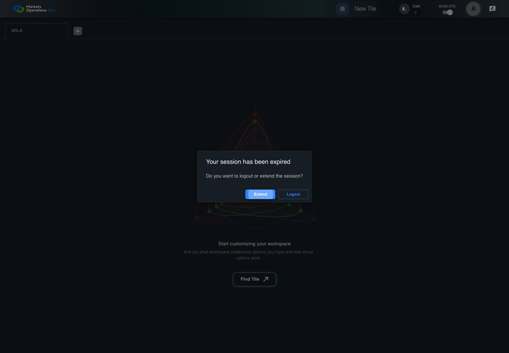
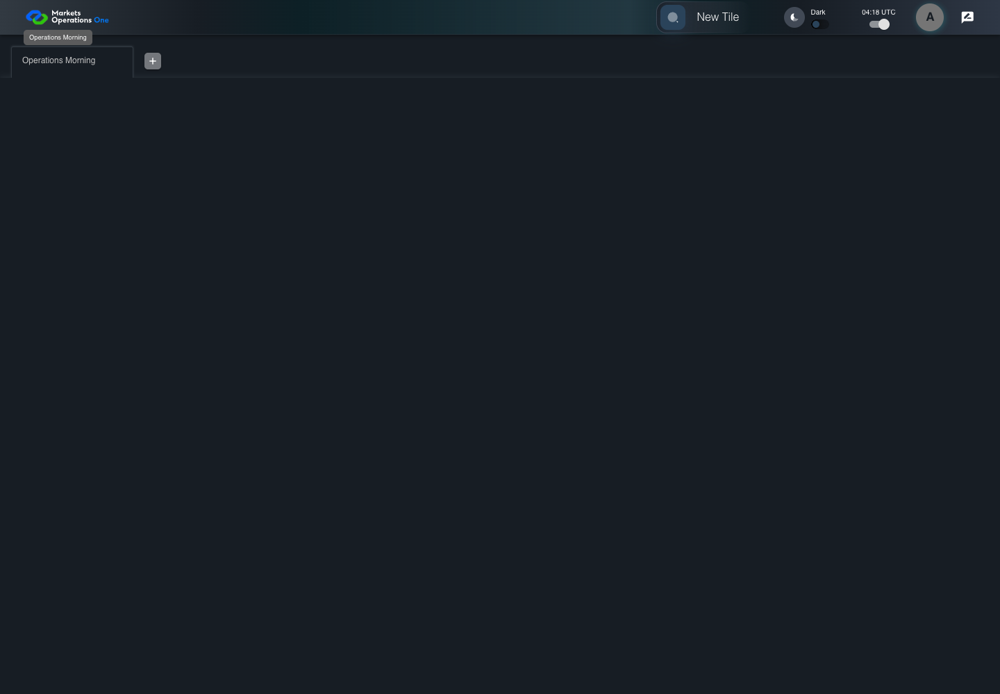
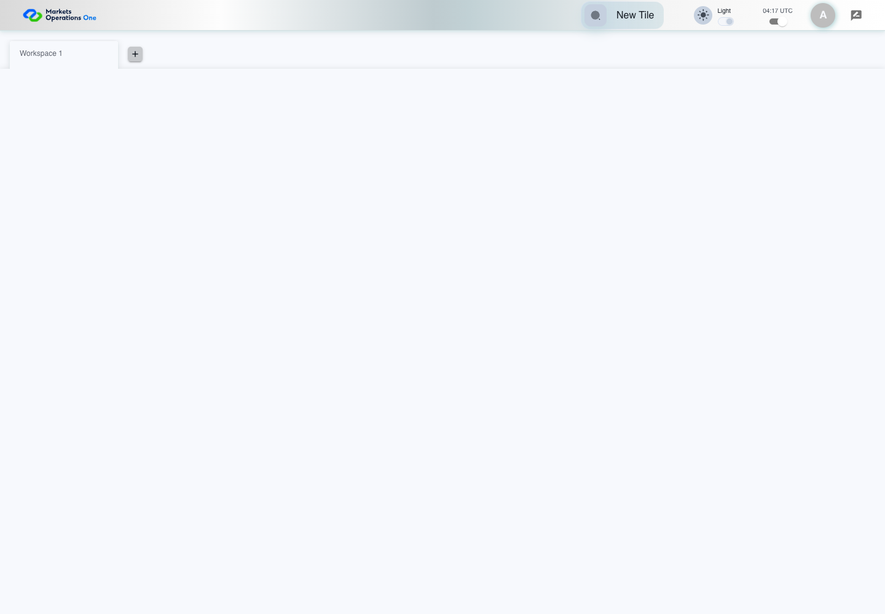

---
writing_review:
  standard: ASD-STE100
  automated_check: PASSED
  asd_review: PENDING
  reviewer: null
  reviewed_at: null
  limitations:
    - Automated checks do not check the complete approved dictionary or grammar rules.
---

# Local UI audit results

**455 cases remain blocked. The test owner must complete their bindings and required fixtures before full execution.**
**Owner: unknown. Consequence: Full business acceptance remains unsupported. Evidence: [complete case ledger](report-001/case-results.csv).**

The isolated local application ran 66 distinct cases with passing UI predicates.
All 24 synthetic POM checks also passed.
The audit retained 367 named screenshots and 113 traces across all attempts.
Failed attempts remain available with their source snapshots and corrections.

Open the [interactive screenshot gallery](report-001/index.html) for every case, result, frame, and trace.
Use the [CSV ledger](report-001/case-results.csv) or [JSON ledger](report-001/case-results.json) for audit reconciliation.
The [summary](report-001/audit-summary.json) provides exact counts, hashes, source inputs, and run identities.

| Scope | Latest case results | Named screenshots | Trace files | Claim limit |
| --- | --- | --- | --- | --- |
| Actual frontend with controlled services | 66 PASS; 455 BLOCKED_NOT_EXECUTED | 274 across 89 attempts | 89 | Local UI predicates only. |
| Synthetic POM harness | 24 PASS | 93 across 24 attempts | 24 | Harness mechanics only. |
| Full business acceptance | 0 established | Not applicable | Not applicable | Identity, BFF parity, policies, and complete bindings remain unresolved. |

## Execution scope

The user selected the isolated local application.
The [stage record](../../execution-stage.md) records this authorization and phase readiness.
The [canonical catalog](../../test-cases.md#coverage-navigation) remains the definition source.
The [frozen preflight](inventory/preflight.md) preserves the original binding and quality states.
The new ledger records subsequent local execution separately.

The 66 cases cover login, errors, callbacks, names, workspaces, preferences, and session timers.
The case gallery links each case to its exact definition.
Each attempt includes executable assertion steps, fixture identity, source hashes, and retained artifacts.
Each frame records capture time, phase, method, claim, step reference, URL, viewport, and SHA-256.
The reporter saved each completed attempt immediately.

The 274 application screenshots include failed attempts.
Each completed application attempt retained at least one named screenshot.
The source-only harness check has no UI screenshot.
Its evidence marks that boundary explicitly.
Screenshots establish visible state only.
Request, storage, credential equality, and timing claims use retained assertions and observations.

## Environment limits

All 223 frontend implementation files match the selected current source.
Two test files differ in the prepared frontend copy.
The [source comparison](environment/mfe-source-comparison.json) records every compared file.
The [environment report](environment/README.md) describes build transformations and local substitutes.

The prepared BFF differs from the current canonical revision by 62 files.
Controlled login, callback, validation, and refresh responses substitute for identity services in these checks.
These results do not establish current BFF acceptance, real permissions, downstream authorization, or deployment parity.
The [configuration snapshot](environment/attempt-02/stack-config.json.snapshot) binds the executed local stack.
The [lifecycle record](environment/attempt-02/stack-lifecycle.json) records startup, readiness, and shutdown.
Only owned audit services were stopped.

Session and clock cases use declared Playwright time controls.
Refresh cutoff cases skip repeating timer callbacks during their long clock jump.
They retain the actual cutoff callback and exact controlled timestamp assertions.
Natural inactivity, browser sleep, freezing, and UAT timing remain unverified.

## Failed attempts and corrections

The audit preserved 23 failed application attempts.
These attempts exposed test setup and binding problems.
Their latest corrected attempts passed.
No application source changed during these corrections.

| Failed scope | Observation | Correction and retained evidence |
| --- | --- | --- |
| Emulated hostnames | Chromium blocked remote-origin requests into loopback. | Fetch local resources through the declared route proxy. See [diagnosis](environment/proxy-diagnosis.json). |
| Notification assertions | Nested source alerts made broad role locators ambiguous. | Select the unique source notification content. See [prior callback source](application/run-002/source-snapshots/callback-profile.spec.ts). |
| Workspace reloads | Unsigned fixture credentials reached the real BFF validation endpoint. | Configure the declared accepted validation fixture. See [reload diagnosis](application/run-004/source-snapshots/workspace-reload-diagnosis.json). |
| Refresh cutoff checks | Repeating dialog timers exhausted the test timeout. | Use the declared clock jump for the cutoff. See [correction record](application/run-005/source-snapshots/session-timing-correction-result.json). |

The [run summary](report-001/audit-summary.json) retains original runner statuses.
The latest case ledger does not erase historical failures.
A test binding failure alone does not establish an application defect.

## Blocked cases

The ledger accounts for all 521 canonical cases exactly once.
It marks 455 cases BLOCKED_NOT_EXECUTED.
Their pages contain the original case, assertion count, frame plan, binding state, and blocking reason.
No screenshots were fabricated for those cases.

The 455 include 28 cases with failed canonical UI quality gates.
Other cases lack complete executable workflows or their required fixtures.
Real identity, administration services, registered fixture panels, and unresolved policy expectations limit wider execution.
The [preflight](inventory/case-preflight.jsonl) preserves each case's specific gaps.
The test owner remains unknown.
The next action is to resolve those gaps before claiming full execution.

## Essential frame examples

[AUTH-078 definition](../../test-cases.md#auth-078). Session expiry presents the Extend and Logout decision.

[UI-SHL-009 definition](../../test-cases.md#ui-shl-009). Workspace rename shows the exact saved value and tooltip.

[UI-PREF-001 definition](../../test-cases.md#ui-pref-001). The theme control shows the selected light appearance.

## Validation and retention

TypeScript checks passed.
All 42 static UI contracts and canonical traceability checks passed.
Workspace validation returned VALID with no findings.
The gallery generator checked retained artifact hashes and case uniqueness.
Visual review and gallery checks appear in the [gallery validation](validation/report-001-validation.json).
Final document checks appear in the [validation receipt](validation.json).

Per-case copies retain screenshots, traces, errors, and manifests.
Runner output directories contain duplicate local copies.
The audit-specific ignore file excludes those duplicate directories from Git.
Their retained per-case copies preserve unchanged bytes and hashes.
Scoped Git attributes preserve raw error whitespace and the CSV line endings.
The report retains pending ASD writing review separately from automated checks.
