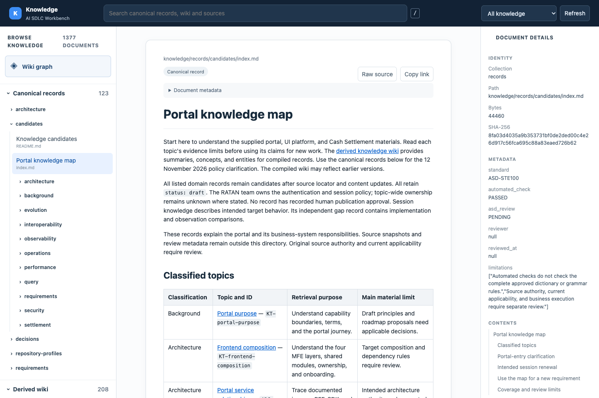
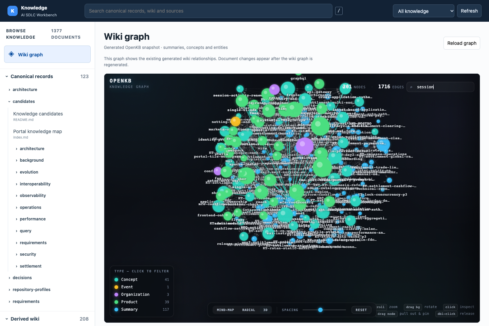
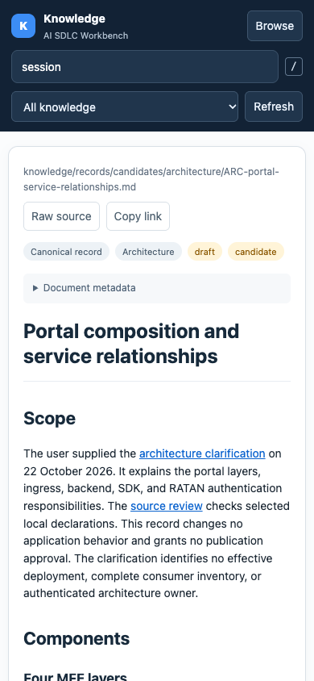

# Knowledge web reader maintenance

> **No critical conclusions require user attention or action.**
>
> The local reader refinement is implemented and checked.
> Source-format and platform limits remain explicit below.

Date: 17 November 2026.
Updated: 19 November 2026.
Scope: Workbench maintenance; local knowledge browsing and existing wiki graph integration.
Status: Implemented and locally verified. Shared hosting and publication are outside this scope.

## Current refinement outcome

The [19 November request](#knowledge-web-service-refinement-19-november-2026) supersedes the earlier collection scope.
The reader now exposes only approved content under `knowledge/`.
It excludes audit events, wiki logs, processing receipts, incoming exports, task snapshots, and project documentation.
Page reads create no retained action records or audit files.
Existing canonical sources, wiki content, graph bytes, and governance history remain unchanged.

Canonical navigation follows actual record folders and classifications.
Wiki navigation retains its authored index, summaries, concepts, entities, and explorations.
The reader displays actual type, version, status, governance state, and source metadata.
Relative links, native wikilinks, heading fragments, source-line citations, and validated canonical aliases resolve through the catalog.

The bundled Marked renderer preserves nested lists, complete tables, fenced code, and heading structure.
Empty authored anchors remain usable. General source HTML is escaped, and unsupported URL schemes remain inert.
The graph view embeds the existing OpenKB viewer without changing its renderer or regenerating knowledge.
Its sandbox blocks access to the parent reader. Its content policy excludes external asset requests.
The inspected graph contains 201 nodes and 1,716 edges.

### Verification and evidence

The [check summary](evidence/web-refinement-20261119/checks.json) binds commands, outcomes, source hashes, and environment details.

Applicable unit inventory: 1,113 core unit tests, including ten knowledge-reader tests.
The complete discovery command ran 1,115 tests: 1,113 passed, two optional connector integration tests skipped.
The skipped integrations require `WORKBENCH_CONNECTOR_INTEGRATION=1` and do not exercise changed reader interfaces.
There were no failures, errors, or expected failures.
Runtime: macOS arm64, Python 3.14.5; suite duration: 96.788 seconds.

```sh
PYTHONPATH=. .venv/bin/python -m unittest discover -s tests -v
.venv/bin/python -m pip wheel . --no-deps --no-build-isolation --wheel-dir dist
```

The wheel build passed and includes the renderer bundle and its MIT license.
The [isolated installation check](evidence/web-refinement-20261119/package-check.json) passed outside this checkout.
Seven installed HTTP routes responded successfully. A fresh workspace validated as `VALID`.
Generated workspaces retain guides, skills, schemas, and templates without Python runtime source.
The initial probe incorrectly rejected the entire `core/` guide directory; the retained result explains its correction.

Five [browser cases](evidence/web-refinement-20261119/run-2/results.json) passed against the final local service.
They cover scope, authored navigation, native links, source aliases, Markdown structure, unsafe content, graph isolation, and mobile browsing.
The format case uses a synthetic API document. Other cases read the actual workspace.
No browser page errors or external asset requests occurred.
The [retained probe](evidence/web-refinement-20261119/probe.mjs) records assertion outcomes and source hashes after each case.
Independent inspection also checked containment, rendering, and graph restrictions.

Visual review found an overlapping mobile header after the [initial passing assertions](evidence/web-refinement-20261119/run-1/results.json).
The [initial screenshot](evidence/web-refinement-20261119/run-1/mobile.png) retains that limitation.
The corrected layout and an explicit non-overlap assertion passed in the final run.







### Current documentation and limits

Updated [setup](../../docs/SETUP.md#local-knowledge-web-reader), [dependencies](../../docs/DEPENDENCIES.md#browser-assets-and-documentation), and [lifecycle guidance](../../docs/KNOWLEDGE_LIFECYCLE.md#three-connected-lifecycles).
Updated the [root guide](../../README.md) and [architecture knowledge section](../../ARCHITECTURE.md#knowledge).
No installer prerequisite changed. Existing wheel and offline-bundle paths carry the bundled browser assets.
Browser startup downloads no packages and needs no Node installation or model credentials.

Images remain unavailable placeholders; Mermaid fences remain source code.
Source exports cannot reconstruct missing attachments or exact original Confluence styling.
The internal wiki source manifest includes processing history and is excluded from browsable documents.
Its authored links report an unavailable destination; native canonical source aliases remain usable.
Graph freshness still requires the existing wiki workflow. Displayed relationships remain a generated snapshot.
Native Windows, other browser engines, and shared hosting were not tested.
Formal ASD writing review remains pending.

## Exact user input

### Knowledge web service refinement, 19 November 2026

Source: User message in the current Codex session, 19 November 2026.

The JSON string preserves the message's newlines and trailing space.

```json
"knowledge web service\n\n\n\n1. don't need audit logs\n2. only focus on knowledge folder\n3. for canonical knowledges and wikis, follows proper construction.\n4. integrate wiki graph into web "
```

This request authorizes the existing reader refinement and wiki graph integration.
Limit browsing and search to `knowledge/`. Exclude audit logs from the web service.
Preserve canonical record and native wiki structures, metadata, and links.
Keep retained source bytes and governance history unchanged.
Base revision: `d460e4ed80a0694e2ee2fb2ad2b4ef5fa0105c49`.
Existing unrelated changes: deleted `core/connectors/yarn.lock`, untracked `core/release-report/`, and untracked processing-resume task.
Affected consumers: knowledge reader, catalog routes, CLI help, package assets, and reader tests.
Risk: moderate for file containment, document rendering, native navigation, and graph links.
Current documentation to reconcile: setup, dependencies, and knowledge lifecycle guidance.
Status: implementation and local verification completed; see [current outcome](#current-refinement-outcome).

### Original investigation request

Source: User message in the current Codex session, 17 November 2026.

> Please build a web service for this project's knowledge base so I can spin up a web UI to browse everything, cleanly organized to match the structure, format, and layout of the source documentation.
>
> Take a closer look at the current structure, format, features, and outputs, and let's discuss how you want to implement this. Don't write the code directly yet.

### User scope answers

Source: User replies to the current session's questions, 17 November 2026.

| Question | Exact answer |
| --- | --- |
| Who should access the first version? I’m planning around a service you start from the workspace. | Local browser on my machine (recommended) |
| For “browse everything,” which initial scope do you want? | Knowledge, wiki, and linked docs/evidence (recommended) |

These answers confirm local hosting and collection scope. They do not authorize coding.

### Architecture explanation follow-up

Source: User message in the current Codex session, 17 November 2026.

> explain your architecture design and tech stacks

The response explained the proposed stack and request flow before implementation authorization.

### POC implementation authorization

Source: User message in the current Codex session, 17 November 2026.

> make a poc for preview

This authorizes a local preview implementation within the confirmed local hosting and collection scope.
It does not authorize publication, deployment, editing, ingestion, governance transitions, or external messages.

## Boundaries and source state

- Base revision: `8dc410f9896c4b610e2a960252c6c9c9a589c146`.
- Existing local changes include knowledge records, processing receipts, wiki provenance, and raw-import task evidence.
- Other local changes include `core/connectors/yarn.lock` and untracked `core/release-report/`.
- Preserve these changes. Read current local sources and identify relevant revision limits.
- Authorized work includes inspection, proposal documentation, and discussion.
- No knowledge transition, wiki refresh, deployment, or external messages are authorized.
- Expected consumers are local users who browse the selected workspace's knowledge and linked documentation.
- Main design risks are lost formatting, misleading authority labels, stale navigation, and excessive filesystem exposure.
- This documentation-only stage has low change risk. The proposed service has moderate implementation risk at rendering and file-access boundaries.

## Current documentation assessed

- [Principles](../../PRINCIPLE.md): reuse, local operation, dependencies, and knowledge boundaries.
- [Architecture](../../ARCHITECTURE.md): core ownership, interfaces, knowledge, and planned UI scope.
- [Workspace design](../../docs/WORKSPACE_DESIGN.md): portability, documentation ownership, and knowledge governance.
- [Knowledge contract](../../knowledge/README.md): records, evidence, and derived wiki.
- Assess setup, dependencies, lifecycle, and existing visualization guidance during inspection.
- Keep the proposal here until an accepted design changes current implementation guidance.

## Investigation and proposed design

This section retains the original 17 November investigation and proposal.
The current refinement outcome above governs the implemented scope.

### Current structure and formats

Counts describe current local files, including the existing knowledge changes.
Filesystem inventories exclude directory entries and count source aliases separately.

| Area | Inspected inventory | Browser implication |
| --- | --- | --- |
| [Canonical records](../../knowledge/README.md#document-contract) | 117 domain records; six navigation documents | Preserve record types, sections, authored navigation, and classifications. |
| [Candidate index](../../knowledge/records/candidates/index.md) | 11 classifications; all records remain candidate/draft | Display actual metadata; directory placement never grants publication. |
| [Derived wiki](../../knowledge/llm-wiki/wiki/index.md) | 117 summaries, 41 concepts, 43 entities, six explorations | Keep its existing content classes and native links. |
| [Canonical source aliases](../../knowledge/llm-wiki/source-manifest.json) | 234 aliases; 117 records represented twice | Resolve aliases to one canonical document identity. |
| [Source manifest](../../knowledge/evidence/manifest.yaml) | 1,633 entries; 1,411 distinct snapshot paths | Recover source collections and titles from provenance. Snapshot paths can reside under tasks. |
| Retained sources | 1,035 regular files, including 1,033 Markdown files | Present original source hierarchy instead of hash filenames. |
| Incoming exports | 2,188 files, including 1,060 retention-screen files | Keep replaceable imports outside the default source library. |
| [Existing graph](../../.agents/skills/llm-wiki/references/workflows.md#wiki-graph) | 201 nodes and 1,716 directed edges | Reuse as an optional relationship view. It omits explorations and evidence. |
| [Current documentation](../../docs/README.md) | Authored lifecycle and capability maps | Preserve those maps when including project documentation. |

Canonical types comprise 111 KnowledgeTopic records, five Architecture records, and one Requirement record.
Classifications contain 67 settlement, 23 operations, ten architecture, six security, four interoperability, and two query records.
Five additional classifications contain one record each.

Frontmatter uses 84 conventional YAML mappings and 33 JSON objects within YAML fences.
Use the existing YAML dependency. Do not extract fields with line-based regular expressions.
Different [record types](../../knowledge/README.md#document-contract) require different headings and structured fields.
Keep their body order and display metadata in a separate expandable panel.

The inspected wiki bindings match 117 current inputs and 208 reviewed outputs.
These matches establish byte freshness within the inspected snapshot, not factual accuracy or publication.
The graph lacks a full current-content binding. Label it as a generated snapshot.

### Source fidelity limits

The retained source inventory contains tables in 816 Markdown files and image references in 518 files.
It contains details blocks in 30 files and superscript or subscript elements in 13 files.
Eighteen files contain legacy wiki references.
These counts identify syntax occurrences. They are not rendering test results.

The [retained SDK page](<../../knowledge/evidence/sources/confluence/FM TPT UI Guild/Microfrontend/FMO Post Trade Portal Home/Single UI SDK/page.md>) references unavailable attachment images.
No binary images were present in the inspected retained-source and incoming trees.
Preserve available images elsewhere when their approved asset paths resolve.
Show an unavailable-attachment placeholder when they do not resolve.
Provide the recorded original source link without automatic remote retrieval.

The [auto-netting record](../../knowledge/records/candidates/settlement/KT-settlement-auto-netting.md) contains source citations such as `#L24-L33`.
Provide a line-numbered source view for these fragments.
Preserve normal heading anchors, duplicate-heading behavior, explicit anchors, and relative paths.
Resolve logical source paths through the manifest when physical snapshots use hash filenames.

The [settlement selections](../../knowledge/evidence/selections/settlement-netting.json) exclude duplicated pages already represented by Cash Settlement sources.
Show those dispositions in source details. Do not count excluded aliases as additional current topics.

### Proposed browsing experience

Use a documentation reader with a persistent search box and three responsive columns.
The left column contains collection navigation. The center displays the source document.
The right column contains the table of contents and expandable source context.
On narrow screens, both side columns become drawers.

| Collection | Default navigation | Page details |
| --- | --- | --- |
| Wiki | Existing index; summaries, concepts, entities, explorations | Derived label, canonical sources, related pages, backlinks |
| Records | Existing candidate index and actual classifications | Type, ID, version, status, governance state, owner, questions |
| Sources and evidence | Manifest collections and original paths | Source title, revision, hash, selection, retained locator, audit links |
| Project documentation | Existing documentation maps and approved root guides | Current document path and linked task evidence |

Offer a source-tree view alongside authored navigation.
Retain authored link order where available. Use deterministic directory ordering for remaining files.
Generate facets from actual metadata and indexes. Do not invent a second domain taxonomy.
Keep candidate, derived, historical-source, and execution-evidence labels distinct.

Provide rendered and raw-source modes, heading permalinks, copy-link controls, breadcrumbs, and browser history.
Keep tables scrollable without clipping. Preserve nested lists, fenced code, Gherkin, and callouts.
Support sanitized details blocks, explicit anchors, approved images, and locally rendered Mermaid diagrams.
Support ordinary Markdown links and native `[[wikilinks]]` without modifying their source bytes.
Unresolved links must retain their destination and explain the missing target.

Search titles, record IDs, headings, and body text across the selected collections.
Return snippets with collection labels and source locations.
Provide filters for classification, content type, lifecycle state, and source collection.
Deduplicate canonical aliases while preserving distinct historical revisions.
Expose result limits and pagination. Never imply complete search after truncation.

Confirmed scope: knowledge, wiki, retained sources, linked current documentation, and linked task evidence.
Whole-task discovery is outside the selected scope. Task histories contain large generated artifact trees.
Show incoming exports only through an explicitly selected working-import collection.

### Recommended service design

Add an optional browser command to the installed Python runtime.
The following command is proposed and does not exist yet:

```sh
ai-sdlc --workspace PATH knowledge serve --port 8765 --open
```

Use `ThreadingHTTPServer` with a purpose-built request handler for the local, read-only service.
Bundle semantic HTML, CSS Grid, and vanilla JavaScript modules for the interface.
Recommend markdown-it, DOMPurify, and Mermaid for rendering, sanitizing, and diagrams; exact versions remain undecided.
Do not write another Markdown parser.
Serve bundled assets locally. Browsing needs no model credentials or external asset requests.
Node may prepare shipped assets, but users should need only the installed Python runtime and a browser.
Python returns document text and metadata. The browser owns the single Markdown rendering pipeline.
Sanitize rendered HTML and Mermaid SVG. Use strict Mermaid settings.

Keep implementation under `core/` and retain the installed package name `ai_sdlc_workbench`.
Ship runtime and static assets through the wheel. Generated workspaces receive guides and content structures only.
Reuse [knowledge layout resolution](../../core/knowledge_layout.py) for both supported layouts.
Preserve its conflict errors instead of merging ambiguous roots.

Build an in-memory catalog of approved documents and relationships.
Read document bodies lazily and rescan changed, added, or removed entries on refresh.
Full-text search reads searchable body text once, at startup or first search.
Keep searchable text in memory and rebuild changed entries on refresh.
Use collection and logical path, or source ID, for stable document identity.
Keep revision and content hash separate. Hashes support content fingerprints and provenance comparisons.
Publish refreshed catalog and search snapshots together. Concurrent requests must not observe a partial refresh.
Keep any optional cache replaceable and outside canonical knowledge.
Do not create a database service or copy the knowledge tree.

Expose small GET endpoints for navigation, document content, bounded search, approved assets, and service health.
Use logical collection identities instead of unrestricted filesystem paths.
Resolve aliases only through inspected canonical bindings.
Preserve source identity, revision, hash, original hierarchy, and historical disposition in responses.

The [knowledge provider](../../core/providers/knowledge.py) intentionally excludes navigation, evidence, and wiki content.
Preserve that contract. A browser catalog needs broader document discovery.
The [action dispatcher](../../core/runtime.py) retains operation records and payloads for each call.
Use shared pure readers for page requests instead of dispatching each browser read as a retained action.
This prevents browsing from multiplying task evidence and action storage.

### Alternatives assessed

| Option | Fit and tradeoff |
| --- | --- |
| Local Python reader with bundled assets | Recommended for one-command local browsing and immediate source access. |
| FastAPI and Uvicorn | Consider for shared hosting and authenticated APIs. These are not core runtime dependencies. |
| Static documentation generator | Useful for publishing a curated site. Live files, provenance, aliases, and evidence require additional adaptation. |
| Existing OpenKB server | Installed API sources lack shipped web assets and reject intentional canonical source links. Mutation routes require separation. |
| Existing graph viewer alone | Useful for relationships, but provides no complete document reader. |

The [dependency guide](../../docs/DEPENDENCIES.md#knowledge-wiki-engines) keeps OpenKB in a separate optional environment.
Do not make that environment or Release Clinic mandatory for browsing.
No service option was installed or launched during this assessment.

### Access and content boundaries

Bind the proposed local service to loopback by default.
Use approved collections, resolved-path containment, request-host checks, and recognized source aliases.
Exclude private settings, credentials, Git internals, engine state, and arbitrary repository files.
Manifest-backed task snapshots remain reachable through their exact approved locators.
Do not treat a source declaration as permission to expose an entire task directory.

Sanitize source HTML and generated markup. Restrict URL schemes and Mermaid behavior.
Present executable HTML evidence separately from trusted application assets.
Reject mutation methods. Do not connect browsing to compilation, governance transitions, connector calls, or publication.
Shared hosting requires a separate access design after the user selects that scope.

### Confirmed scope and remaining discussion

Two optional questions were submitted during inspection:

1. Local access on this machine, or shared team access?
2. Knowledge with linked documentation and evidence, knowledge only, or all workspace documentation and task reports?

The user selected local access and knowledge with linked documentation and evidence.
The [exact answers](#user-scope-answers) govern those boundaries.
The proposed reader layout, rendering approach, and implementation sequence remain for discussion.

### POC implementation

Implemented the local command:

```sh
PYTHONPATH=. .venv/bin/python -m ai_sdlc_workbench --workspace . knowledge serve --port 8765 --open
```

The preview binds to loopback and exposes read-only `GET` routes for health, navigation, refresh, search, and document content.
It discovers canonical records, derived wiki pages, current documentation, knowledge evidence, and manifest-linked task snapshots.
It rejects unknown document keys, arbitrary filesystem reads, mutation methods, non-loopback hosts, symlink files, and excluded workspace directories.
The browser provides collection navigation, search, rendered Markdown preview, raw-source mode, metadata, headings, SHA-256 display, breadcrumbs, and copy-link controls.
The POC uses a small bundled Markdown subset renderer in vanilla JavaScript because the current checkout has no Markdown renderer dependency.
Mermaid rendering, full CommonMark compatibility, image serving, and production sanitization remain follow-up work.

Changed implementation files:

- [Knowledge preview server](../../core/knowledge_web/server.py)
- [Preview page](../../core/knowledge_web/static/index.html)
- [Preview behavior](../../core/knowledge_web/static/app.js)
- [Preview styling](../../core/knowledge_web/static/styles.css)
- [CLI registration](../../core/cli.py)
- [Wheel package data](../../pyproject.toml)
- [Source distribution manifest](../../MANIFEST.in)
- [Focused POC checks](../../tests/test_knowledge_web.py)

The live local catalog contained 123 records, 210 wiki pages, 23 current-document pages, and 3,872 evidence pages.
The task-evidence collection uses only manifest-linked snapshots; it does not recursively expose every task artifact.
The current process was launched at `http://localhost:8765` for visual preview.

### Implementation sequence after authorization

1. Discuss the proposed layout and source-format fidelity within the confirmed scope.
2. Add the shared catalog, read endpoints, source resolution, and bundled document reader.
3. Verify representative real formats, search, links, metadata, missing assets, and authority labels.
4. Integrate the existing graph with explicit snapshot limits.
5. Complete package, setup, dependency, offline, accessibility, and installed-workspace checks.

Required behavioral checks include traversal rejection, symlink escapes, unsafe HTML, private-file exclusion, and unsupported methods.
Check source-line citations, duplicate headings, Unicode paths, aliases, changed files, pagination, and malformed frontmatter.
Malformed metadata should remain visible without granting the document canonical validity.
Verify keyboard navigation, narrow screens, and wide tables in the supported browser harness.
Run the applicable complete unit suite, wheel build, installed-workspace probe, and workspace validation after implementation.

## Source identity checkpoint

These source hashes describe the 17 November checkpoint.

| Source | Current local SHA-256 |
| --- | --- |
| [Candidate index](../../knowledge/records/candidates/index.md) | `706a3d5f84b810355347495afec5ad78d635a143267b2883f3022be516aebac8` |
| [Source manifest](../../knowledge/evidence/manifest.yaml) | `3da4f1a1515db37db20e7f56e36fe8fdf02b15463508117d93cc34fd45a750e0` |
| [Settlement selections](../../knowledge/evidence/selections/settlement-netting.json) | `1f87814ca85aa8cb85b2044e70dfae6101ad65dcda1c1af523e1261980649759` |

Parallel readers inspected content formats, wiki outputs, and runtime integration independently.
They made no file changes, provider calls, or server launches.
Inventories reflect local bytes during this assessment. Concurrent later changes can invalidate their counts or hashes.

## Checks and limits

The following observations describe the 17 November POC baseline.
The current verification and limits above describe the 19 November refinement.

Workspace discovery succeeded through `.venv/bin/ai-sdlc --workspace . status`.
The bare `ai-sdlc` command was unavailable on the current shell PATH.
No installation change was needed for investigation.
The focused preview suite passed: four tests covering catalog parsing, collection counts, search snippets, HTTP document reads, refresh, mutation rejection, and unknown-key rejection.
The wheel build passed and contained the server plus all three static assets.
The live HTTP smoke passed for health, navigation, search, root HTML, and asset responses.
The live Chrome preview rendered the three-column layout and document metadata.
Final document checks passed for 26 local links, their heading fragments, balanced fences, and three source checkpoint hashes.
The staged diff review checks whitespace and confirms this task remains the only staged change.

The original POC stage left current guides unchanged.
The 19 November refinement reconciles current documentation as recorded above.

```yaml
standard: ASD-STE100
automated_check: PASSED
asd_review: PENDING
reviewer: null
reviewed_at: null
limitations:
  - Automated checks do not establish complete writing review.
  - Images remain placeholders and Mermaid fences remain source code.
  - Local Chromium checks do not establish native Windows or cross-browser behavior.
```
